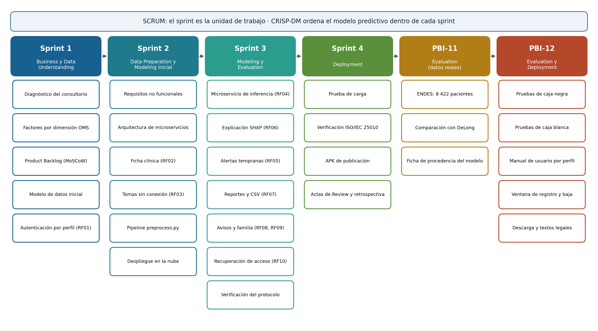

# Productos, artefactos y entregables del desarrollo

El gráfico relaciona cada fase del desarrollo —los cuatro sprints de SCRUM y los dos elementos posteriores, con la fase de CRISP-DM que atendió cada uno— con los productos que generó. La tabla describe el aporte de cada producto al proyecto y dónde puede verificarse.

| Fase | Producto, artefacto o entregable | Aporte al proyecto | Dónde se verifica |
| :--- | :--- | :--- | :--- |
| Sprint 1 | Diagnóstico del consultorio y brechas B1 a B4 | Fundamenta los requisitos en necesidades declaradas por el médico | Apartado 1.1.4 · Anexo n.° 02 |
| Sprint 1 | Product Backlog priorizado con MoSCoW | Ordena el desarrollo según su relación con la hipótesis | Tabla 17 · Anexo n.° 07 |
| Sprint 1 | Autenticación con perfil diferenciado (RF01) | Primer incremento; base del control de acceso | Apartado 1.1.4.c |
| Sprint 2 | Requisitos no funcionales y arquitectura de microservicios | Fija los atributos de calidad y aísla el modelo del resto del sistema | Tabla 24 · apartado 1.1.2.c |
| Sprint 2 | Ficha clínica y registro de tomas sin conexión (RF02, RF03) | Produce los datos que alimentan al modelo | Apartado 1.1.5.d |
| Sprint 2 | Pipeline de preparación de datos (`preprocess.py`) | Limpia y transforma las fichas sin fuga de información | Apartado 1.1.5.b |
| Sprint 2 | Servicios desplegados en Aiven, Render y Vercel | Hace del incremento un software utilizable y no una rama local | Anexo n.° 18 |
| Sprint 3 | Microservicio de inferencia con explicación SHAP (RF04, RF06) | Componente inteligente integrado al sistema | Apartados 1.1.6.a y 1.1.6.b |
| Sprint 3 | Alertas tempranas, reportes y aplicación del paciente y del familiar (RF05, RF07 a RF10) | Completa el núcleo funcional y el soporte entre citas | Apartado 1.1.6 · Anexos n.° 13, 14, 16 y 17 |
| Sprint 3 | Corrida de verificación del protocolo de selección | Demuestra que el protocolo funciona de extremo a extremo | Tabla 31 |
| Sprint 4 | Prueba de carga y verificación ISO/IEC 25010 | Mide la eficiencia y verifica los atributos de calidad | Tablas 37 y 38 |
| Sprint 4 | Actas de Review y retrospectiva | Registran la aceptación del Product Owner y las mejoras acordadas | Anexo n.° 09 |
| PBI-11 | Conjunto ENDES y comparación de algoritmos con DeLong | Ejecuta el OE3 sobre 8 422 pacientes reales | Apartado 1.1.8 · Anexo n.° 22 |
| PBI-12 | Pruebas de caja negra y caja blanca | Verifican los requisitos y la lógica interna con resultados reales | Apartado 1.1.11 · Anexos n.° 24 y 25 |
| PBI-12 | Manual de usuario por perfil | Permite usar, instalar y mantener el sistema sin el desarrollador | Anexo n.° 23 |
| Todas | Repositorio de código, matriz de trazabilidad y guía de despliegue | Hacen el producto reproducible y trazable desde el requisito hasta la prueba | Anexos n.° 06, 08 y 11 |
