# MANUAL DE USUARIO: CDSS ADHERENCIA Y APLICACIÓN «MI TRATAMIENTO»

| Dato | Detalle |
| :--- | :--- |
| **Software** | Sistema de soporte a la decisión clínica (CDSS) para la prevención del incumplimiento terapéutico en pacientes hipertensos y diabéticos polimedicados |
| **Componentes** | Panel médico web «CDSS Adherencia» y aplicación móvil «Mi tratamiento» (paciente y familiar) |
| **Versión** | 1.0 |
| **Fecha de actualización** | 3 de noviembre de 2026 |
| **Organización** | Consultorio médico Milko Ugaz Zegarra, Chiclayo — Universidad Católica Santo Toribio de Mogrovejo, Escuela de Ingeniería de Sistemas y Computación |
| **Elaborado por** | Leonardo Guzmán Salazar |

# 1. INTRODUCCIÓN Y REQUISITOS

## 1.1 Propósito del manual y público objetivo

Este manual le acompaña paso a paso en el uso del sistema. No necesita
conocimientos de programación: cada apartado le dice qué pantalla abrir, qué
botón pulsar y qué significa lo que verá. Las capturas tienen **números rojos**;
cada número corresponde a un paso o a un elemento que se explica en el texto
que acompaña a la figura.

El manual está **dividido en una sección por cada tipo de usuario**. Busque la
suya y léala completa; no necesita leer las demás.

| Usted es… | Usa… | Lea la sección |
| :--- | :--- | :--- |
| **Médico del consultorio** | El panel web, en una computadora | **2. Sección del médico** |
| **Paciente polimedicado** o **familiar acompañante** | La aplicación «Mi tratamiento», en un celular Android | **3. Sección del paciente y del familiar** |
| **Encargado del sistema** (responsable técnico) | La computadora o los servicios en la nube donde funciona el sistema | **4. Sección del encargado del sistema** |

Las secciones 1 (introducción), 5 (soporte) y 6 (glosario) son comunes a todos.

**Lo que el sistema hace.** El paciente registra desde su celular si tomó o
no cada medicamento; un familiar de confianza puede confirmar las tomas que
presenció. Con ese registro, el sistema calcula qué tan bien está cumpliendo
cada paciente, estima la probabilidad de que abandone el tratamiento antes del
próximo control, explica por qué y avisa al médico cuando algo se desvía.

**Lo que el sistema no hace.** No diagnostica, no indica tratamientos ni
cambia dosis. Es una herramienta de apoyo: señala a quién mirar con más
atención y por qué. **La decisión clínica siempre es del médico.**

**Cómo se relaciona este manual con la estructura solicitada.** Cada sección de
usuario recorre, en su propio orden, los mismos puntos de la plantilla:
configuración inicial y acceso, interfaz y navegación, operación y llenado de
datos (creación, diccionario de datos, edición, eliminación, búsquedas y
reportes) y gestión de errores.

| Punto de la plantilla | Médico | Paciente y familiar | Encargado |
| :--- | :--- | :--- | :--- |
| Guía de instalación / acceso | 2.1 | 3.1 | 4.3 y 4.4 |
| Inicio de sesión y autenticación | 2.2 | 3.2 | 4.5 |
| Recuperación y cambio de contraseña | 2.3 | 3.3 | 4.5 |
| Pantalla principal | 2.4 | 3.4 | 4.1 |
| Menús e iconografía | 2.5 | 3.4 | — |
| Flujo de creación de registros | 2.6 | 3.5, 3.6, 3.8 y 3.9 | 4.5 |
| Diccionario de datos | 2.7 | 3.11 | 4.2 |
| Edición, modificación y guardado | 2.8 y 2.9 | 3.7 | 4.6 |
| Eliminación o archivado | 2.10 | 3.7, 3.8 y 3.10 | 4.6 |
| Búsquedas, filtros y exportación | 2.11 | — | 4.6 |
| Alertas de validación | 2.12 | 3.12 | — |
| Solución de problemas | 5.1 | 5.1 | 4.7 |
| Contacto técnico | 5.2 | 5.2 | 5.2 |
| Descarga de la aplicación | 2.13 | 3.1 | 4.3 C y 4.4 D |
| Política de privacidad y Términos y condiciones | 2.13 | 3.13 | 4.4 C; textos completos en 6.2 y 6.3 |

## 1.2 Requisitos del sistema (hardware y software)

**Para el médico (computadora del consultorio):**

| Elemento | Mínimo | Recomendado |
| :--- | :--- | :--- |
| Sistema operativo | Windows 10, macOS 12 o Linux reciente | Windows 11 |
| Navegador | Google Chrome, Microsoft Edge o Mozilla Firefox actualizados | Chrome o Edge en su última versión |
| Pantalla | 1280 × 720 píxeles | 1366 × 768 o superior |
| Memoria RAM | 4 GB | 8 GB |
| Conexión | Red local (modo local) o internet (sistema desplegado) | Banda ancha estable |

**Para el paciente y el familiar (celular):**

| Elemento | Mínimo |
| :--- | :--- |
| Sistema operativo | Android 7.0 o superior |
| Espacio libre | 150 MB |
| Conexión | Wi-Fi o datos móviles. Sin conexión puede seguir registrando: las tomas se envían solas cuando vuelve la señal |
| Permisos | Notificaciones (para los recordatorios de cada toma) |

**Para el encargado del sistema:** los requisitos técnicos están en el
apartado 4.2.

# 2. SECCIÓN DEL MÉDICO

Esta sección es para usted, doctor. Aquí aprenderá a entrar al panel, a
registrar y seguir a sus pacientes, a interpretar el riesgo que estima el
modelo y a atender las alertas tempranas.

## 2.1 Acceso al panel web

1. Encienda la computadora del consultorio y abra **Google Chrome** o
   **Microsoft Edge**.
2. En la barra de direcciones escriba la dirección del panel:
   - si el sistema funciona en **modo local**: **http://localhost:5173**
   - si el sistema está **desplegado en internet**: la dirección que le entregó el encargado del sistema.
3. Pulse **Enter**. Verá la pantalla de inicio de sesión (Figura 1).
4. Guarde la página en **Favoritos** (la estrella de la barra de direcciones)
   para abrirla con un solo clic la próxima vez.

No necesita instalar nada: el panel funciona dentro del navegador. Su cuenta
la crea el encargado del sistema, que le entregará su correo y su contraseña.

## 2.2 Inicio de sesión

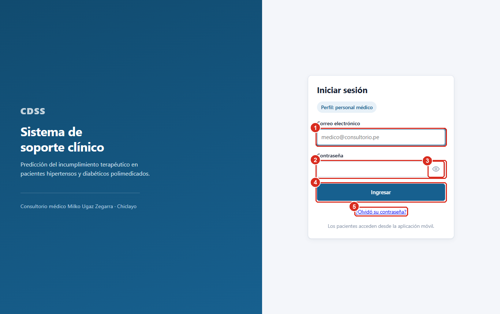

1. Escriba su **correo electrónico** en el campo **(1)**.
2. Escriba su **contraseña** en el campo **(2)**. Si quiere comprobar lo que
   escribió, pulse el ícono del ojo **(3)**; púlselo otra vez para ocultarla.
3. Pulse **Ingresar** **(4)**.
4. Si los datos son correctos, entrará directamente al **Panel de auditoría**
   (Figura 5).
5. Si se equivocó, verá el aviso de la Figura 2. Revise que el correo esté bien
   escrito y que no tenga activadas las mayúsculas, y vuelva a intentarlo. Si no
   recuerda su contraseña, use el enlace **¿Olvidó su contraseña?** **(5)**
   (apartado 2.3).

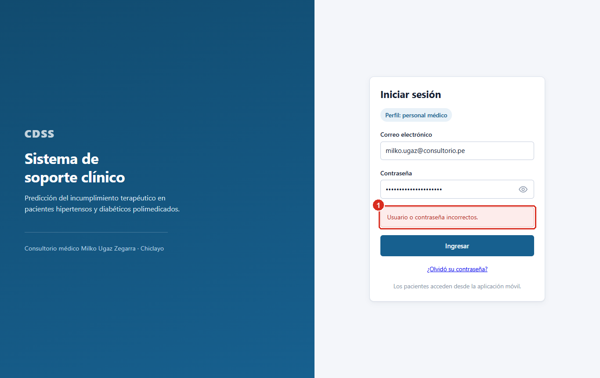

Por seguridad, el aviso **(1)** no dice si lo que falló fue el correo o la
contraseña. La sesión se cierra sola después de **60 minutos**; si eso ocurre,
el panel le devolverá a esta pantalla y solo tendrá que volver a ingresar. Lo
que ya guardó no se pierde.

## 2.3 Recuperación y cambio de contraseña

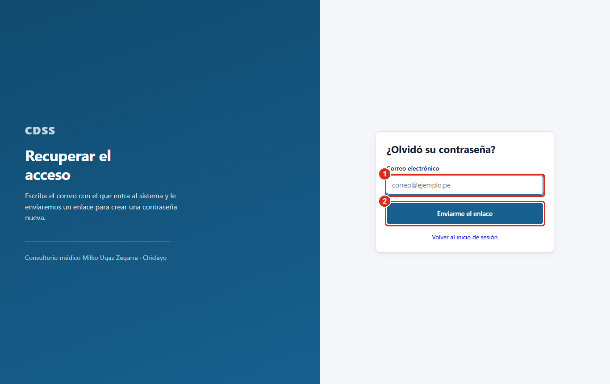

1. En la pantalla de inicio, pulse **¿Olvidó su contraseña?**.
2. Escriba su correo en el campo **(1)** y pulse **Enviarme el enlace** **(2)**.
3. Revise su bandeja de entrada (y la carpeta de correo no deseado). Le llegará
   un mensaje con un enlace.
4. Abra el enlace. Verá la pantalla de la Figura 4.

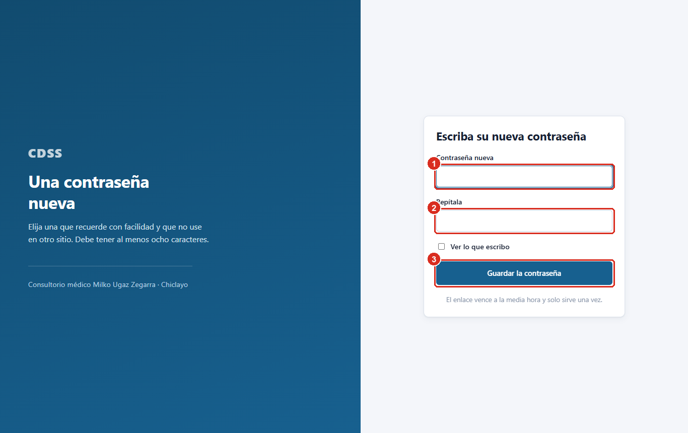

5. Escriba su contraseña nueva en **(1)** y repítala en **(2)**. Debe tener al
   menos **ocho caracteres**. Marque **Ver lo que escribo** si quiere comprobarla.
6. Pulse **Guardar la contraseña** **(3)** y vuelva a iniciar sesión con ella.

El enlace **vence a la media hora y solo sirve una vez**. Si venció, pida otro.
En **modo local** el envío de correos está desactivado: verá el mensaje «El
envío de correos no está disponible» y deberá pedir el cambio al encargado del
sistema (apartado 4.5).

## 2.4 Pantalla principal: el Panel de auditoría

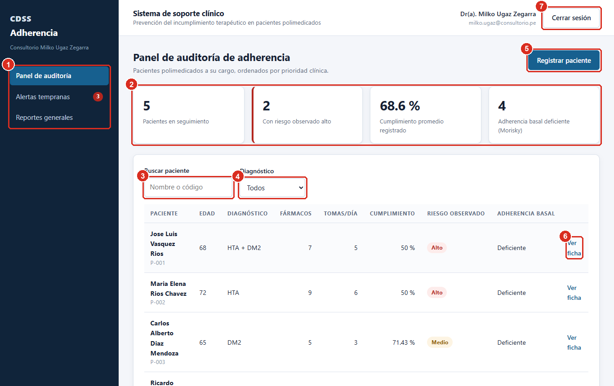

Es lo primero que verá al ingresar. Sus partes son:

| N.° | Elemento | Para qué sirve |
| :--- | :--- | :--- |
| 1 | **Menú lateral** | Cambia de sección: *Panel de auditoría*, *Alertas tempranas* (el número rojo indica cuántas alertas están pendientes) y *Reportes generales* |
| 2 | **Indicadores** | Resumen al instante: pacientes en seguimiento, cuántos tienen riesgo observado alto, cumplimiento promedio y cuántos tenían adherencia basal deficiente según el test de Morisky-Green |
| 3 | **Buscar paciente** | Filtra la lista por nombre, apellidos o código (por ejemplo, *P-002*) |
| 4 | **Diagnóstico** | Muestra solo hipertensos, solo diabéticos o quienes tienen ambas enfermedades |
| 5 | **Registrar paciente** | Abre el formulario de alta (apartado 2.6) |
| 6 | **Ver ficha** | Abre el detalle de ese paciente: riesgo, explicación, historial y datos |
| 7 | **Cerrar sesión** | Sale del sistema. Úselo siempre al terminar, sobre todo en una computadora compartida |

La lista está **ordenada por prioridad clínica**: arriba aparecen los pacientes
con riesgo observado más alto. La columna **Riesgo observado** usa tres colores:
rojo (*Alto*), ámbar (*Medio*) y verde (*Bajo*).

## 2.5 Menús, barras de herramientas e iconografía

| Elemento | Dónde está | Qué hace |
| :--- | :--- | :--- |
| Panel de auditoría | Menú lateral | Lista de pacientes y búsqueda |
| Alertas tempranas (número rojo) | Menú lateral | Pacientes que necesitan contacto antes de su próximo control |
| Reportes generales | Menú lateral | Indicadores de todo el consultorio y exportación a CSV |
| ← Panel de auditoría | Arriba, dentro de una ficha | Vuelve a la lista |
| Botón azul | En todas las pantallas | Acción principal (Registrar, Guardar, Exportar) |
| Botón rojo **Dar de baja** | Ficha del paciente | Acción delicada; siempre pide confirmación |
| Botón blanco | Junto a los botones principales | Acción secundaria (Cancelar, Ocultar) |
| Etiquetas de color | Listas y fichas | Rojo = alto o pendiente; ámbar = medio; verde = bajo o cumplido |
| Barras rojas y verdes | Ficha, recuadro de riesgo | Rojo: la variable **sube** el riesgo; verde: lo **baja** |
| Mensaje verde | Arriba de la lista | Confirma que la acción se guardó |
| Mensaje rojo | Junto al campo o al botón | Explica qué falta corregir |

## 2.6 Registrar un paciente nuevo

1. En el **Panel de auditoría**, pulse **Registrar paciente** (Figura 5, **(5)**).
   Se abrirá el formulario de la Figura 6.

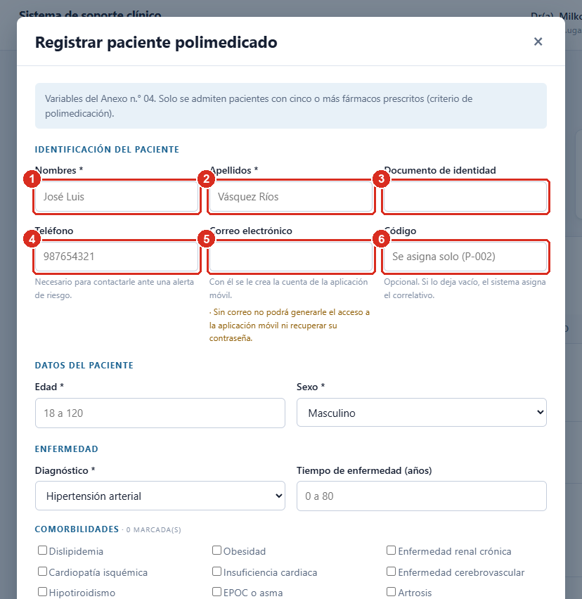

2. Complete los datos de identificación: **Nombres** **(1)** y **Apellidos**
   **(2)** son obligatorios (llevan un asterisco junto al nombre). El
   **Documento de identidad** **(3)**, el **Teléfono** **(4)** y el **Correo
   electrónico** **(5)** son opcionales, pero el correo es necesario para darle
   acceso a la aplicación.
3. El **Código** **(6)** se asigna solo si lo deja vacío. Es el identificador
   anonimizado que se usa en los reportes.
4. Baje con la rueda del ratón y complete los datos clínicos (Figura 7):
   **Edad** **(1)**, **Diagnóstico** **(2)**, las **Comorbilidades** que tenga
   **(3)** (marque todas las que correspondan), el **N.° de fármacos prescritos**
   **(4)** y las **Tomas por día** **(5)**.

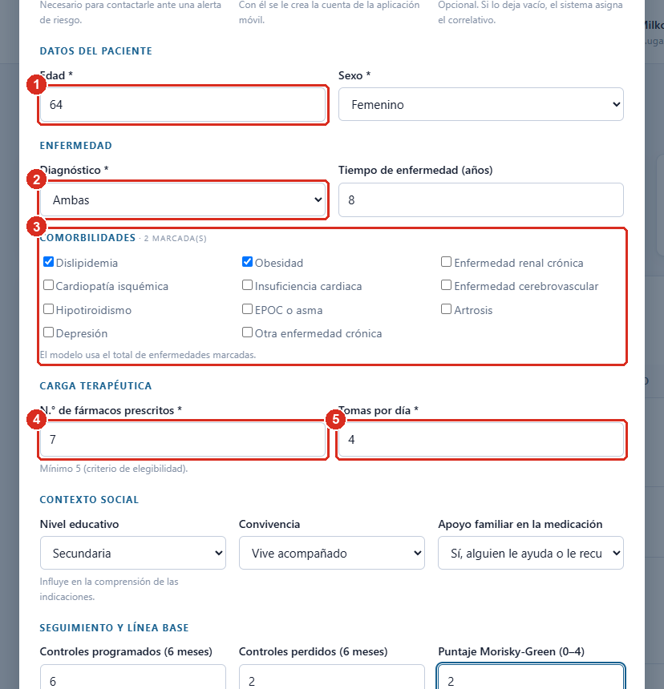

5. Siga bajando y complete el contexto social y el seguimiento (Figura 8):
   **Nivel educativo** **(1)**, **Convivencia** **(2)**, **Apoyo familiar en la
   medicación** **(3)**, los **Controles programados** **(4)** y perdidos en los
   últimos seis meses y el **Puntaje Morisky-Green** **(5)**.

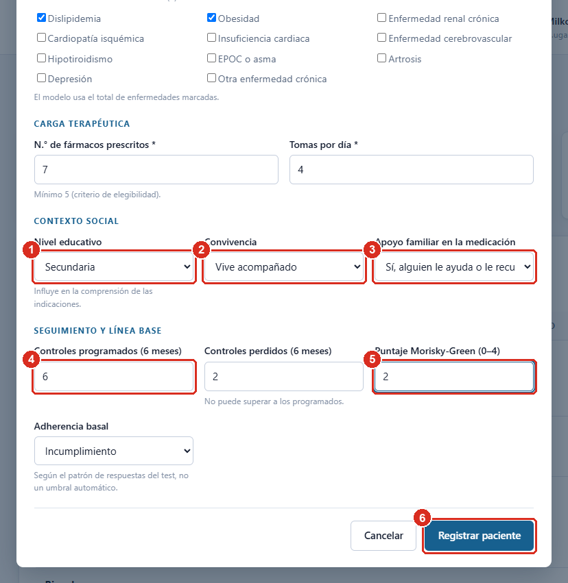

6. Pulse **Registrar paciente** **(6)**.
7. Si algún dato no es válido, el formulario no se guarda: marca en rojo el
   campo con el problema y le explica qué corregir (apartado 2.12).
8. Si todo está bien, volverá al panel y verá el mensaje verde de la Figura 9.

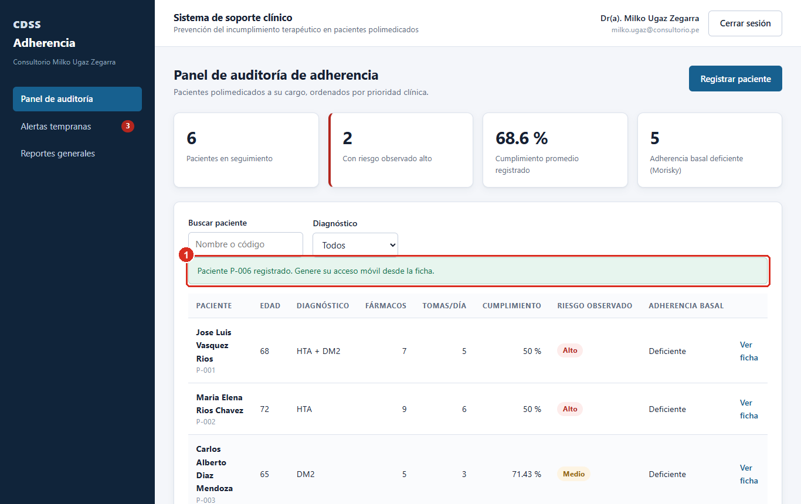

9. **Dele acceso a la aplicación.** Pulse **Ver ficha** del paciente nuevo; en
   el recuadro **Acceso a la aplicación móvil** pulse **Generar acceso** y
   confirme. El sistema le mostrará el correo y una **contraseña temporal**.
   Pulse **Copiar las dos** o anótelas y entrégueselas al paciente en ese
   momento: **no volverán a mostrarse**. El texto copiado incluye también el
   enlace para descargar la aplicación (apartado 2.13).

## 2.7 Diccionario de datos del formulario del paciente

| Campo | ¿Obligatorio? | Formato y valores permitidos | Ejemplo |
| :--- | :--- | :--- | :--- |
| Nombres | Sí | Solo letras y espacios; 2 a 120 caracteres | Ana María |
| Apellidos | Sí | Solo letras y espacios; 2 a 120 caracteres | Torres Díaz |
| Documento de identidad | No | Solo dígitos; hasta 20 | 45781236 |
| Teléfono | No | Solo dígitos, con + opcional; 9 dígitos para celular peruano | 987654321 |
| Correo electrónico | No (sí para dar acceso a la app) | Formato nombre@dominio | ana.torres@correo.pe |
| Código | No (se asigna solo) | *P-* seguido de 3 a 6 dígitos; no puede repetirse | P-006 |
| Edad | Sí | Número entero de 18 a 120 | 64 |
| Sexo | Sí | Masculino o Femenino | Femenino |
| Diagnóstico | Sí | Hipertensión arterial, Diabetes mellitus tipo 2 o Ambas | Ambas |
| Tiempo de enfermedad (años) | No | Número de 0 a 80; no puede superar la edad | 8 |
| Comorbilidades | No | Casillas; el modelo usa cuántas hay marcadas | Dislipidemia, Obesidad |
| N.° de fármacos prescritos | Sí | Número de 5 a 30 (el estudio incluye solo polimedicados) | 7 |
| Tomas por día | Sí | Número de 1 a 20 | 4 |
| Nivel educativo | No | Sin estudios, Primaria, Secundaria o Superior | Secundaria |
| Convivencia | No | Vive solo o Vive acompañado | Vive acompañado |
| Apoyo familiar en la medicación | No | Sí o No | Sí |
| Controles programados (6 meses) | No | Número de 0 a 30 | 6 |
| Controles perdidos (6 meses) | No | Número de 0 a 30; no puede superar los programados | 2 |
| Puntaje Morisky-Green | No | Número de 0 a 4 | 2 |
| Adherencia basal | No | No evaluada, Adherente o Incumplimiento (según el patrón de respuestas del test) | Incumplimiento |

Los campos numéricos solo aceptan dígitos: si escribe una letra o un cero a la
izquierda, el formulario lo ignora mientras usted escribe.

**Lo que muestra la ficha del paciente:**

| Dato | Qué significa |
| :--- | :--- |
| Riesgo predicho por el modelo | Probabilidad, de 0 % a 100 %, de que el paciente incumpla su tratamiento antes del próximo control. Bajo, Medio o Alto |
| Por qué este paciente tiene este riesgo | Explicación SHAP: cuántos puntos porcentuales (pp) sube (+, rojo) o baja (−, verde) cada variable el riesgo de un paciente de referencia |
| Cumplimiento | Porcentaje de tomas cumplidas sobre las registradas |
| Retraso | Minutos entre la hora programada y la hora en que el paciente registró la toma en su celular |
| Estado | Tomada, Tomada con retraso u Omitida (con su motivo) |
| Testigo | Quién registró la toma (el paciente, el médico o la carga de datos) y qué familiar la confirmó |

## 2.8 Consultar y editar la ficha de un paciente

1. En el **Panel de auditoría**, pulse **Ver ficha** del paciente
   (Figura 5, **(6)**). Se abrirá su ficha (Figura 10).

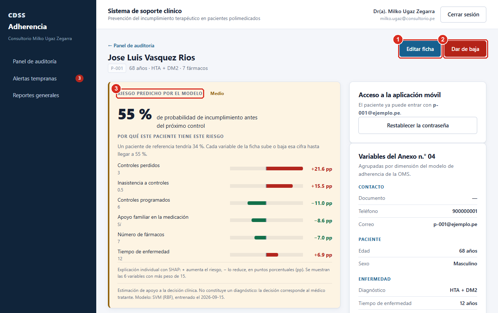

2. Arriba encontrará los botones **Editar ficha** **(1)** y **Dar de baja**
   **(2)**. Debajo, el recuadro **Riesgo predicho por el modelo** **(3)**.
3. Lea el riesgo y su explicación (Figura 11): la cifra grande **(1)** es la
   probabilidad de incumplimiento; las barras **(2)** le dicen qué variables de
   la ficha la empujan hacia arriba (rojo) o hacia abajo (verde) y cuánto.

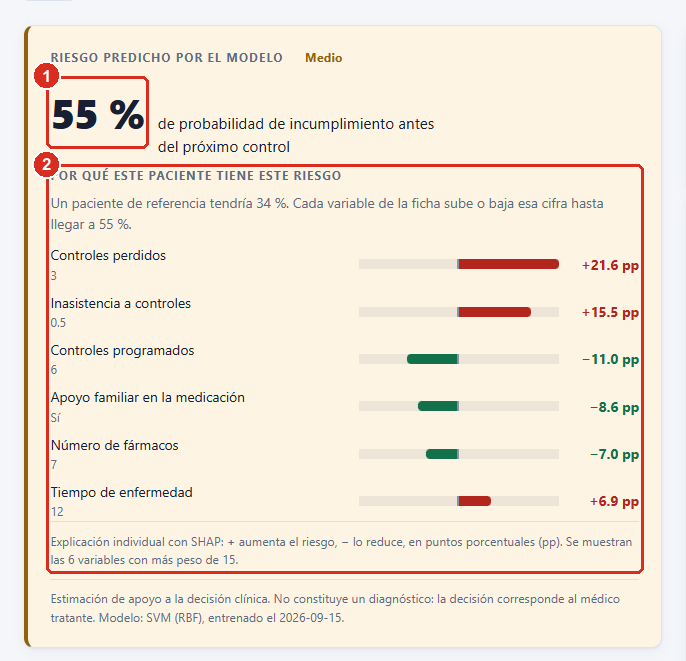

4. Más abajo está el **Historial de tomas registradas** (Figura 12). Revise el
   **Retraso** **(1)**, el **Estado** **(2)** y el **Testigo** **(3)** de cada
   toma: allí verá el nombre de quien la registró y del familiar que la confirmó.

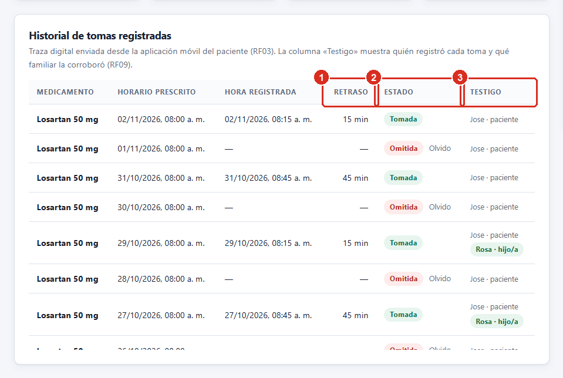

5. En el recuadro **Acceso a la aplicación móvil** (Figura 13) puede pulsar
   **Restablecer la contraseña** **(1)** si el paciente olvidó la suya: el
   sistema genera una contraseña temporal que solo se muestra una vez.

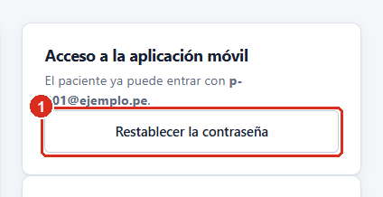

6. Para modificar un dato, pulse **Editar ficha**. Se abre el mismo formulario
   del alta, ya lleno (Figura 14). El **Código** **(1)** no se puede cambiar.
   Corrija el dato que necesite, por ejemplo las **Tomas por día** **(2)**.

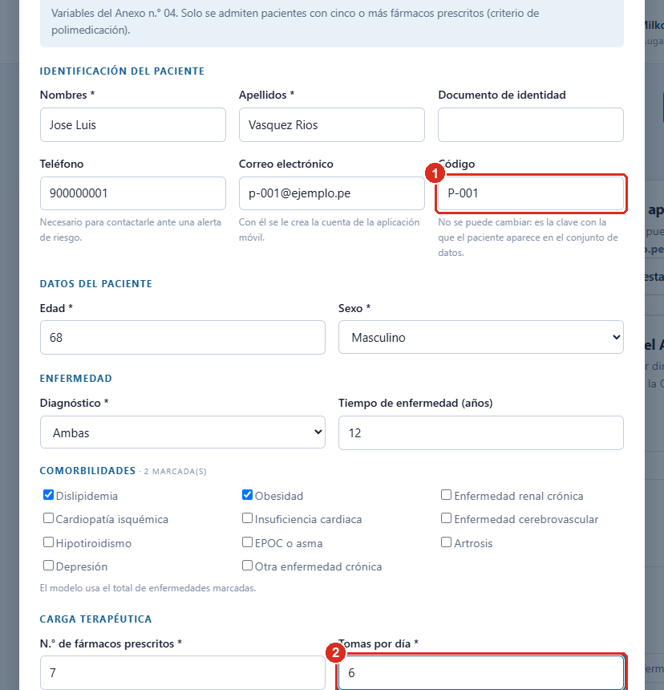

7. Baje hasta el final y pulse **Guardar cambios**. Verá el mensaje verde de la
   Figura 15 y el riesgo se recalculará con los datos nuevos.

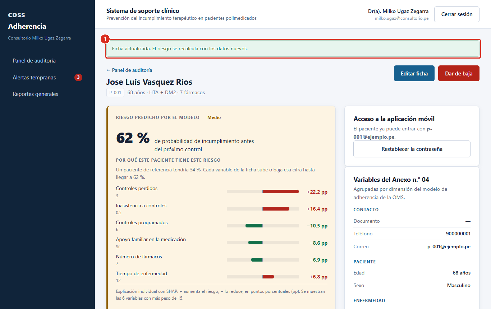

Si cierra el formulario con **Cancelar** o con la **×**, no se guarda nada.

## 2.9 Atender las alertas tempranas

1. En el menú lateral, pulse **Alertas tempranas** (Figura 16). El selector
   **Ver** **(1)** muestra por defecto las alertas **Pendientes**.

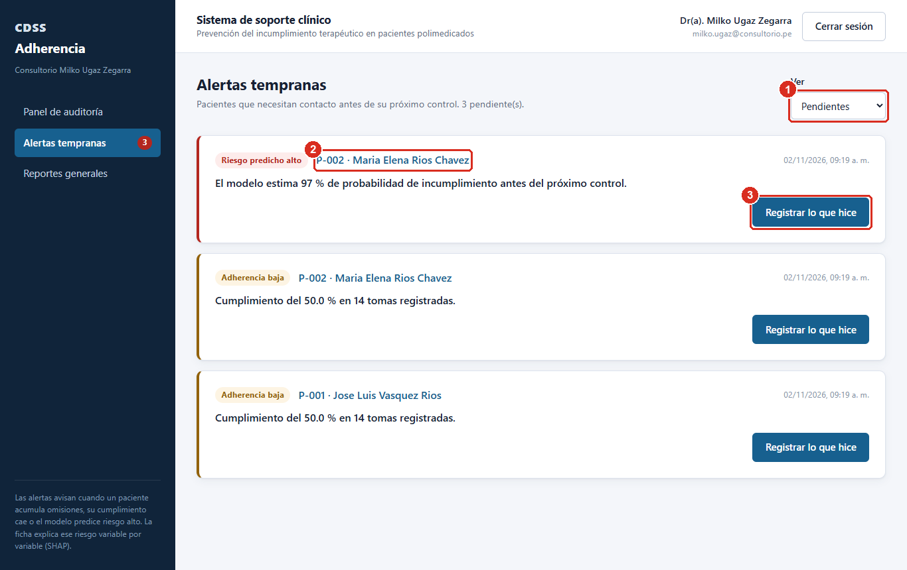

2. Cada tarjeta indica el tipo de alerta (*Riesgo predicho alto*, *Adherencia
   baja* u *Omisiones seguidas*), el paciente **(2)** —pulse su nombre para ir a
   su ficha— y el motivo.
3. Cuando haya actuado (por ejemplo, llamó al paciente), pulse **Registrar lo
   que hice** **(3)**.
4. Escriba brevemente qué hizo **(1)** (Figura 17) y pulse **Atendida** **(2)**.
   Si la alerta no correspondía, pulse **No aplica** **(3)**.

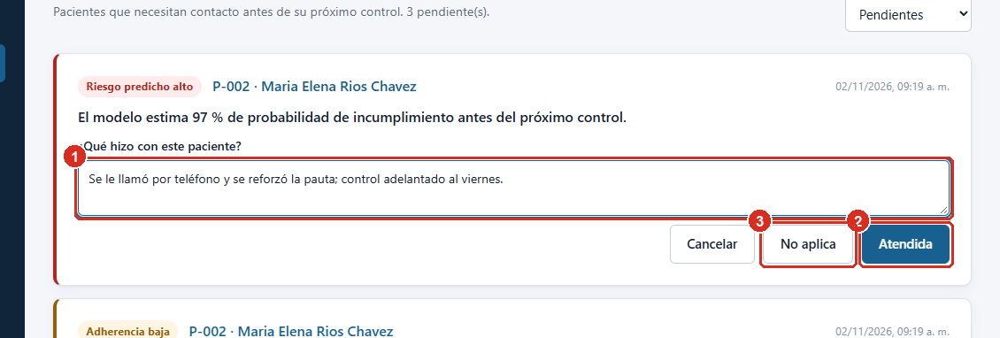

5. La alerta deja la lista de pendientes. Para revisarla después, cambie el
   selector **Ver** a **Atendidas** (Figura 18).

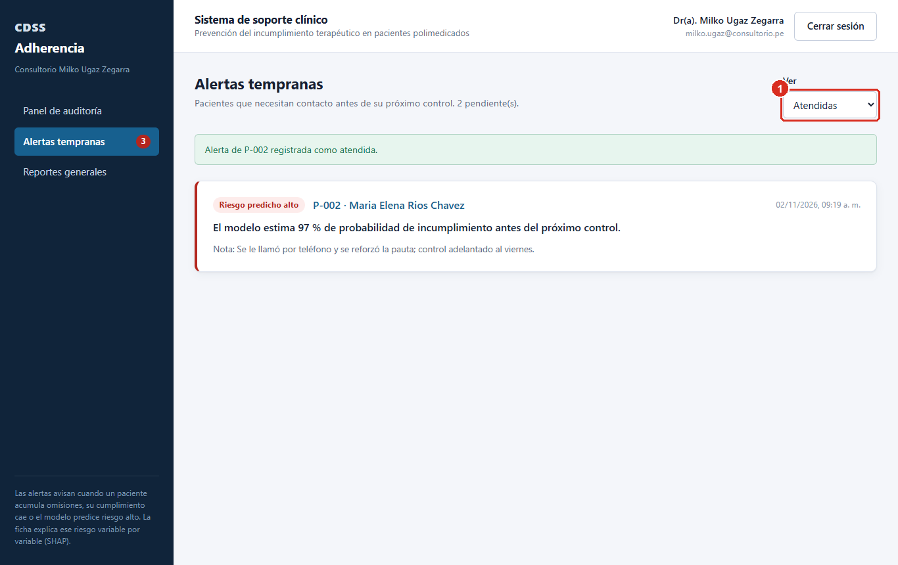

## 2.10 Dar de baja a un paciente (archivado)

El sistema **no borra** pacientes: los **da de baja**. El paciente deja de
aparecer en el panel y en las alertas, y ya no puede entrar a la aplicación,
pero su historial de tomas se conserva, porque es evidencia del estudio.

1. Abra la ficha del paciente y pulse el botón rojo **Dar de baja**
   (Figura 10, **(2)**).
2. Aparecerá un recuadro de confirmación (Figura 19). Léalo con atención.
3. Si está seguro, pulse **Sí, dar de baja** **(1)**. Si no, pulse **Cancelar**
   **(2)** y nada cambiará.

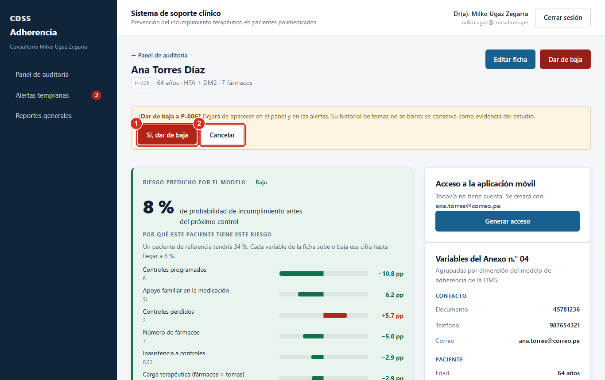

4. Volverá al panel con el mensaje verde de la Figura 20.

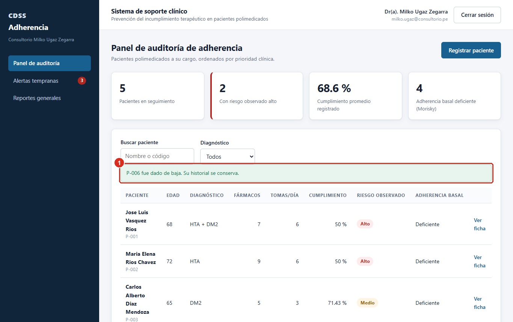

## 2.11 Búsquedas, filtros y exportación de reportes

**Buscar un paciente**

1. En el **Panel de auditoría**, escriba en **Buscar paciente** **(1)** parte del
   nombre, de los apellidos o el código (Figura 21).
2. La lista se filtra mientras escribe **(2)**. Borre el texto para volver a
   ver a todos.

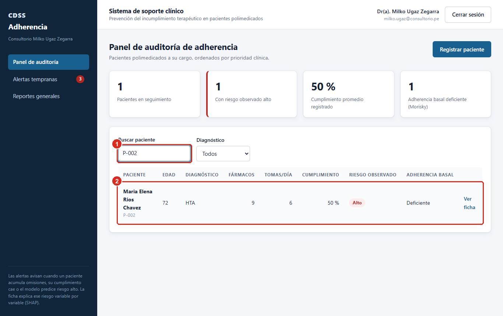

**Filtrar por diagnóstico**

1. Abra la lista **Diagnóstico** **(1)** y elija *Hipertensión*, *Diabetes tipo
   2* o *Ambas* (Figura 22).
2. Para quitar el filtro, elija **Todos**.

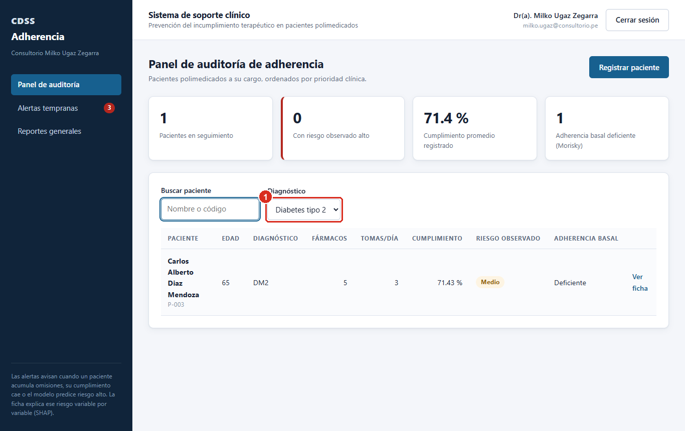

**Consultar y exportar los reportes generales**

1. En el menú lateral, pulse **Reportes generales** (Figura 23).
2. Elija el **Periodo** **(1)**: *Todo el historial*, *Últimos 30 días* o
   *Últimos 90 días*. Los indicadores **(3)** y los gráficos de barras se
   actualizan solos.
3. Pulse **Exportar CSV** **(2)**. El navegador descargará un archivo que puede
   abrir en Microsoft Excel o en Google Sheets, con una fila por paciente: su
   código, nombre, diagnóstico, adherencia y riesgo.

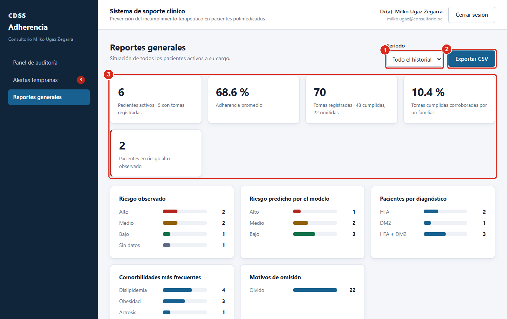

**Cuidado con el archivo exportado:** contiene datos personales de salud.
Guárdelo solo en la computadora del consultorio y no lo envíe por correo ni por
mensajería.

## 2.12 Alertas de validación en pantalla

El sistema revisa los datos **antes** de guardarlos. Cuando algo no es válido,
el campo se marca en rojo y debajo aparece un mensaje con el símbolo ⚠ que le
dice qué corregir (Figura 24). Corrija el campo y vuelva a pulsar el botón de
guardar.

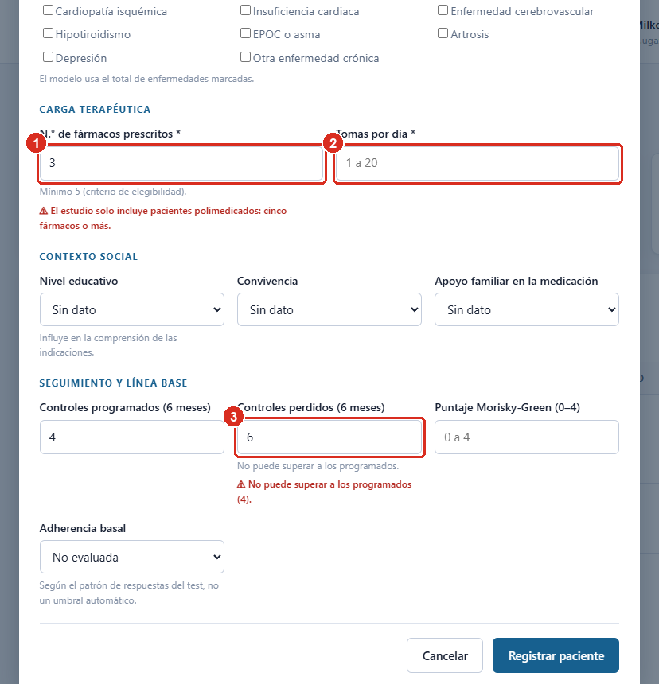

| Mensaje | Dónde aparece | Qué hacer |
| :--- | :--- | :--- |
| *El estudio solo incluye pacientes polimedicados: cinco fármacos o más.* | N.° de fármacos | Verifique la receta. Con menos de cinco fármacos, el paciente no entra al estudio |
| *No puede superar a los programados.* | Controles perdidos | Los perdidos no pueden ser más que los programados |
| *La edad es obligatoria.* / *Nombres son obligatorios.* | Campos marcados con asterisco | Complete el campo indicado |
| *Ya existe un paciente con el código P-…* | Al registrar | Use otro código o déjelo vacío para que se asigne solo |
| *Usuario o contraseña incorrectos.* | Inicio de sesión | Revise el correo, las mayúsculas y la contraseña |
| *El enlace no es válido o ya venció. Pida uno nuevo.* | Restablecer contraseña | Pida otro enlace; vence a los 30 minutos |
| *Las dos contraseñas no coinciden.* | Restablecer contraseña | Escriba la misma contraseña en ambos campos |
| *El modelo predictivo no está disponible…* | Ficha del paciente | El resto del sistema sigue funcionando; avise al encargado |

## 2.13 Descarga de la aplicación, privacidad y términos

El panel tiene tres páginas públicas, que se abren sin iniciar sesión y que
usted puede mostrar a sus pacientes: **Descargar la app**, **Privacidad** y
**Términos**. Los enlaces están al pie de la pantalla de inicio de sesión
(Figura 25): **(1)** lleva a la descarga y **(2)** a los textos legales.

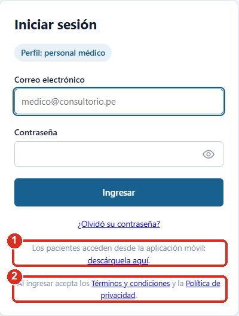

**Ayudar a un paciente a instalar la aplicación**

1. En la computadora del consultorio, abra la página **Descargar la app**
   **(1)** (Figura 26).
2. Pida al paciente que apunte la cámara de su celular al **código QR** **(3)**
   y toque el enlace que aparece. Se abrirá la misma página en su celular.
3. Indíquele que toque **Descargar para Android (APK)** **(2)** y siga los pasos
   del apartado 3.1.
4. Entréguele su correo y su contraseña temporal (apartado 2.6, paso 9).

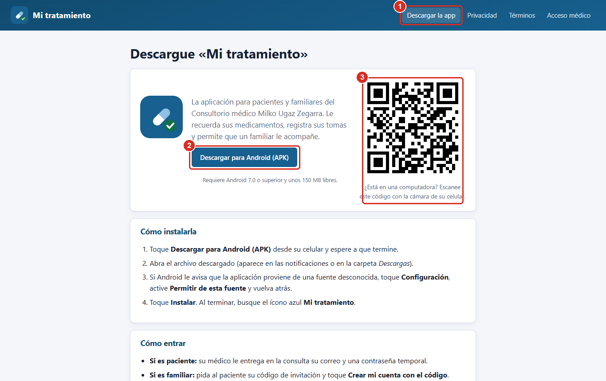

**Política de privacidad y Términos y condiciones**

La página **Privacidad** **(1)** (Figura 27) explica qué datos guarda el
sistema, para qué, quién los ve y cómo ejercer los derechos de acceso,
rectificación, cancelación y oposición **(2)**. La página **Términos** **(1)**
(Figura 28) fija las reglas de uso. Al iniciar sesión, usted acepta ambos
documentos. Sus textos completos están en los anexos 6.2 y 6.3.

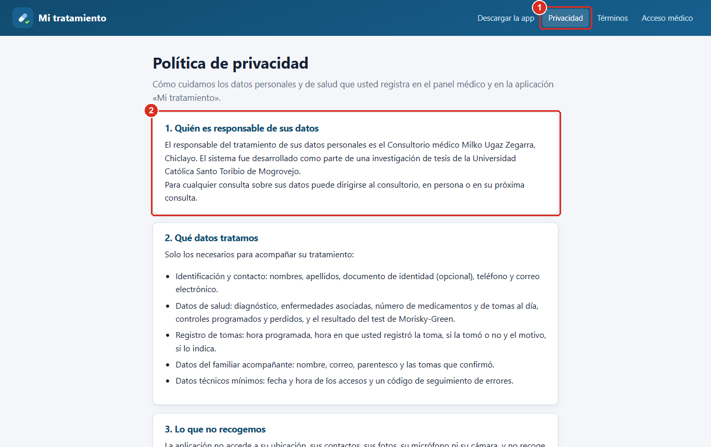

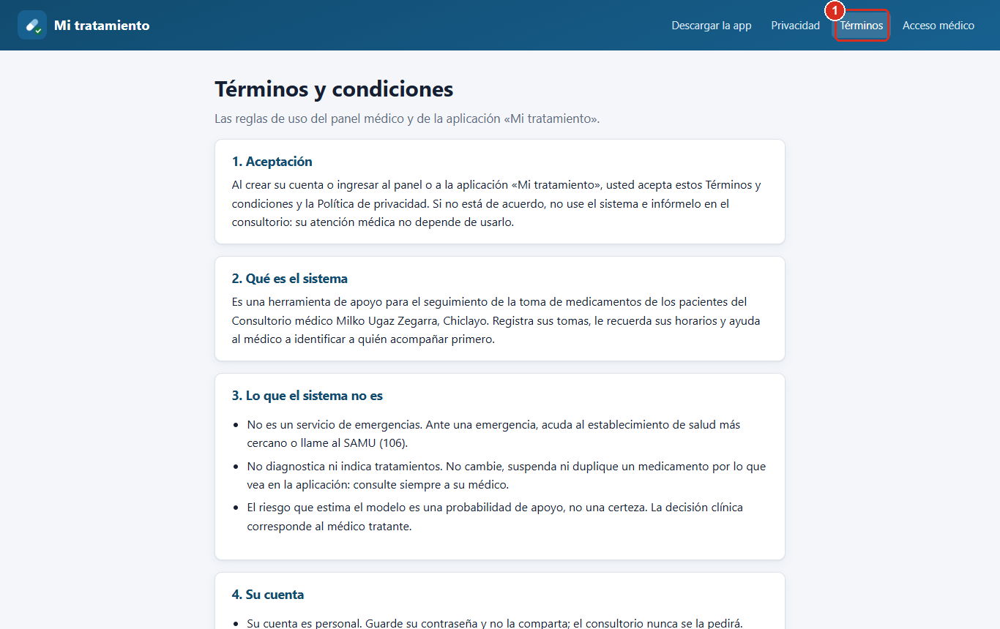

# 3. SECCIÓN DEL PACIENTE Y DEL FAMILIAR

Esta sección es para usted, que lleva su tratamiento con la aplicación «Mi
tratamiento», y para el familiar que le acompaña. Los apartados 3.1 a 3.8 y
3.10 son para el **paciente**; el 3.9, para el **familiar**. El 3.13, sobre
privacidad y términos, es para los dos.

## 3.1 Descarga e instalación de la aplicación

1. Abra en su celular la página **Descargar la app** del consultorio
   (Figura 29). Puede llegar a ella de tres formas:
   - escaneando con la cámara el código QR que le muestra su médico;
   - con el enlace que su médico le copia junto a su contraseña;
   - escribiendo en el navegador la dirección del panel seguida de **/descargar**.
2. Toque **Descargar para Android (APK)** **(1)** y espere a que termine.
3. Abra el archivo descargado (aparece en las notificaciones o en la carpeta
   *Descargas*). Si Android le advierte que proviene de una fuente desconocida,
   toque **Configuración**, active **Permitir de esta fuente** y vuelva atrás.
4. Toque **Instalar** y espere a que termine. La misma página le recuerda estos
   pasos **(2)**.
5. Busque en su pantalla de inicio el ícono azul con una cápsula y un visto
   verde, llamado **Mi tratamiento**, y tóquelo.

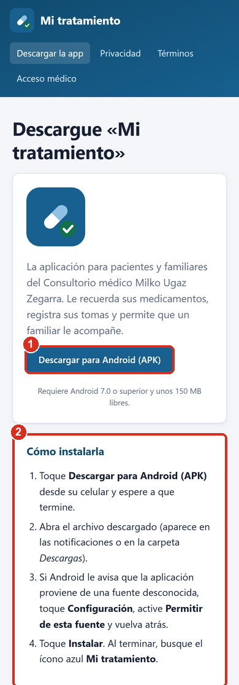

**Su cuenta:** si usted es paciente, su médico la crea en la consulta y le
entrega su correo y una contraseña temporal. Si es familiar, usted mismo la
crea con el código que le da el paciente (apartado 3.9).

## 3.2 Inicio de sesión

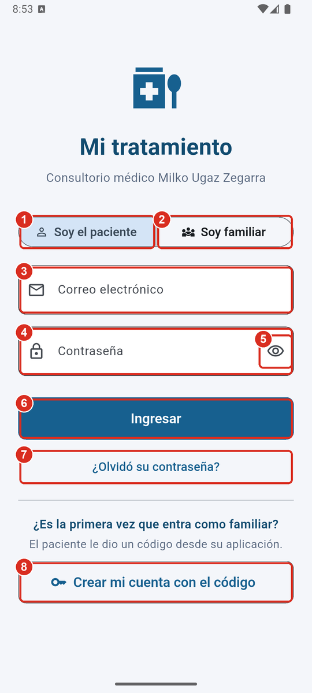

1. Elija quién es usted: **Soy el paciente** **(1)** o **Soy familiar** **(2)**.
   El botón elegido queda resaltado.
2. Toque el campo **Correo electrónico** **(3)** y escriba el correo que le
   entregaron.
3. Toque el campo **Contraseña** **(4)** y escríbala. Con **Mostrar** **(5)**
   puede verla mientras la escribe.
4. Toque **Ingresar** **(6)**.
5. Si es familiar y todavía no tiene cuenta, toque **Crear mi cuenta con el
   código** **(8)** y siga el apartado 3.9.

La aplicación recuerda su sesión: la próxima vez que la abra entrará
directamente a su pantalla principal.

## 3.3 Si olvidó su contraseña

Tiene dos caminos:

- **Desde la aplicación:** toque **¿Olvidó su contraseña?** (Figura 30, **(7)**), confirme su correo y abra el enlace que le llegará. Escriba su contraseña nueva dos veces (al menos ocho caracteres) y guárdela. El enlace vence a la media hora.
- **En el consultorio:** pida a su médico que le genere una contraseña nueva. Se la entregará en ese momento.

## 3.4 Pantalla principal y navegación

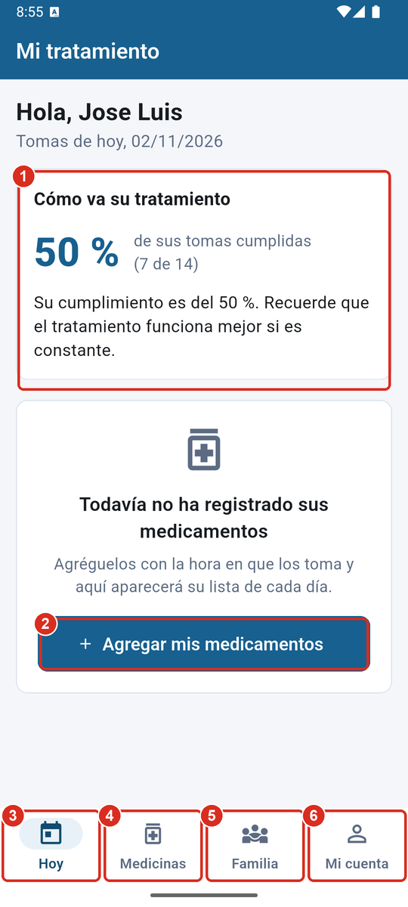

| N.° | Elemento | Para qué sirve |
| :--- | :--- | :--- |
| 1 | **Cómo va su tratamiento** | Su porcentaje de tomas cumplidas y un mensaje de ánimo o de alerta |
| 2 | **Agregar mis medicamentos** | Aparece solo mientras no haya registrado ninguno; le lleva a la opción «Medicinas» |
| 3 | **Hoy** | Sus tomas del día |
| 4 | **Medicinas** | La lista de sus medicamentos y sus horas |
| 5 | **Familia** | Las personas que pueden confirmar sus tomas |
| 6 | **Mi cuenta** | Sus datos, sus alertas programadas y el botón para cerrar sesión |

**Íconos que verá:**

| Ícono | Qué significa |
| :--- | :--- |
| Visto en círculo verde | Toma cumplida |
| Equis en círculo rojo | Toma omitida |
| Reloj | Todavía no puede registrarse; indica desde qué hora |
| Nube tachada | La toma está guardada en el teléfono y se enviará al volver la conexión |
| Lápiz | Editar un medicamento |
| Papelera | Quitar un medicamento |

## 3.5 Registrar sus medicamentos

1. Toque la opción **Medicinas** en la barra inferior (o el botón **Agregar mis
   medicamentos** de la pantalla «Hoy»).
2. Toque **Agregar** **(1)** (Figura 32).

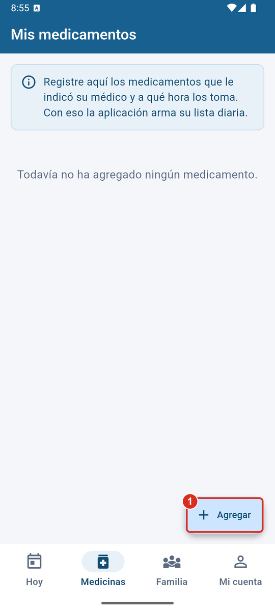

3. Se abrirá el recuadro **Nuevo medicamento** (Figura 33). Escriba el
   **Nombre del medicamento** **(1)** tal como figura en su receta y, si quiere,
   la **Dosis** **(2)** (por ejemplo, *850 mg*).
4. En **Horas de toma** aparece una hora propuesta **(3)**. Para quitarla toque
   la **x** **(4)**; para añadir otra, toque **Agregar hora** **(5)**.

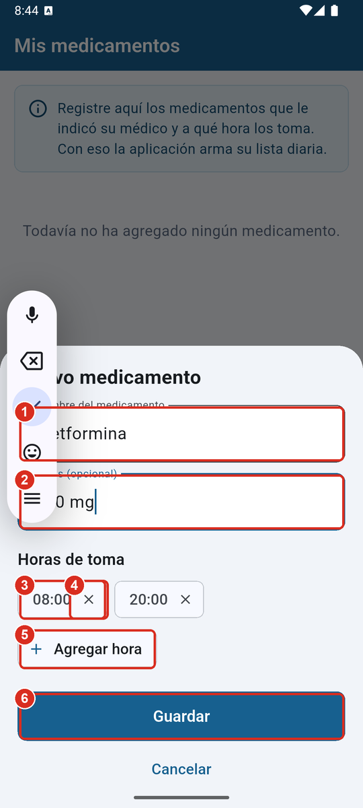

5. Al tocar **Agregar hora** se abre un reloj (Figura 34). Toque la **hora**
   **(1)** y los minutos, elija **AM** **(2)** o **PM** **(3)**, o, si le resulta
   más fácil, toque el ícono del teclado **(4)** para escribirla. Toque **OK**
   **(5)**.

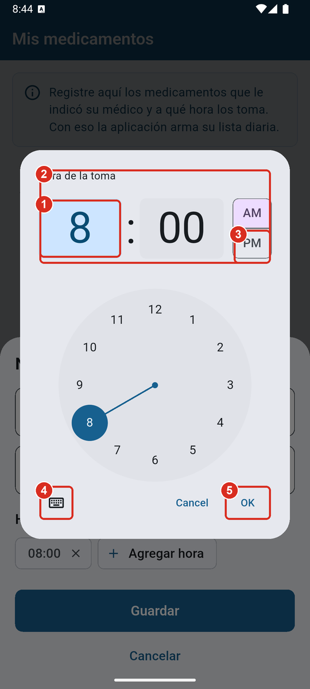

6. Toque **Guardar** (Figura 33, **(6)**).
7. La primera vez, Android le preguntará si permite las notificaciones
   (Figura 35). Toque **Allow / Permitir** **(1)**: así la aplicación le
   avisará a la hora de cada toma, incluso sin internet.

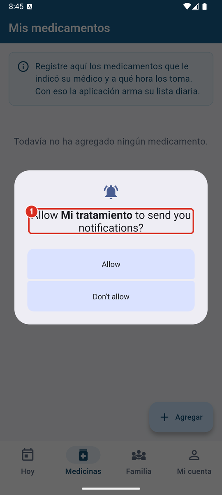

8. Su medicamento aparecerá en la lista (Figura 36). El aviso azul **(1)**
   confirma que las alertas quedaron activas. Repita los pasos 2 a 6 por cada
   medicamento de su receta.

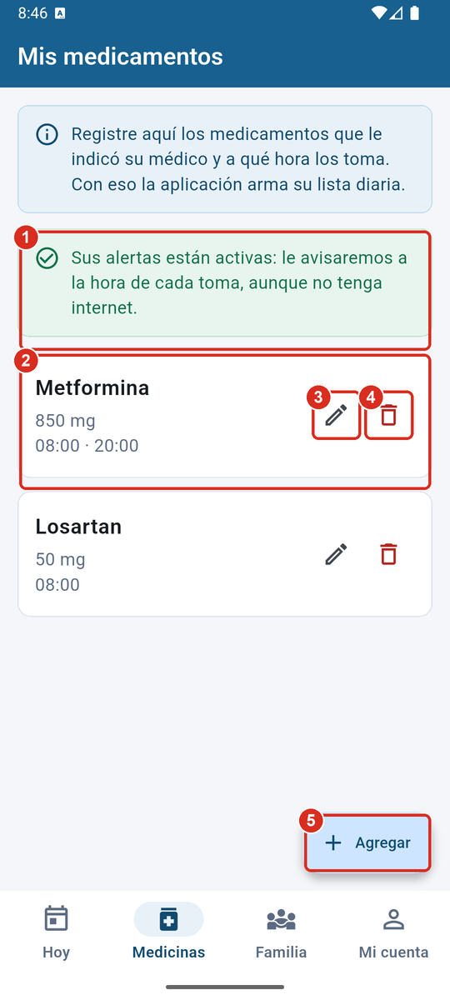

## 3.6 Registrar sus tomas

Cuando ya tiene medicamentos registrados, la pantalla **Hoy** muestra una
tarjeta por cada toma del día (Figura 37).

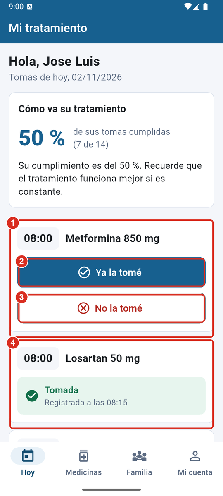

**Si tomó el medicamento**

1. Busque la tarjeta de la toma **(1)**.
2. Después de tomar el medicamento, toque **Ya la tomé** **(2)**. Verá el
   mensaje «Registrado. ¡Gracias!» y la tarjeta cambiará a **Tomada** **(4)**,
   con la hora en que lo registró.

Para que el registro refleje lo que realmente ocurrió, solo puede marcar **Ya
la tomé** desde **una hora antes** hasta **tres horas después** de la hora
programada. Antes de ese momento la tarjeta dice «Podrá registrarla desde
las…»; después, el botón desaparece y le invita a registrar que no la tomó.

**Si no tomó el medicamento**

1. En la tarjeta de la toma, toque **No la tomé** (Figura 37, **(3)**).
2. Se abre la pantalla de la Figura 38. Compruebe que el medicamento y la hora
   sean los correctos **(1)**.
3. Elija el motivo **(2)**: *Me olvidé*, *No tenía el medicamento*, *Me sentí
   mal al tomarlo*, *Me sentía bien y no lo creí necesario*, *No estaba en casa*
   u *Otro motivo*. Es opcional, pero ayuda a su médico a acompañarle mejor.
4. Toque **Registrar que no la tomé** **(3)**. Si cambió de idea, toque
   **Cancelar** **(4)**.

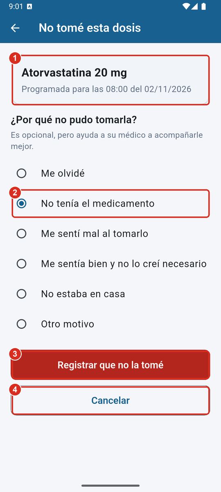

**Los estados de una toma.** En la Figura 39 verá los cuatro estados
posibles: **Tomada con retraso** **(1)**, **Tomada** **(2)**, **No tomada** con
su motivo **(3)** y en espera, con la hora desde la que podrá registrarla **(4)**.

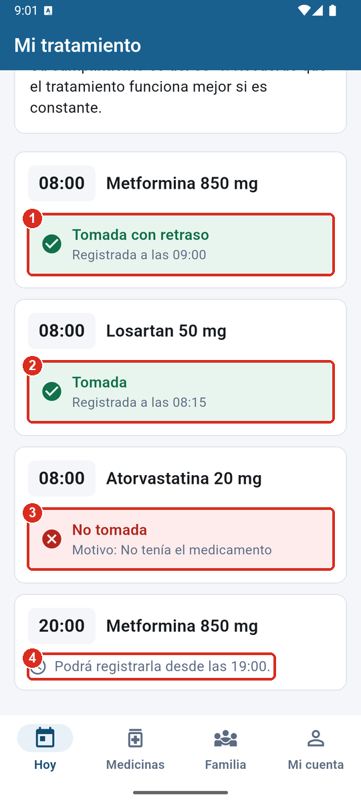

**Sin internet** puede registrar igual: la tarjeta mostrará una nube tachada y
la toma se enviará sola cuando vuelva la conexión.

## 3.7 Modificar o quitar un medicamento

1. Vaya a la opción **Medicinas** (Figura 36).
2. Para **modificarlo**, toque el lápiz **Editar** **(3)**, cambie el nombre, la
   dosis o las horas, y toque **Guardar**. Las alertas se reprograman solas.
3. Para **quitarlo**, toque la papelera **Quitar** **(4)** y confirme. Sus
   alertas se cancelan; las tomas que ya registró se conservan.

## 3.8 Invitar o retirar a un familiar

1. Toque la opción **Familia**. Verá a los familiares que ya le acompañan
   (Figura 40, **(1)**).
2. Toque **Invitar** **(3)**.

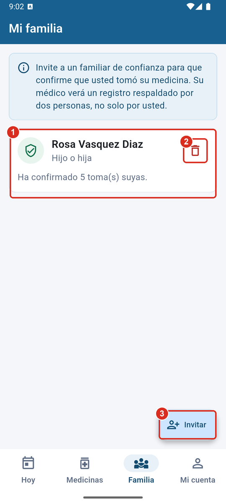

3. Escriba **cómo se llama** su familiar **(1)** y elija **qué es suyo** **(2)**
   (hijo o hija, cónyuge, hermano, cuidador…). Toque **Generar código** **(3)**
   (Figura 41).

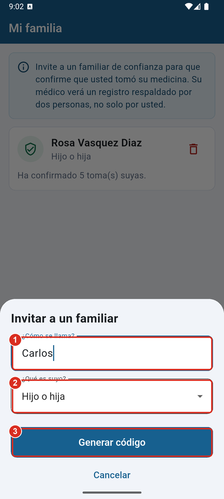

4. La aplicación le muestra un **código de invitación** de ocho caracteres
   (Figura 42). Toque **Copiar** **(1)** para enviarlo por mensaje o díctelo.
   El código **vence en 8 días** **(3)**. Toque **Listo** **(2)**.

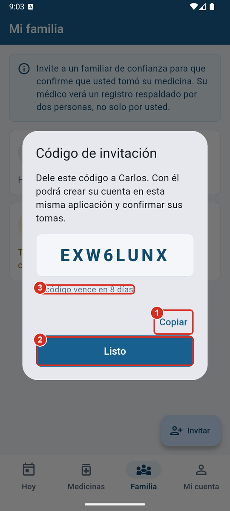

5. Para **retirar** a un familiar, toque **Retirar** (Figura 40, **(2)**) y
   confirme. Esa persona dejará de ver y confirmar sus tomas.

## 3.9 Para el familiar: crear su cuenta y confirmar las tomas

1. Instale la aplicación (apartado 3.1) y, en la pantalla de inicio, toque
   **Crear mi cuenta con el código** (Figura 30, **(8)**).
2. Escriba el **código** que le dio el paciente, sus **nombres**, **apellidos**,
   **correo** y una **contraseña** de al menos ocho caracteres.
3. Lea los términos con el enlace **Leer los Términos y la Política de
   privacidad** **(2)** (Figura 43) y, si está de acuerdo, marque la casilla
   **He leído y acepto…** **(1)**. Sin ella no se puede crear la cuenta.
4. Toque **Crear mi cuenta** **(3)**.

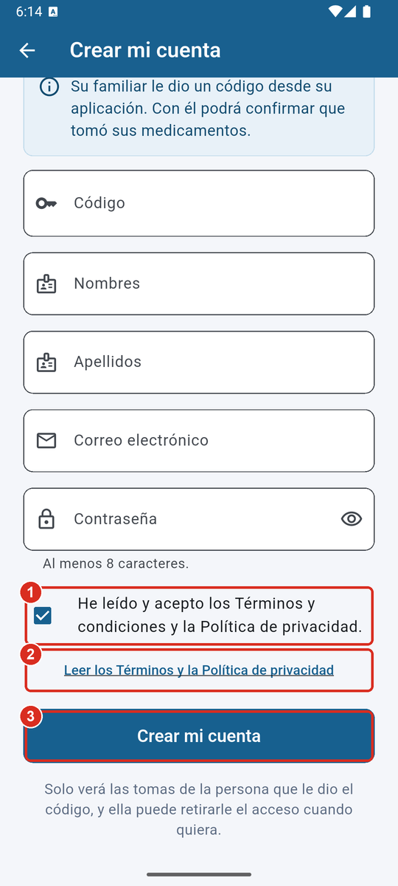
5. Entrará a la pantalla **Acompañamiento** (Figura 44).

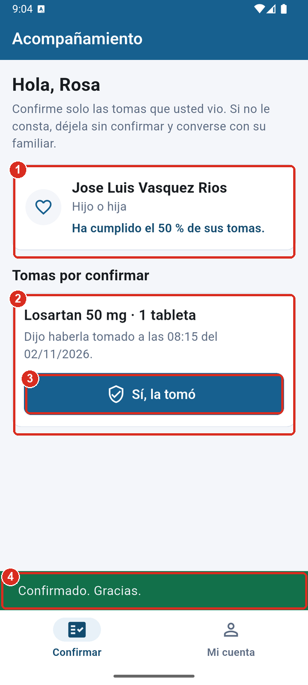

| N.° | Elemento | Qué significa |
| :--- | :--- | :--- |
| 1 | **Tarjeta del paciente** | A quién acompaña, su parentesco y cómo va su cumplimiento |
| 2 | **Toma por confirmar** | Una toma que el paciente dijo haber tomado, con la hora que registró |
| 3 | **Sí, la tomó** | Confírmela **solo si usted lo vio** |
| 4 | **Confirmado. Gracias.** | Aviso de que la confirmación quedó guardada |

6. Si usted **vio** al paciente tomar el medicamento, toque **Sí, la tomó**
   **(3)**. Si no le consta, no la confirme: converse con su familiar.

Cada confirmación aparece en la ficha que ve el médico, en la columna
**Testigo**, con su nombre y su parentesco.

## 3.10 Mi cuenta y cierre de sesión

1. Toque la opción **Mi cuenta** (Figura 45). Verá sus datos **(1)** y cuántas
   alertas tiene programadas en el teléfono **(2)**.
2. Encima de **Cerrar sesión** encontrará **Privacidad y términos**, que abre
   el resumen del apartado 3.13.
3. Para salir, toque **Cerrar sesión** **(3)**.

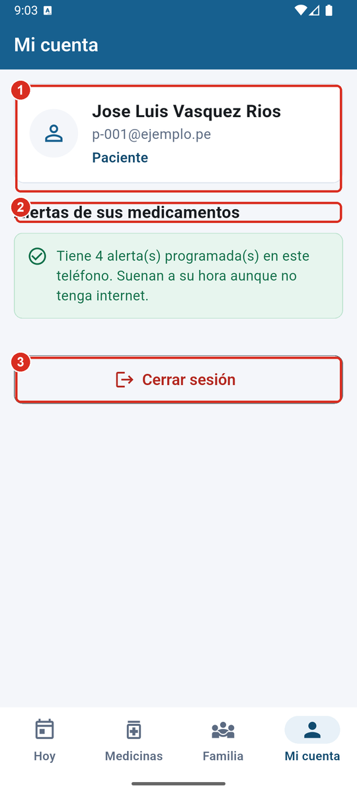

4. Confirme con **Cerrar sesión** **(1)** (Figura 46). Sus medicamentos y las
   tomas que aún no se enviaron **se quedan guardados** en el teléfono.

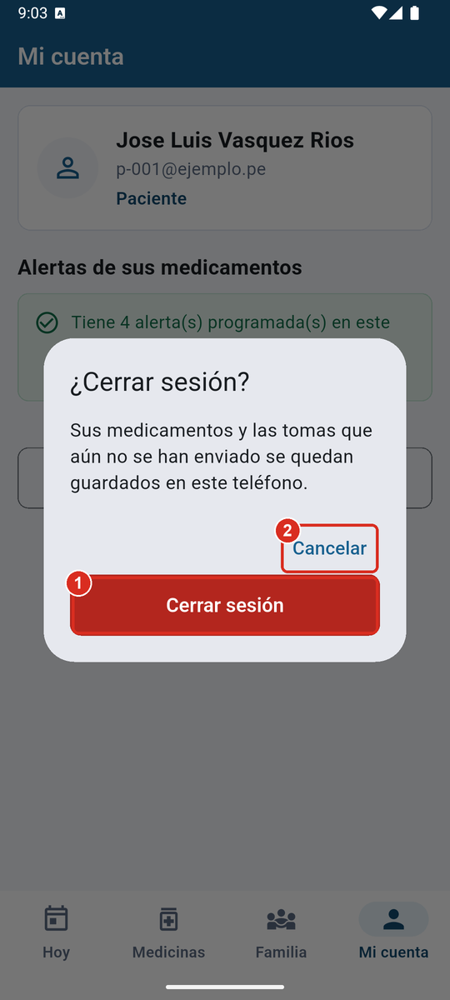

## 3.11 Diccionario de datos de la aplicación

| Campo | ¿Obligatorio? | Formato | Ejemplo |
| :--- | :--- | :--- | :--- |
| Correo electrónico | Sí | Formato nombre@dominio | p-001@ejemplo.pe |
| Contraseña | Sí | Al menos 8 caracteres | — |
| Nombre del medicamento | Sí | Texto libre | Metformina |
| Dosis | No | Texto libre | 850 mg |
| Horas de toma | Sí, al menos una | Hora del día (HH:MM) | 08:00 · 20:00 |
| Motivo de omisión | No | Una de las seis opciones de la Figura 38 | No tenía el medicamento |
| Nombre del familiar | Sí | Texto libre | Carlos |
| Parentesco | Sí | Hijo o hija, cónyuge, hermano, cuidador u otro | Hijo o hija |
| Código de invitación | Sí (para el familiar) | 8 letras y números; vence en 8 días | — |

## 3.12 Mensajes que puede ver en pantalla

| Mensaje | Qué hacer |
| :--- | :--- |
| *Usuario o contraseña incorrectos.* | Revise el correo y la contraseña, y que haya elegido bien «Soy el paciente» o «Soy familiar» |
| *Podrá registrarla desde las HH:MM.* | Aún no es hora; regístrela cuando llegue la ventana |
| *El plazo para marcarla como tomada terminó a las HH:MM.* | Pasaron más de tres horas; si no la tomó, regístrelo con **No la tomé** |
| *No se pudo conectar con el servidor. Puede registrar sus tomas igual…* | Siga registrando: se enviarán solas. La aplicación vuelve a intentarlo sola cada pocos segundos |
| *El paciente está dado de baja del seguimiento…* | Su médico le retiró del seguimiento; consulte en el consultorio |
| *El código no es válido o ya venció.* | (Familiar) Pida al paciente un código nuevo |
| *El plazo para corroborar esta toma ya venció.* | (Familiar) Esa toma ya no puede confirmarse |

## 3.13 Privacidad y términos

Al ingresar a la aplicación usted acepta los Términos y condiciones y la
Política de privacidad. Puede leerlos cuando quiera:

1. En la pantalla de inicio de sesión, toque el enlace **Al ingresar acepta los
   Términos y la Política de privacidad** **(1)** (Figura 47), o, ya dentro,
   la opción **Mi cuenta → Privacidad y términos**.
2. Se abre un resumen en letra grande (Figura 48): quién cuida sus datos
   **(2)**, qué datos se guardan, para qué, quién los ve y sus derechos.
3. Deslice hacia abajo para leer los **Términos y condiciones** **(1)**
   (Figura 49). Lo más importante: **la aplicación no es un servicio de
   emergencias** **(2)** y no reemplaza las indicaciones de su médico.

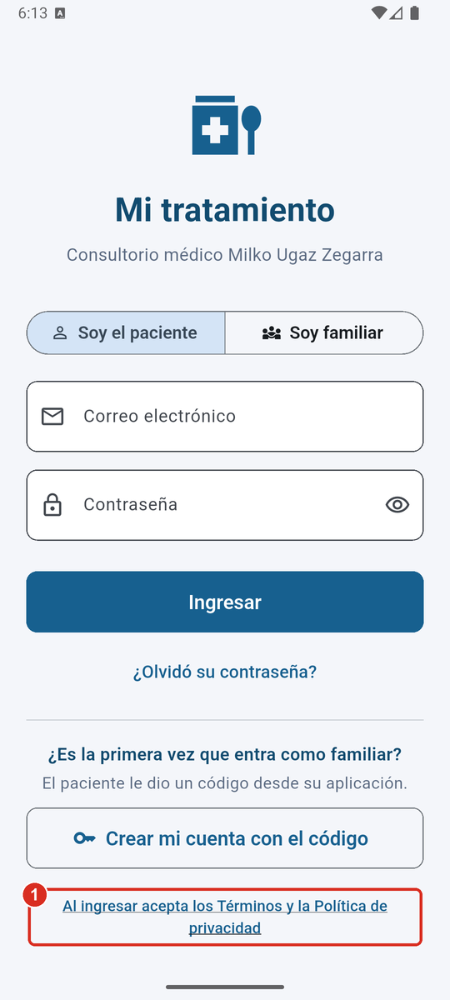

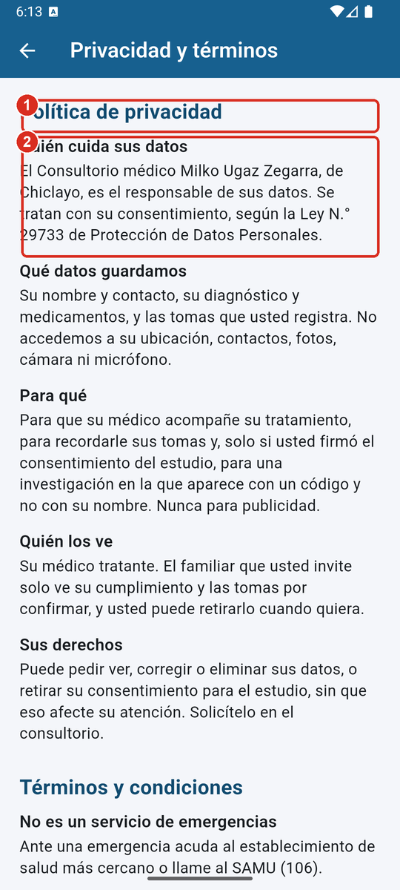

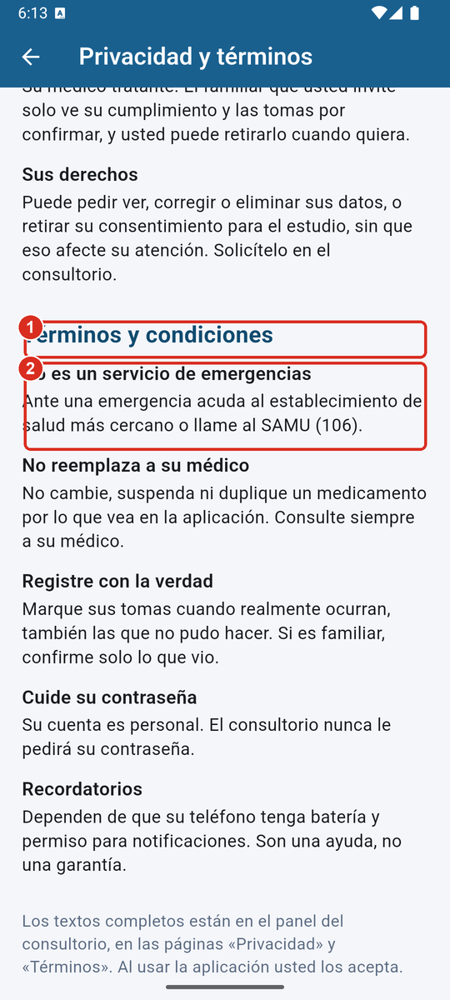

Los textos completos están en las páginas **Privacidad** y **Términos** del
panel (apartado 2.13) y en los anexos 6.2 y 6.3 de este manual.

# 4. SECCIÓN DEL ENCARGADO DEL SISTEMA

Esta sección es para el responsable técnico: quien pone en marcha el sistema,
crea las cuentas, lo mantiene y resuelve sus fallas. Explica las dos formas de
funcionamiento: **modo local** (todo en una computadora, como en la
sustentación) y **sistema desplegado** (en servicios en la nube, accesible desde
internet).

## 4.1 Arquitectura y componentes

| Componente | Tecnología | Modo local | Sistema desplegado |
| :--- | :--- | :--- | :--- |
| Base de datos | PostgreSQL | PostgreSQL 18 en la computadora (puerto 5432) | Aiven (PostgreSQL gestionado, con SSL) |
| API central | Python 3.12 + FastAPI | http://localhost:8000 | Render: `cdss-adherencia-api` |
| Microservicio del modelo | FastAPI + scikit-learn + SHAP | http://localhost:8001 | Render: `cdss-adherencia-ml` |
| Panel médico | React 19 + Vite | http://localhost:5173 | Vercel |
| Aplicación móvil | Flutter (Android) | Emulador, conectada a `http://10.0.2.2:8000` | APK de publicación conectado al API de Render |

El panel y la aplicación solo hablan con el **API central**. El API es el único
que accede a la base de datos y el único que consulta al microservicio del
modelo, con una clave compartida.

## 4.2 Requisitos técnicos y variables de configuración

| Software | Versión | Para qué |
| :--- | :--- | :--- |
| Python | 3.12 o 3.13 | API y microservicio |
| Node.js | 20 o superior | Panel web |
| PostgreSQL y pgAdmin | 16 a 18 | Base de datos local |
| Flutter SDK y Android Studio | Flutter 3.x; emulador con Android 14 o superior | Aplicación móvil |
| Git | Cualquiera reciente | Obtener y actualizar el código |
| Hardware | 8 GB de RAM, 10 GB libres, virtualización activada | El emulador es lo más exigente |

**Variables de configuración del API** (en local las fija el lanzador; en
Render se escriben en *Environment*):

| Variable | Qué contiene |
| :--- | :--- |
| `DATABASE_URL` | Cadena de conexión a PostgreSQL. En Aiven debe terminar en `?sslmode=require` |
| `SECRET_KEY` | Clave con la que se firman las sesiones. Larga, aleatoria y distinta en cada entorno |
| `ENVIRONMENT` | `local` o `produccion`. En producción oculta la documentación interactiva del API |
| `CORS_ORIGINS` | Dirección del panel autorizada a llamar al API |
| `ALLOWED_HOSTS` | Nombre público del API |
| `ML_SERVICE_URL` y `ML_SERVICE_CLAVE` | Dirección del microservicio del modelo y la clave compartida |
| `FRONTEND_URL` | Dirección del panel, para los enlaces de recuperación de contraseña |
| `SMTP_HOST`, `SMTP_PORT`, `SMTP_USUARIO`, `SMTP_CONTRASENA`, `SMTP_REMITENTE` | Servidor de correo saliente. Si `SMTP_HOST` está vacío, la recuperación por correo se desactiva sola |

**Variables del panel web** (en local, archivo `frontend-web/.env`; en Vercel,
*Environment Variables*):

| Variable | Qué contiene |
| :--- | :--- |
| `VITE_API_URL` | Dirección del API, sin barra final |
| `VITE_APK_URL` | Dirección del APK que ofrece la página **/descargar**. Si falta, se usa `/descargas/mi-tratamiento.apk`, el archivo que deja `python iniciar_local.py apk` |
| `VITE_CORREO_CONTACTO` | Correo que citan la Política de privacidad y los Términos. Si falta, los textos remiten al consultorio |

**Regla de seguridad:** los valores de estas variables (contraseñas, claves y
cadenas de conexión) se escriben **solo** en `local.env` o en el panel de
Render. Nunca se suben al repositorio, no se pegan en conversaciones ni se
muestran en pantalla durante una presentación.

## 4.3 Puesta en marcha en modo local

**A. Preparar la base de datos (una sola vez)**

1. Instale PostgreSQL y abra **pgAdmin**.
2. Conéctese al servidor local con el usuario `postgres`.
3. Abra el archivo `backend-api/scripts/crear_base_local.sql` en la herramienta
   de consultas, escriba allí una contraseña propia para el usuario `cdss_app`
   y ejecute **una instrucción a la vez** (seleccione y pulse F5). Se crean el
   usuario `cdss_app` y la base `cdss_local`.
4. En la carpeta del proyecto, copie `local.env.example` con el nombre
   `local.env` y escriba en él la cadena de conexión con la contraseña que
   eligió. Ese archivo está excluido del repositorio.
5. Abra una terminal en la carpeta del proyecto y ejecute:

   `python iniciar_local.py preparar`

   El programa le pedirá la contraseña de las cuentas de demostración (médico,
   pacientes y familiar), creará las tablas y cargará los pacientes P-001 a
   P-005. Para empezar de cero más adelante, use
   `python iniciar_local.py preparar --rehacer`.

**B. Levantar el sistema (cada vez que se use)**

1. En una terminal, ejecute `python iniciar_local.py`. Espere a que aparezcan
   como listos el modelo (puerto 8001), el API (8000) y el panel (5173).
2. Abra **http://localhost:5173** en el navegador para el panel médico.
3. En una segunda terminal, ejecute `python iniciar_local.py movil`. Se abre el
   emulador de Android y se instala la aplicación ya conectada al API local.
4. Para detener todo, pulse **Ctrl + C** en cada terminal.

**C. Comprobar que todo funciona**

| Qué abrir | Qué debe verse |
| :--- | :--- |
| http://localhost:8000/health | `{"estado":"ok", …}` |
| http://localhost:8001/health | Estado del modelo cargado |
| http://localhost:5173 | Pantalla de inicio de sesión del panel |
| http://localhost:8000/docs | Documentación interactiva del API (solo en modo local) |

**D. Instalador para la página de descarga**

Ejecute `python iniciar_local.py apk`. El programa construye el APK de
publicación y lo copia en `frontend-web/public/descargas/mi-tratamiento.apk`,
de donde lo sirve la página **http://localhost:5173/descargar**. Ese APK se
conecta al API publicado en internet; para uno que se conecte a otro API,
indique su dirección con `--api https://…`. Con una dirección `http://` (por
ejemplo, `--api http://10.0.2.2:8000`) se genera un APK de depuración que solo
funciona en el emulador, porque Android bloquea el tráfico sin cifrar.

En modo local la recuperación de contraseña por correo está desactivada; si un
usuario la olvida, vuelva a preparar la base o restablézcala desde la ficha (en
el caso de los pacientes).

## 4.4 Sistema desplegado en internet

El orden importa: **base de datos → microservicio y API → panel web →
aplicación**, porque cada paso necesita la dirección que produce el anterior.
La guía detallada, con cada pantalla de las plataformas, está en el archivo
`DESPLIEGUE.md` del repositorio.

**A. Base de datos en Aiven**

1. Cree un servicio **PostgreSQL** en el plan gratuito, en la región más cercana
   a Perú.
2. Copie el *Service URI* que entrega la consola: será el valor de
   `DATABASE_URL`. Debe incluir `sslmode=require`; no lo quite.

**B. API y microservicio en Render**

1. En Render elija **New → Blueprint** y conecte el repositorio. Render lee
   `render.yaml` y propone dos servicios: `cdss-adherencia-api` y
   `cdss-adherencia-ml`.
2. En **Environment** del API complete las variables marcadas como manuales
   (apartado 4.2): `DATABASE_URL`, `SECRET_KEY`, `CORS_ORIGINS`,
   `ALLOWED_HOSTS` y `ML_SERVICE_URL`. La clave compartida con el modelo la
   enlaza el blueprint.
3. Despliegue. Las migraciones de la base se aplican solas en cada arranque.
4. Verifique abriendo `https://<su-api>.onrender.com/health`.
5. (Opcional) Para activar la recuperación de contraseña por correo, complete
   `FRONTEND_URL` y las variables `SMTP_…` con los datos de su proveedor de
   correo.

**C. Panel médico en Vercel**

1. En Vercel elija **Add New → Project** e importe el repositorio.
2. Como **Root Directory** indique `frontend-web`.
3. Defina la variable `VITE_API_URL` con la dirección del API en Render, sin
   barra final. Defina también `VITE_APK_URL` (paso D) y `VITE_CORREO_CONTACTO`
   con el correo de contacto que citarán la Política de privacidad y los
   Términos. Despliegue.
4. Copie la dirección que asigna Vercel y escríbala en `CORS_ORIGINS` del API.

**D. Aplicación móvil (APK de publicación)**

1. En la carpeta `app-movil`, ejecute:

   `flutter build apk --release --dart-define=API_URL=https://<su-api>.onrender.com`

2. El instalador queda en `app-movil/build/app/outputs/flutter-apk/app-release.apk`.
3. **Publíquelo para la página de descarga.** El APK no se guarda en el
   repositorio (pesa unos 55 MB). Súbalo como archivo de una *release* de
   GitHub con el nombre `mi-tratamiento.apk` y escriba su dirección en
   `VITE_APK_URL` del panel en Vercel, por ejemplo
   `https://github.com/<usuario>/<repositorio>/releases/latest/download/mi-tratamiento.apk`.
   Con `latest`, cada versión nueva que suba reemplaza a la anterior sin tocar
   el panel.
4. Compruebe en `https://<su-panel>/descargar` que el botón descarga el archivo.

**E. Antes de una demostración o de la consulta**

El plan gratuito de Render suspende los servicios tras 15 minutos sin uso, y la
primera petición tarda cerca de un minuto. Despiértelos cinco minutos antes:

`python backend-api/scripts/despertar.py --api https://<su-api>.onrender.com --panel <URL del panel>`

## 4.5 Gestión de cuentas y contraseñas

| Tarea | Cómo se hace |
| :--- | :--- |
| Crear la cuenta del médico | Defina la variable `SEED_PASSWORD` con la contraseña elegida y ejecute `python scripts/seed.py` dentro de `backend-api` (en local lo hace `preparar`). Crea la cuenta del consultorio si no existe |
| Crear las cuentas de los pacientes | El médico las genera desde la ficha (apartado 2.6, paso 9). Para fichas cargadas en bloque con correo: `python scripts/seed.py --cuentas` |
| Cuentas de familiares | Las crea cada familiar con el código del paciente; el encargado no interviene |
| Médico que olvidó su contraseña | Con correo activo, el enlace de «¿Olvidó su contraseña?». Sin correo (modo local), vuelva a preparar la base con `preparar --rehacer`, que pide una contraseña nueva |
| Paciente que olvidó su contraseña | El médico usa **Restablecer la contraseña** en la ficha |
| Cambiar la clave de firma (`SECRET_KEY`) | Cámbiela en Render y vuelva a desplegar. Todas las sesiones abiertas se cierran |

## 4.6 Mantenimiento, respaldo y actualización

**Copia de seguridad de la base de datos**

- **Modo local:** en pgAdmin, clic derecho sobre `cdss_local` → **Backup…**, formato *Custom*, y guarde el archivo fuera de la carpeta del proyecto.
- **Sistema desplegado:** Aiven hace copias automáticas. Para una copia propia, ejecute `pg_dump` con la cadena de conexión de Aiven y guarde el archivo en un lugar seguro: contiene datos de salud.

**Restaurar una copia:** en pgAdmin, clic derecho sobre la base → **Restore…** y
elija el archivo.

**Actualizar el sistema a una versión nueva**

1. Obtenga el código nuevo (`git pull`).
2. **Modo local:** vuelva a ejecutar `python iniciar_local.py`; las migraciones
   de la base se aplican solas al arrancar.
3. **Sistema desplegado:** Render y Vercel vuelven a desplegar solos con cada
   cambio en la rama principal. La aplicación móvil requiere construir y
   entregar un APK nuevo.

**Actualizar el modelo predictivo**

1. Entrene y evalúe con `python src/train_evaluate.py` dentro de `ml-pipeline`
   (véase su README). El resultado es `ml-pipeline/models/risk_model_v1.pkl`
   con su ficha `risk_model_v1.json`.
2. Revise en la ficha del modelo las métricas y la procedencia de los datos.
3. Reinicie el microservicio (en local, `python iniciar_local.py`; en Render,
   **Manual Deploy**).

**Archivado de pacientes:** los pacientes no se borran; el médico los da de baja
y su historial se conserva (apartado 2.10).

**Exportación de datos para el estudio:** el CSV de **Reportes generales**
(apartado 2.11) o una consulta directa a la tabla `pacientes` desde pgAdmin.
Los pacientes de demostración (correos `@ejemplo.pe`) son ficticios y no deben
incluirse en los resultados de la investigación.

## 4.7 Solución de problemas técnicos

| Síntoma | Causa probable | Solución |
| :--- | :--- | :--- |
| `preparar` no conecta con PostgreSQL | Servicio detenido o cadena de `local.env` incorrecta | Inicie el servicio `postgresql-x64-18` en *Servicios de Windows* y revise usuario, contraseña y base en `local.env` |
| El lanzador dice que un puerto está ocupado | Quedó abierta una ejecución anterior | Cierre las otras terminales o reinicie la computadora |
| El panel abre pero no carga pacientes | El API no arrancó | Revise los mensajes de la terminal del API |
| La ficha dice que el modelo no está disponible | El microservicio no arrancó o falta `ML_SERVICE_URL` / `ML_SERVICE_CLAVE` | En local, reinicie el lanzador; en Render, revise las variables y despierte el microservicio |
| El emulador no instala la aplicación (*not enough space*) | El emulador está lleno | Desinstale apps que no use dentro del emulador o haga *Wipe Data* desde Android Studio |
| La app dice «No se pudo conectar con el servidor» en local | El API no está en marcha | Compruebe http://localhost:8000/health; la app reintenta sola |
| `could not translate host name` en Render | Corte pasajero de la base gestionada | Vuelva a desplegar; verifique en Aiven que el servicio esté *Running* |
| `password authentication failed` en Render | `DATABASE_URL` mal copiada | Vuelva a copiar el *Service URI* desde Aiven |
| El panel de Vercel no se comunica con el API | `CORS_ORIGINS` no incluye la dirección del panel o `VITE_API_URL` está mal | Corrija ambas variables y vuelva a desplegar el panel |
| No llegan los correos de recuperación | Faltan las variables `SMTP_…` o el proveedor los marca como no deseados | Complete las variables; use una contraseña de aplicación o un servicio transaccional |

# 5. SOPORTE Y CONTACTO

## 5.1 Problemas frecuentes de los usuarios

| Problema | Causa probable | Solución |
| :--- | :--- | :--- |
| El panel no abre (*No se puede acceder a este sitio*) | El sistema no está en marcha | Avise al encargado del sistema |
| El panel le devuelve a la pantalla de inicio de sesión | Pasaron 60 minutos y la sesión venció | Vuelva a iniciar sesión; lo guardado no se pierde |
| No llegan los correos de recuperación | El correo está desactivado (modo local) o fue a *no deseado* | Revise *no deseado*; si no llega, pida ayuda al encargado o, si es paciente, al médico |
| La aplicación muestra «No se pudo conectar con el servidor» | El celular no tiene señal o el servidor está apagado | Siga registrando; las tomas se envían solas. Verifique el Wi-Fi o los datos |
| No suenan los recordatorios | Se negó el permiso de notificaciones | Android → Ajustes → Aplicaciones → Mi tratamiento → Notificaciones → Activar |
| No aparece el botón «Ya la tomé» | Está fuera de la ventana de registro | Antes de la hora, espere el mensaje «Podrá registrarla desde…»; después, use «No la tomé» |
| El familiar no ve tomas por confirmar | El paciente aún no registró tomas cumplidas | Espere a que el paciente las registre |

## 5.2 Canales de contacto técnico y horarios de atención

| Canal | Detalle |
| :--- | :--- |
| Encargado del sistema | Leonardo Guzmán Salazar, autor del sistema |
| Correo de soporte | [completar con el correo institucional del encargado] |
| Teléfono / WhatsApp | [completar] |
| Atención presencial | Consultorio médico Milko Ugaz Zegarra, Chiclayo |
| Horario de atención | Lunes a viernes, de 8:00 a 13:00 y de 16:00 a 20:00 |
| Tiempo de respuesta | Problemas que impiden usar el sistema: el mismo día. Consultas y mejoras: hasta 48 horas hábiles |

Cuando reporte un problema, indique qué estaba haciendo, qué pantalla tenía
abierta, el mensaje exacto que vio (una foto de la pantalla ayuda) y, si
aparece, el **código de traza** del mensaje de error. **Nunca envíe su
contraseña**: el soporte no la necesita.

# 6. ANEXOS

## 6.1 Glosario de términos

| Término | Significado |
| :--- | :--- |
| **Adherencia terapéutica** | Grado en que el paciente toma sus medicamentos como se los indicó el médico |
| **Incumplimiento terapéutico** | Omitir dosis, tomarlas fuera de hora o abandonar el tratamiento |
| **Polimedicado** | Paciente que toma cinco o más medicamentos de forma crónica |
| **CDSS** | *Clinical Decision Support System*: sistema de soporte a la decisión clínica. Apoya al médico; no decide por él |
| **Panel de auditoría** | Pantalla principal del médico con la lista de pacientes ordenada por prioridad |
| **Ficha del paciente** | Pantalla con los datos, el riesgo, su explicación y el historial de un paciente |
| **Riesgo observado** | Clasificación según el cumplimiento que el paciente ya registró |
| **Riesgo predicho** | Probabilidad que estima el modelo de aprendizaje automático de que el paciente incumpla antes del próximo control |
| **SHAP** | Método que explica la predicción: muestra cuánto sube o baja el riesgo cada variable de la ficha |
| **pp (puntos porcentuales)** | Unidad de las barras SHAP. +10 pp significa que esa variable suma 10 puntos al porcentaje de riesgo |
| **Test de Morisky-Green** | Cuestionario de cuatro preguntas que mide la adherencia; su puntaje va de 0 a 4 |
| **Adherencia basal** | Adherencia del paciente al inicio del seguimiento, según el test |
| **Alerta temprana** | Aviso al médico cuando un paciente acumula omisiones, su cumplimiento cae o el modelo predice riesgo alto |
| **Toma** | Cada dosis programada de un medicamento a una hora determinada |
| **Ventana de registro** | Periodo en que se puede marcar «Ya la tomé»: desde una hora antes hasta tres horas después de la hora programada |
| **Retraso** | Minutos entre la hora programada y la hora en que el paciente registró la toma |
| **Testigo** | Persona que registró o confirmó una toma: el paciente, el médico o un familiar |
| **Familiar acompañante** | Persona invitada por el paciente que puede confirmar las tomas que presenció |
| **Código de invitación** | Clave de ocho caracteres, válida por ocho días, con la que el familiar crea su cuenta |
| **Código anonimizado** | Identificador del paciente (P-001, P-002…) que se usa en los reportes en lugar de su nombre |
| **Dar de baja** | Retirar al paciente del seguimiento sin borrar su historial |
| **Cola de envío** | Tomas guardadas en el celular sin conexión, que se envían solas al volver la señal |
| **CSV** | Archivo de texto con datos separados por comas que se abre con Excel o Google Sheets |
| **Modo local** | Ejecución de todo el sistema en una sola computadora, con una base de datos PostgreSQL propia |
| **Sistema desplegado** | Ejecución en servicios en la nube (Aiven, Render y Vercel), accesible desde internet |
| **API** | Programa central que recibe las peticiones del panel y de la aplicación y accede a la base de datos |
| **Microservicio del modelo** | Programa separado que calcula el riesgo y su explicación SHAP |
| **Migración** | Cambio ordenado de la estructura de la base de datos que se aplica solo al arrancar |
| **Emulador de Android** | Programa que simula un celular Android dentro de la computadora |
| **APK** | Archivo instalador de una aplicación Android |
| **Contraseña temporal** | Contraseña que el médico genera para el paciente; solo se muestra una vez |
| **Datos sensibles** | Datos personales que requieren protección reforzada, como los de salud. Se tratan solo con consentimiento expreso (Ley N.° 29733) |
| **Derechos ARCO** | Derechos de Acceso, Rectificación, Cancelación y Oposición sobre los propios datos personales |
| **Código QR** | Imagen cuadrada que, al escanearla con la cámara del celular, abre una dirección web |

## 6.2 Política de privacidad

Vigente desde el 3 de noviembre de 2026.

### 1. Quién es responsable de sus datos

El responsable del tratamiento de sus datos personales es el Consultorio médico Milko Ugaz Zegarra, Chiclayo. El sistema fue desarrollado como parte de una investigación de tesis de la Universidad Católica Santo Toribio de Mogrovejo.

Para cualquier consulta sobre sus datos puede dirigirse al consultorio, en persona o en su próxima consulta.

### 2. Qué datos tratamos

Solo los necesarios para acompañar su tratamiento:

- Identificación y contacto: nombres, apellidos, documento de identidad (opcional), teléfono y correo electrónico.
- Datos de salud: diagnóstico, enfermedades asociadas, número de medicamentos y de tomas al día, controles programados y perdidos, y el resultado del test de Morisky-Green.
- Registro de tomas: hora programada, hora en que usted registró la toma, si la tomó o no y el motivo, si lo indica.
- Datos del familiar acompañante: nombre, correo, parentesco y las tomas que confirmó.
- Datos técnicos mínimos: fecha y hora de los accesos y un código de seguimiento de errores.

### 3. Lo que no recogemos

La aplicación no accede a su ubicación, sus contactos, sus fotos, su micrófono ni su cámara, y no recoge datos biométricos. Tampoco usamos sus datos para publicidad ni los vendemos.

### 4. Para qué los usamos

- Que su médico tratante conozca cómo va su tratamiento y le acompañe a tiempo.
- Estimar el riesgo de incumplimiento y explicar sus causas, como apoyo a la decisión del médico. El sistema no toma decisiones clínicas por sí solo: siempre decide el médico.
- Enviarle recordatorios en su propio teléfono a la hora de cada toma.
- Permitir que el familiar que usted invite confirme las tomas que presenció.
- Investigación académica, solo si usted firmó el consentimiento informado del estudio. En ese caso sus datos se identifican con un código (por ejemplo, P-001) y no con su nombre.

### 5. Base legal

Sus datos de salud son datos sensibles. Los tratamos con su consentimiento expreso, conforme a la Ley N.° 29733, Ley de Protección de Datos Personales, y su Reglamento, y con el deber de confidencialidad que establece la Ley N.° 26842, Ley General de Salud.

### 6. Quién puede verlos

- Su médico tratante: toda su ficha y su historial.
- El familiar que usted invite: solo su porcentaje de cumplimiento y las tomas pendientes de confirmar. Usted puede retirarlo cuando quiera desde la opción «Familia».
- El encargado técnico del sistema: únicamente para mantenerlo y resolver fallas.
- Los proveedores de alojamiento del sistema cuando funciona en internet (base de datos y servidores en la nube), que procesan la información por encargo y bajo condiciones de seguridad. Pueden estar ubicados fuera del Perú. Cuando el sistema funciona en modo local, los datos no salen de la computadora del consultorio.

### 7. Cómo los protegemos

- Las contraseñas se guardan cifradas: nadie, ni siquiera el médico, puede leerlas.
- Las conexiones del sistema publicado viajan cifradas (HTTPS y SSL).
- Cada perfil ve solo lo que le corresponde, y las sesiones vencen solas.
- Los datos que se usan en la investigación van seudonimizados.

### 8. Cuánto tiempo los conservamos

Mientras dure su seguimiento y el estudio. Si el médico le da de baja, su historial se conserva como parte de su atención y del estudio durante el plazo que exijan las normas sobre historias clínicas y el protocolo de investigación; después se elimina o se anonimiza.

### 9. Sus derechos

Usted puede pedir en cualquier momento acceder a sus datos, corregirlos, que se cancelen o oponerse a su uso, y retirar su consentimiento para la investigación sin que eso afecte su atención médica. Solicítelo al consultorio, en persona o en su próxima consulta. Responderemos dentro de los plazos que establece la ley.

Si considera que no se atendió su solicitud, puede presentar un reclamo ante la Autoridad Nacional de Protección de Datos Personales del Ministerio de Justicia y Derechos Humanos.

### 10. Menores de edad

El sistema está dirigido a personas adultas. No registramos a menores de 18 años.

### 11. Cambios en esta política

Si cambiamos esta política, publicaremos la nueva versión en esta página con su fecha de vigencia y se lo informaremos en la consulta.

## 6.3 Términos y condiciones

Vigente desde el 3 de noviembre de 2026.

### 1. Aceptación

Al crear su cuenta o ingresar al panel o a la aplicación «Mi tratamiento», usted acepta estos Términos y condiciones y la Política de privacidad. Si no está de acuerdo, no use el sistema e infórmelo en el consultorio: su atención médica no depende de usarlo.

### 2. Qué es el sistema

Es una herramienta de apoyo para el seguimiento de la toma de medicamentos de los pacientes del Consultorio médico Milko Ugaz Zegarra, Chiclayo. Registra sus tomas, le recuerda sus horarios y ayuda al médico a identificar a quién acompañar primero.

### 3. Lo que el sistema no es

- No es un servicio de emergencias. Ante una emergencia, acuda al establecimiento de salud más cercano o llame al SAMU (106).
- No diagnostica ni indica tratamientos. No cambie, suspenda ni duplique un medicamento por lo que vea en la aplicación: consulte siempre a su médico.
- El riesgo que estima el modelo es una probabilidad de apoyo, no una certeza. La decisión clínica corresponde al médico tratante.

### 4. Su cuenta

- Su cuenta es personal. Guarde su contraseña y no la comparta; el consultorio nunca se la pedirá.
- Si cree que alguien conoce su contraseña, cámbiela o pida al médico una nueva.
- Mantenga sus datos correctos y avise en el consultorio si cambian.

### 5. Uso correcto

- Paciente: registre sus tomas con la verdad, cuando realmente ocurran. Un registro honesto, incluso de las tomas que no pudo hacer, es lo que permite ayudarle.
- Familiar: confirme solo las tomas que usted presenció.
- Médico: use la información solo para la atención de sus pacientes y la investigación autorizada, y no descargue reportes en equipos ajenos al consultorio.
- Está prohibido acceder a cuentas ajenas, intentar vulnerar la seguridad del sistema o usarlo con fines distintos a los descritos.

### 6. Recordatorios y funcionamiento

Los recordatorios dependen de su teléfono: de que tenga batería, de que la aplicación tenga permiso para enviar notificaciones y de la hora configurada. Son una ayuda, no una garantía. El sistema puede interrumpirse por mantenimiento o por fallas de conexión; sin internet, la aplicación guarda sus registros y los envía cuando vuelve la señal.

### 7. Responsabilidad

El sistema se ofrece como apoyo al seguimiento clínico, en el marco de un proyecto académico. No reemplaza la consulta médica ni las indicaciones de su médico, que prevalecen siempre sobre lo que muestre la aplicación.

### 8. Fin del uso

Puede dejar de usar el sistema cuando quiera. El médico puede dar de baja su cuenta al terminar el seguimiento o si se incumplen estos términos. Su historial se conserva según la Política de privacidad.

### 9. Propiedad intelectual

El software, su diseño y sus textos pertenecen a sus autores. Se autoriza su uso únicamente para los fines descritos en estos términos.

### 10. Ley aplicable y contacto

Estos términos se rigen por las leyes de la República del Perú. Para cualquier consulta, diríjase al consultorio, en persona o en su próxima consulta.
