# ANEXO N.° 25: PRUEBAS DE CAJA BLANCA

## 1. Objetivo y alcance

Verificar la **lógica interna** del núcleo funcional: que cada camino de
ejecución de las funciones críticas se recorra al menos una vez y produzca el
resultado correcto, y medir qué parte del código ejercitan las pruebas
automatizadas. A diferencia de la caja negra (Anexo n.° 24), aquí el diseño de
los casos parte del código fuente.

## 2. Herramientas

| Componente | Lenguaje | Pruebas | Cobertura | Complejidad |
| :--- | :--- | :--- | :--- | :--- |
| API central | Python 3.13 | pytest 8.3 | coverage.py (pytest-cov 6.0), sentencias y ramas | radon 6.0 |
| Microservicio del modelo | Python 3.13 | pytest 8.3 | coverage.py, sentencias y ramas | radon 6.0 |
| Panel médico | JavaScript | Ejecutor de pruebas de Node.js (`node --test`) | `--experimental-test-coverage`, líneas y ramas | Conteo manual de decisiones |
| Aplicación móvil | Dart (Flutter) | flutter_test | `flutter test --coverage` (líneas) | Conteo manual de decisiones |

## 3. Método

1. **Selección.** Se eligieron las funciones que sostienen el escenario
   principal y los requisitos críticos: la ventana de registro de la toma, la
   clasificación del riesgo observado, las alertas tempranas, el control de
   acceso, la predicción del modelo, la validación del formulario, la tarjeta
   de toma de la app y la sincronización sin conexión.
2. **Código fuente y grafo de flujo.** Se presenta el código de cada función con su número de línea real en el repositorio, y a partir de él se construye su grafo: los nodos son
   bloques de instrucciones y las aristas, los posibles saltos. Las condiciones
   compuestas (`a and b`, `a or b`) se separan en un nodo por condición. En las
   figuras, los rombos son decisiones y los círculos, bloques de proceso.
3. **Complejidad ciclomática.** V(G) = A − N + 2 (aristas menos nodos más dos),
   que equivale al número de decisiones más uno. Para Python coincide con la
   que calcula `radon`; el script `caja_blanca/grafos.py` comprueba la fórmula
   en cada grafo.
4. **Caminos básicos.** V(G) es el número de caminos independientes que hay que
   recorrer. Se escribió **una prueba automatizada por camino**, identificada
   como CB-XX-Cn. Cuando un camino del conjunto básico no puede ejecutarse
   (porque exige que la misma condición sea verdadera y falsa a la vez), se
   declara **no factible** y se justifica.
5. **Prueba de bucles.** En las funciones con bucles se probó el bucle con
   cero, una y varias iteraciones.
6. **Cobertura.** Se midió la cobertura de sentencias y de ramas de cada
   función objetivo (meta: 100 %) y la de cada componente completo.

## 4. Funciones analizadas

| ID | Componente | Función | Requisito | V(G) | Caminos factibles | Casos | Líneas | Ramas |
| :--- | :--- | :--- | :--- | :---: | :---: | :---: | :---: | :---: |
| CB-01 | API | `RegistroTomaCreate._coherencia_clinica` | RF03 | 10 | 8 | 10 | 11/11 | 10/10 |
| CB-02 | API | `riesgo.clasificar` | RF02, RF07 | 6 | 6 | 6 | 7/7 | 6/6 |
| CB-03 | API | `alertas.evaluar_paciente` | RF05 | 11 | 11 | 11 | 23/23 | 12/12 |
| CB-04 | API | `acceso.obtener_paciente_autorizado` | RNF01 | 6 | 6 | 6 | 12/12 | 10/10 |
| CB-05 | Modelo | `modelo.predecir` | RF04, RF06 | 9 | 9 (con bucles) | 9 | 18/18 | 6/6 |
| CB-06 | Modelo | `modelo.nivel` | RF04 | 3 | 3 | 3 | 5/5 | 4/4 |
| CB-07a | Panel | `limpiarAlEscribir` | RF02 | 7 | 7 | 7 | 100 % | 100 % |
| CB-07b | Panel | `limpiarNumero` | RF02 | 5 | 4 | 5 | 100 % | 100 % |
| CB-08 | App | `TarjetaToma.build` y `_Acciones` | RF03 | 5 | 5 | 5 | 77/77 (archivo) | — |
| CB-09 | App | `_Respuesta.build` | RF03, RF09 | 5 | 5 | 5 | 77/77 (archivo) | — |
| CB-10 | App | `ServicioSincronizacion.registrar` | RF03 | 4 | 4 | 4 | 33/33 (ambas) | — |
| CB-11 | App | `ServicioSincronizacion.sincronizar` | RF03 | 6 | 6 | 6 | 33/33 (ambas) | — |

La herramienta de cobertura de Flutter no informa ramas; en Dart se verificó
que cada línea de las funciones se ejecuta y que cada camino tiene su caso.
Todas las pruebas de esta tabla pasan: **33 en el API, 12 en el modelo, 12 en
el panel y 20 en la app**.

## 5. Análisis por función

### CB-01 · Ventana de registro de una toma (`_coherencia_clinica`)

Valida que una toma marcada como cumplida tenga hora, que esa hora esté entre
60 minutos antes y 3 horas después de la programada y que no sea futura, y que
una omitida no traiga hora.

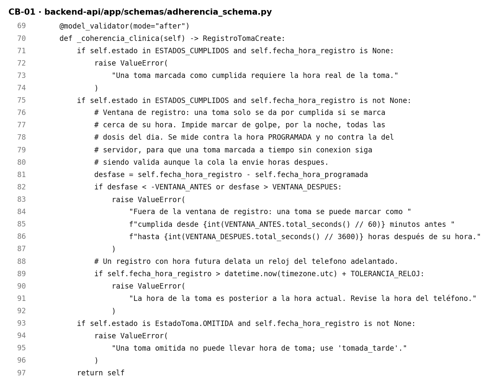

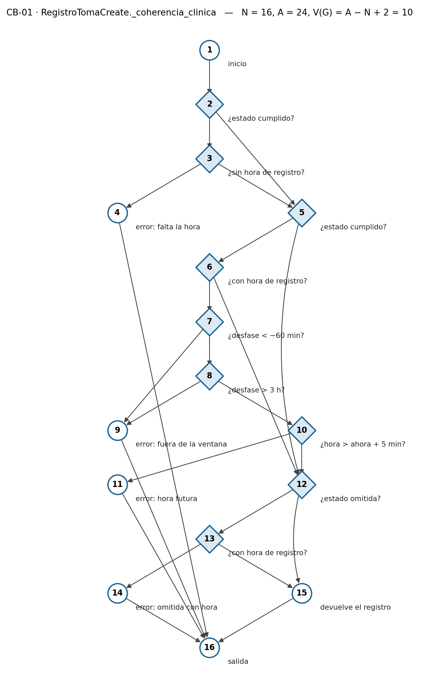

| Camino | Recorrido | Caso (backend-api/tests/test_caja_blanca.py) | Resultado |
| :--- | :--- | :--- | :--- |
| 1 | 1-2-3-4-16 | `test_c1_cumplida_sin_hora_se_rechaza` | Conforme |
| 2 | 1-2-3-5-6-7-8-10-12-15-16 | `test_c2_cumplida_dentro_de_la_ventana_es_valida` | Conforme |
| 3 | 1-2-3-5-6-7-9-16 | `test_c3_antes_de_que_abra_la_ventana_se_rechaza` | Conforme |
| 4 | 1-2-3-5-6-7-8-9-16 | `test_c4_despues_de_que_cierre_la_ventana_se_rechaza` | Conforme |
| 5 | 1-2-3-5-6-7-8-10-11-16 | `test_c5_hora_de_registro_futura_se_rechaza` | Conforme |
| 6 | 1-2-5-12-13-15-16 | `test_c6_omitida_sin_hora_es_valida` | Conforme |
| 7 | 1-2-5-12-13-14-16 | `test_c7_omitida_con_hora_se_rechaza` | Conforme |
| 8 | 1-2-5-12-15-16 | `test_c8_pospuesta_no_recorre_ninguna_regla` | Conforme |
| 9 | 1-2-3-5-12 (… ) | **No factible**: exige que «¿estado cumplido?» sea verdadero en el nodo 2 y falso en el 5 | — |
| 10 | 1-2-3-5-6-12 (…) | **No factible**: el nodo 3 ya garantizó que hay hora, así que el 6 no puede ser falso | — |

Casos adicionales: `test_c9_tomada_tarde…` recorre el camino 2 con el segundo
estado cumplido (cobertura de condición) y `test_c10_los_limites_exactos…`
prueba los valores límite −60 min y +3 h de los nodos 7 y 8.

### CB-02 · Riesgo observado (`clasificar`)

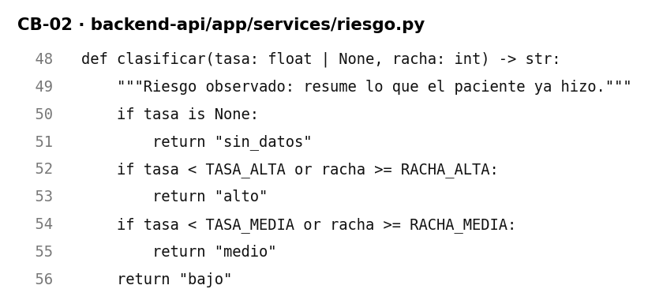

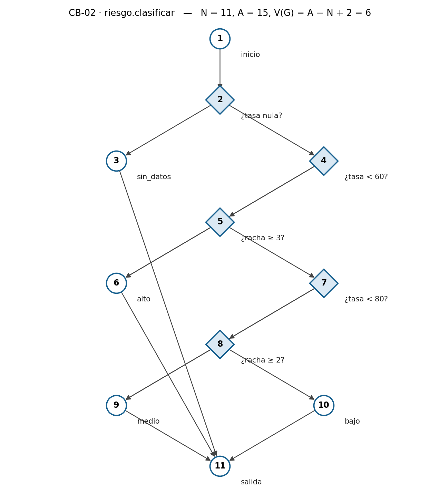

| Camino | Recorrido | Entrada (tasa, racha) | Salida esperada | Caso | Resultado |
| :--- | :--- | :--- | :--- | :--- | :--- |
| 1 | 1-2-3-11 | (nula, 0) | sin_datos | `test_c1_sin_tomas_con_desenlace` | Conforme |
| 2 | 1-2-4-6-11 | (59,9; 0) | alto | `test_c2_tasa_baja` | Conforme |
| 3 | 1-2-4-5-6-11 | (95; 3) | alto | `test_c3_racha_larga_con_buena_tasa` | Conforme |
| 4 | 1-2-4-5-7-9-11 | (60; 0) | medio | `test_c4_tasa_intermedia` | Conforme |
| 5 | 1-2-4-5-7-8-9-11 | (90; 2) | medio | `test_c5_racha_de_dos` | Conforme |
| 6 | 1-2-4-5-7-8-10-11 | (80; 1) | bajo | `test_c6_buena_adherencia` | Conforme |

### CB-03 · Alertas tempranas (`evaluar_paciente`)

Aplica tres reglas (omisiones seguidas, adherencia baja con al menos cinco
tomas y riesgo predicho alto) y cierra las alertas que dejaron de cumplirse,
salvo la de riesgo predicho cuando el modelo no respondió.

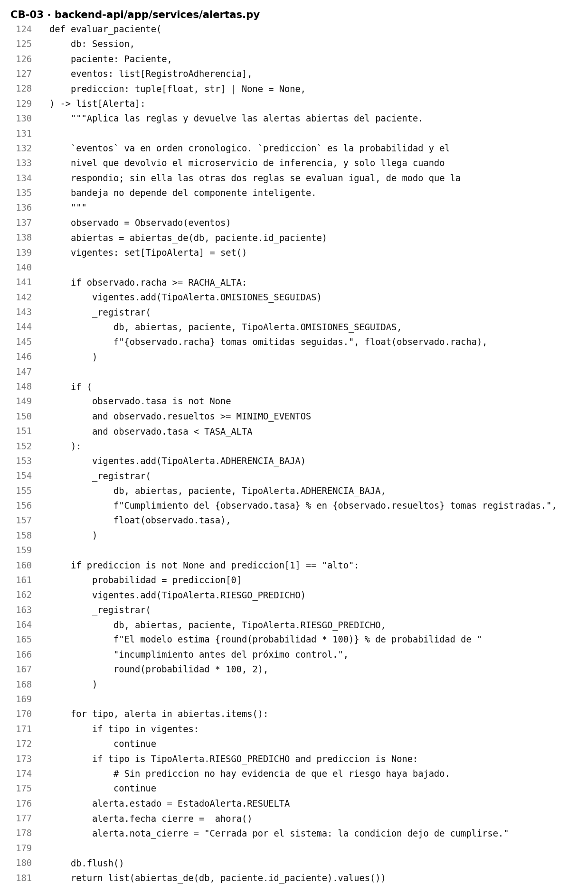

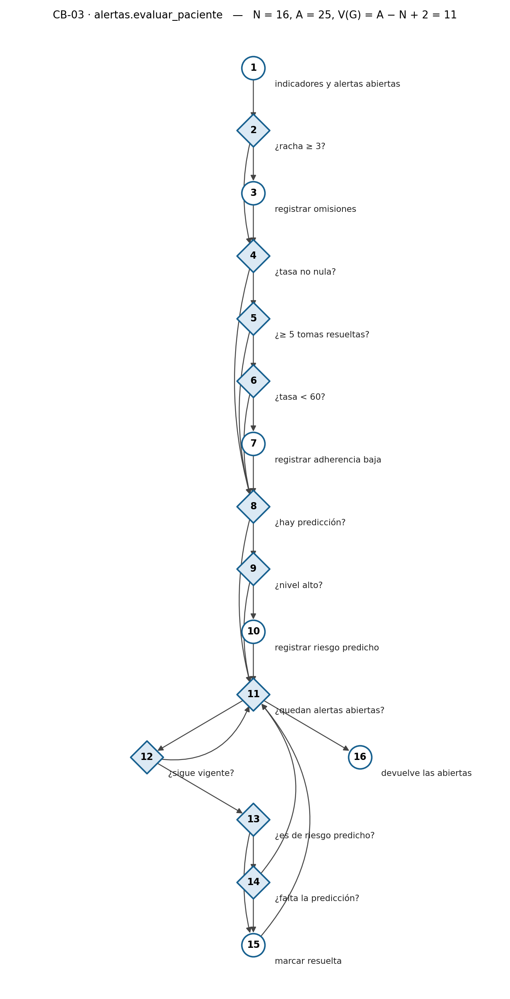

| Camino | Recorrido | Situación | Caso | Resultado |
| :--- | :--- | :--- | :--- | :--- |
| 1 | 1-2-4-8-11-16 | Sin tomas ni predicción | `test_c1_sin_eventos_ni_prediccion` | Conforme |
| 2 | 1-2-3-4-5-8-11-16 | Tres omisiones seguidas | `test_c2_tres_omisiones_seguidas` | Conforme |
| 3 | 1-2-4-5-6-7-8-11-16 | 50 % en 6 tomas | `test_c3_cumplimiento_bajo_con_suficientes_tomas` | Conforme |
| 4 | 1-2-4-5-8-11-16 | 50 % en solo 4 tomas | `test_c4_cumplimiento_bajo_con_pocas_tomas` | Conforme |
| 5 | 1-2-4-8-9-11-12-13-14-15-11-16 | Alerta de riesgo abierta y el modelo ahora dice «medio» | `test_c5_riesgo_predicho_abierto_y_el_modelo_ya_no_dice_alto` | Conforme |
| 6 | 1-2-4-5-6-8-11-16 | 80 % en 5 tomas | `test_c6_buena_tasa_con_suficientes_tomas` | Conforme |
| 7 | 1-2-4-8-9-10-11-16 | Predicción alta | `test_c7_prediccion_alta` | Conforme |
| 8 | 1-2-4-8-9-11-16 | Predicción media | `test_c8_prediccion_media` | Conforme |
| 9 | …-11-12-11-16 | Alerta abierta que sigue vigente | `test_c9_alerta_abierta_que_sigue_vigente` | Conforme |
| 10 | 1-2-4-8-11-12-13-14-11-16 | Alerta de riesgo abierta y el modelo no respondió | `test_c10_riesgo_predicho_abierto_sin_prediccion` | Conforme |
| 11 | 1-2-4-5-8-11-12-13-15-11-16 | Alerta abierta que dejó de cumplirse | `test_c11_alerta_abierta_que_dejo_de_cumplirse` | Conforme |

Al revisar este conjunto se detectó que la primera versión de las pruebas no
recorría la arista 14→15 (el camino 5): una prueba repetía el camino 1 con
otros datos. Se reemplazó por el caso del camino 5.

### CB-04 · Control de acceso a la ficha (`obtener_paciente_autorizado`)

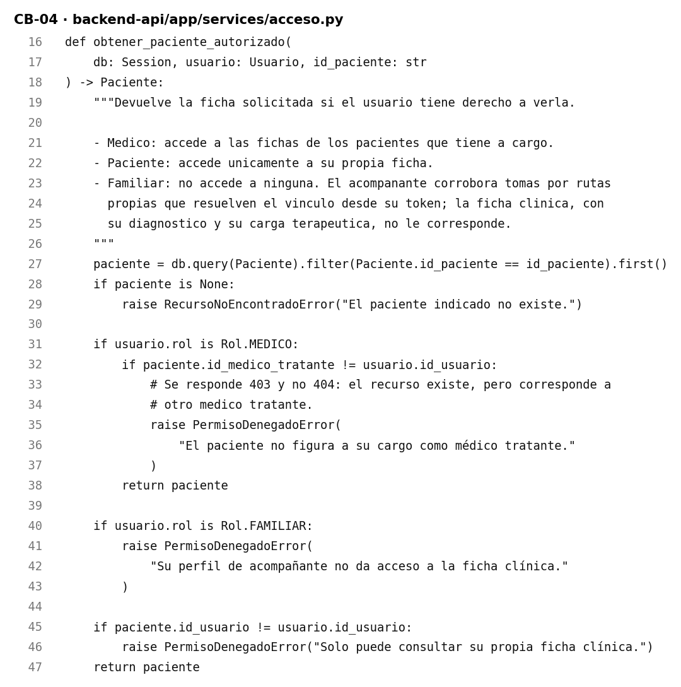

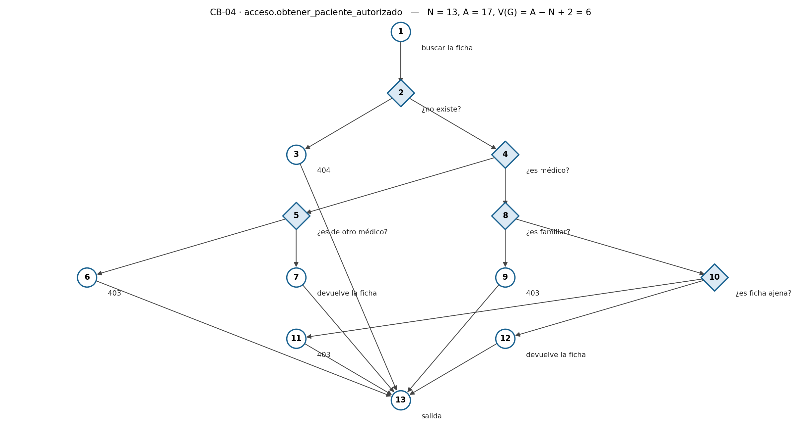

| Camino | Recorrido | Quién pide qué | Esperado | Caso | Resultado |
| :--- | :--- | :--- | :--- | :--- | :--- |
| 1 | 1-2-3-13 | Médico, ficha inexistente | 404 | `test_c1_paciente_inexistente` | Conforme |
| 2 | 1-2-4-5-7-13 | Médico tratante | Ficha | `test_c2_medico_tratante` | Conforme |
| 3 | 1-2-4-5-6-13 | Otro médico | 403 | `test_c3_otro_medico` | Conforme |
| 4 | 1-2-4-8-9-13 | Familiar | 403 | `test_c4_familiar` | Conforme |
| 5 | 1-2-4-8-10-12-13 | Paciente, su ficha | Ficha | `test_c5_paciente_dueno_de_la_ficha` | Conforme |
| 6 | 1-2-4-8-10-11-13 | Paciente, ficha ajena | 403 | `test_c6_paciente_sobre_ficha_ajena` | Conforme |

### CB-05 · Predicción del modelo (`predecir`) y CB-06 · Nivel de riesgo (`nivel`)

`predecir` recibe un lote de fichas, calcula la probabilidad de cada una con el
modelo desplegado, añade la explicación SHAP si se pide y declara qué
variables se imputaron. Tiene tres bucles, por lo que se combinó el análisis
de caminos con la prueba de bucles.

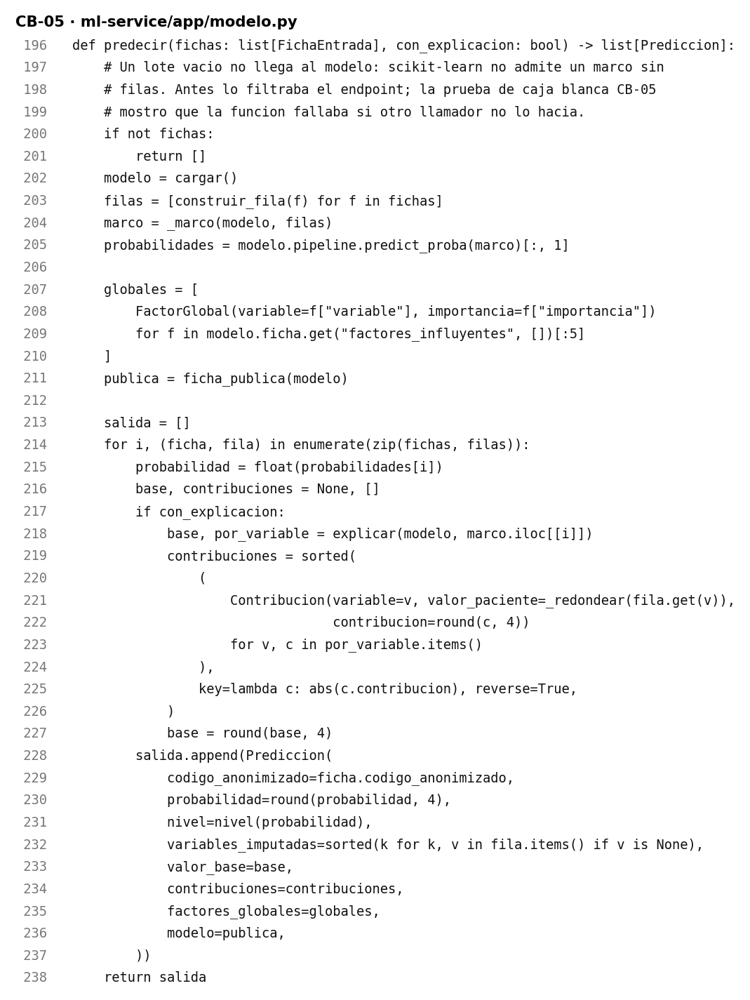

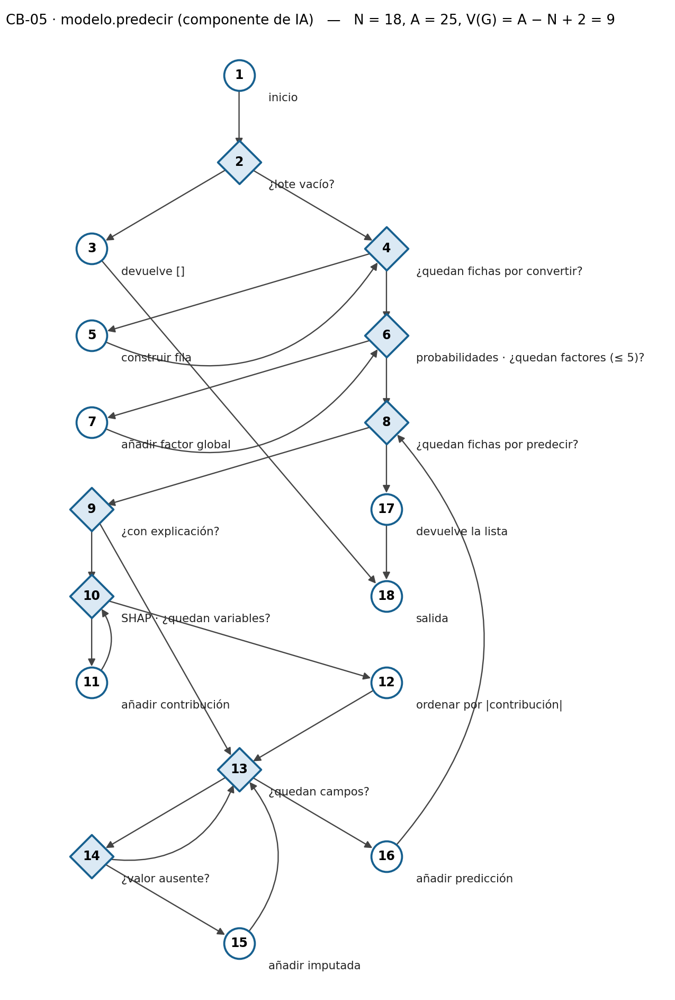

| Caso (ml-service/tests/test_caja_blanca.py) | Decisión o bucle que recorre | Resultado |
| :--- | :--- | :--- |
| `test_c1_lista_vacia` | Nodo 2 verdadero: lote vacío | Conforme (tras corregir el defecto D-06) |
| `test_c2_sin_explicacion` | Bucle de fichas, una iteración; nodo 9 falso | Conforme |
| `test_c3_con_explicacion` | Nodo 9 verdadero; bucle de contribuciones con varias iteraciones | Conforme |
| `test_c4_contribuciones_ordenadas_por_magnitud` | Nodo 12: orden por magnitud | Conforme |
| `test_c5_ficha_completa_sin_imputadas` | Nodo 14 siempre falso | Conforme |
| `test_c6_ficha_incompleta_declara_imputadas` | Nodo 14 verdadero | Conforme |
| `test_c7_factores_globales_recortados_a_cinco` | Bucle de factores, varias iteraciones con tope de cinco | Conforme |
| `test_c8_varias_fichas_conservan_el_orden` | Bucle de fichas, dos iteraciones | Conforme |
| `test_c9_modelo_sin_factores_globales` | Bucle de factores, cero iteraciones | Conforme |

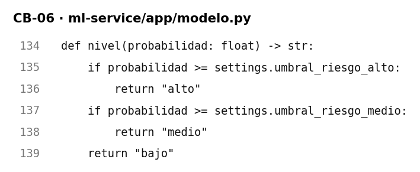

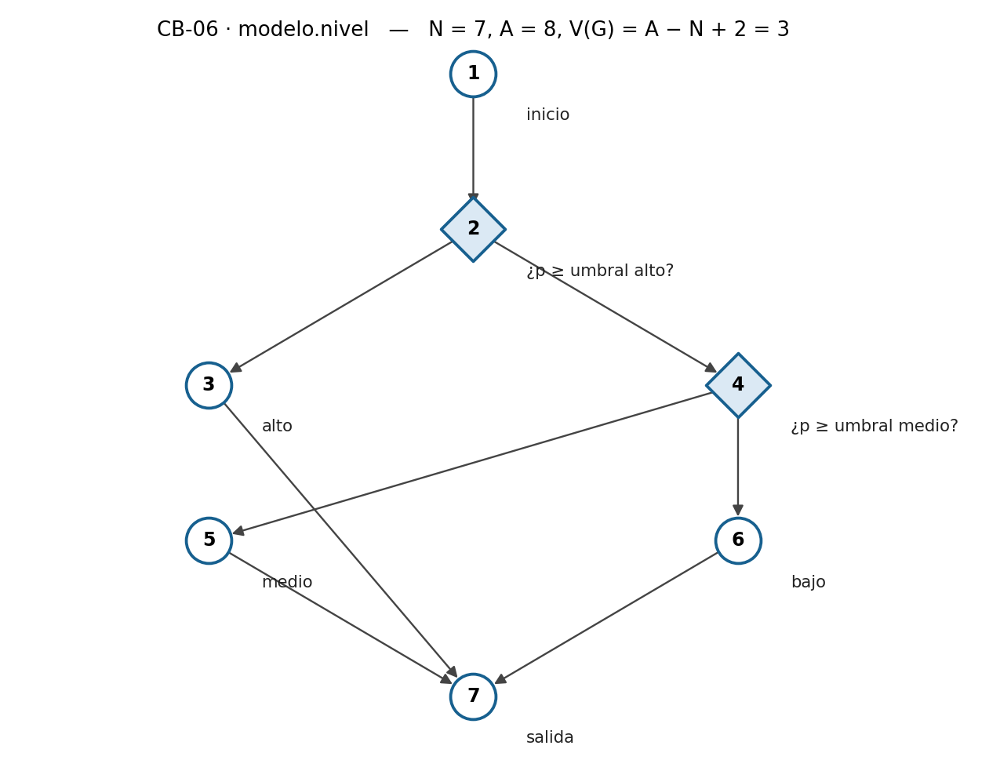

| Camino | Recorrido | Entrada | Esperado | Caso | Resultado |
| :--- | :--- | :--- | :--- | :--- | :--- |
| 1 | 1-2-3-7 | p = 0,70 (umbral alto) | alto | `test_c1_alto` | Conforme |
| 2 | 1-2-4-5-7 | p = 0,40 (umbral medio) | medio | `test_c2_medio` | Conforme |
| 3 | 1-2-4-6-7 | p = 0,3999 | bajo | `test_c3_bajo` | Conforme |

### CB-07 · Limpieza de los campos del formulario (panel web)

`limpiarAlEscribir` decide qué caracteres admite cada campo mientras el médico
escribe; para los numéricos delega en `limpiarNumero`.

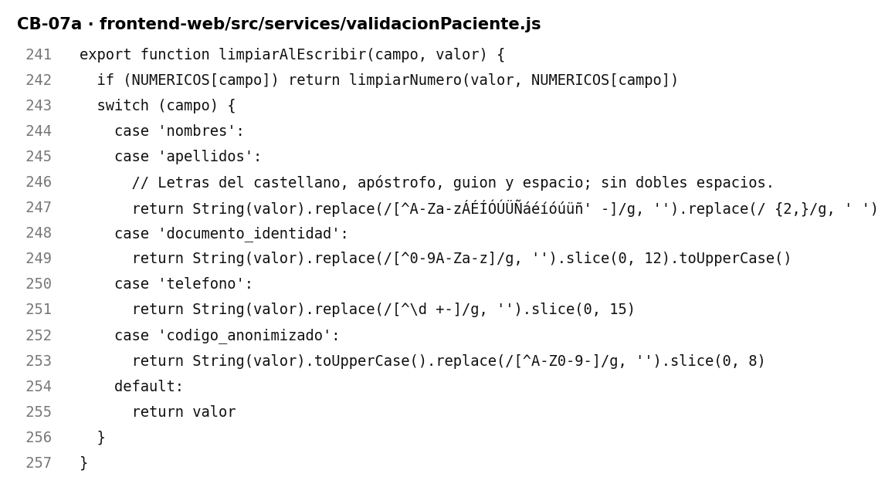

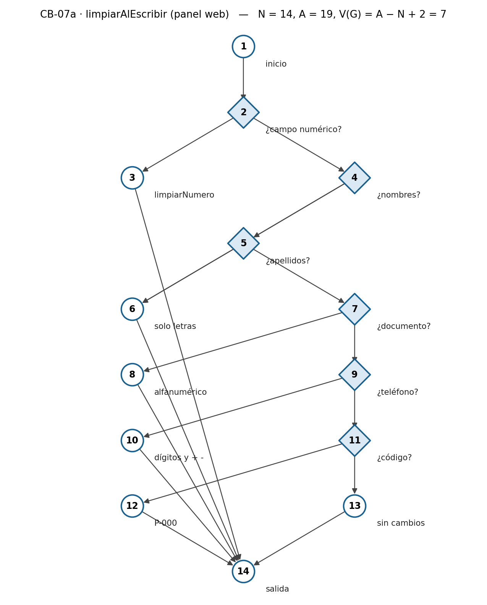

| Camino | Recorrido | Entrada | Salida | Caso (frontend-web/tests/caja_blanca.test.js) | Resultado |
| :--- | :--- | :--- | :--- | :--- | :--- |
| 1 | 1-2-3-14 | numero_farmacos «7a» | «7» | C1 | Conforme |
| 2 | 1-2-4-6-14 | nombres «Ana  María3» | «Ana María» | C2 | Conforme |
| 3 | 1-2-4-5-6-14 | apellidos «O'Brien-Díaz#» | «O'Brien-Díaz» | C3 | Conforme |
| 4 | 1-2-4-5-7-8-14 | documento «ce-12.345.678.901x» | «CE1234567890» | C4 | Conforme |
| 5 | 1-2-4-5-7-9-10-14 | teléfono «+51 987-654-321 ext» | «+51 987-654-321» | C5 | Conforme |
| 6 | 1-2-4-5-7-9-11-12-14 | código «p-00 7?xyz» | «P-007XYZ» | C6 | Conforme |
| 7 | 1-2-4-5-7-9-11-13-14 | correo | Sin cambios | C7 | Conforme |

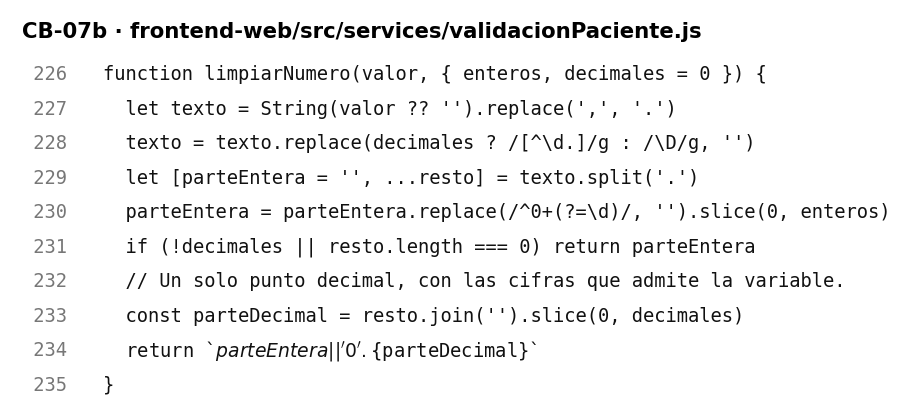

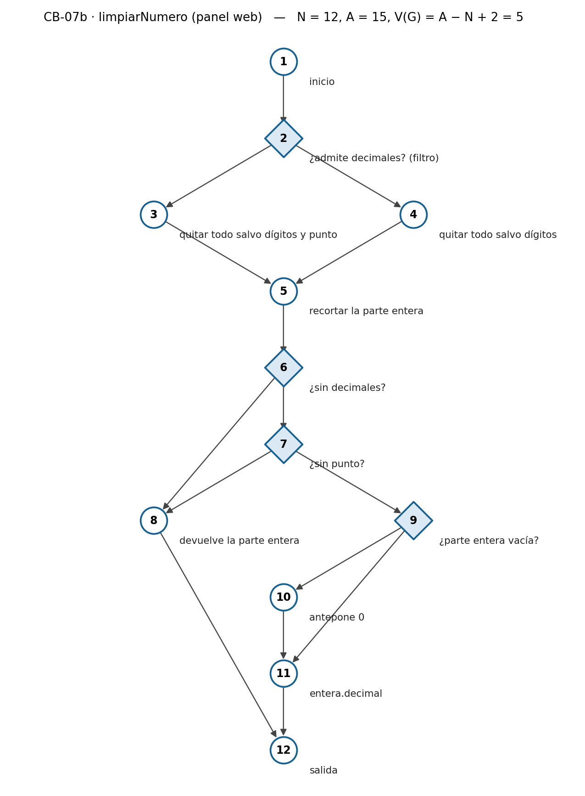

| Camino | Recorrido | Entrada | Salida | Caso | Resultado |
| :--- | :--- | :--- | :--- | :--- | :--- |
| 1 | 1-2-4-5-6-8-12 | edad «0a64» | «64» | C1 (y C2, valor límite de cifras: «1234» → «123») | Conforme |
| 2 | 1-2-3-5-6-7-8-12 | tiempo de enfermedad «12» | «12» | C3 | Conforme |
| 3 | 1-2-3-5-6-7-9-11-12 | «8,55» | «8.5» | C4 | Conforme |
| 4 | 1-2-3-5-6-7-9-10-11-12 | «.5» | «0.5» | C5 | Conforme |
| 5 | 1-2-4-5-6-7… | **No factible**: los nodos 2 y 6 evalúan la misma propiedad (si la variable admite decimales) | — | — |

### CB-08 y CB-09 · Tarjeta de toma de la aplicación móvil

La tarjeta decide qué ve el paciente según el estado de la dosis; dentro de
ella, `_Respuesta` muestra las líneas opcionales de una toma ya registrada.

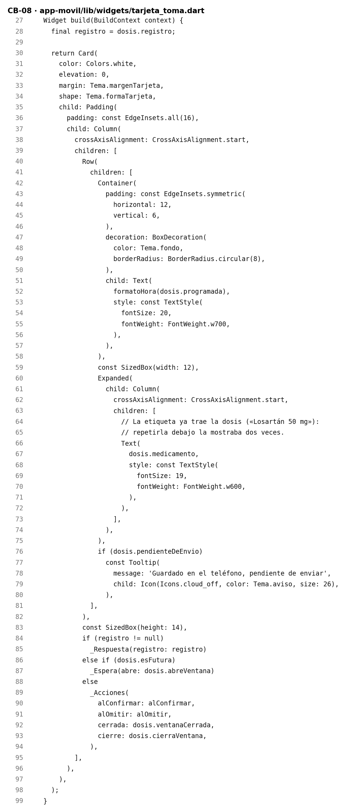

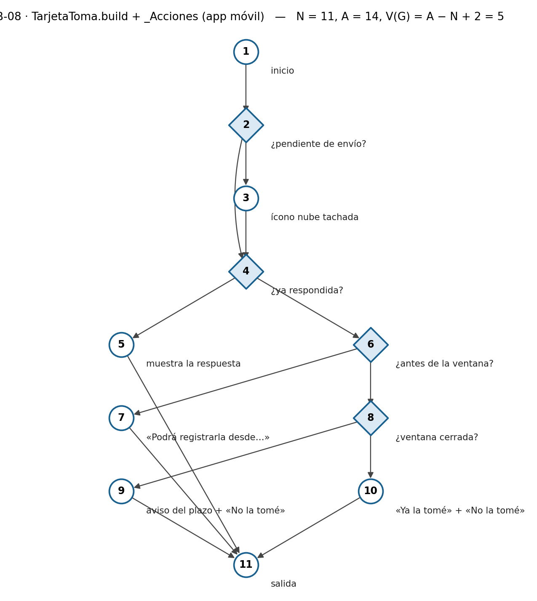

| Camino | Recorrido | Estado de la dosis | Se muestra | Caso (app-movil/test/caja_blanca_test.dart) | Resultado |
| :--- | :--- | :--- | :--- | :--- | :--- |
| 1 | 1-2-4-5-11 | Respondida | El estado, sin botones | C1 | Conforme |
| 2 | 1-2-4-6-7-11 | Faltan 3 h | «Podrá registrarla desde…» | C2 | Conforme |
| 3 | 1-2-4-6-8-10-11 | Ventana abierta | «Ya la tomé» y «No la tomé» | C3 | Conforme |
| 4 | 1-2-4-6-8-9-11 | Pasaron 4 h | Solo «No la tomé» y el aviso del plazo | C4 | Conforme |
| 5 | 1-2-3-4-6-8-10-11 | Pendiente de envío | Ícono de nube tachada | C5 | Conforme |

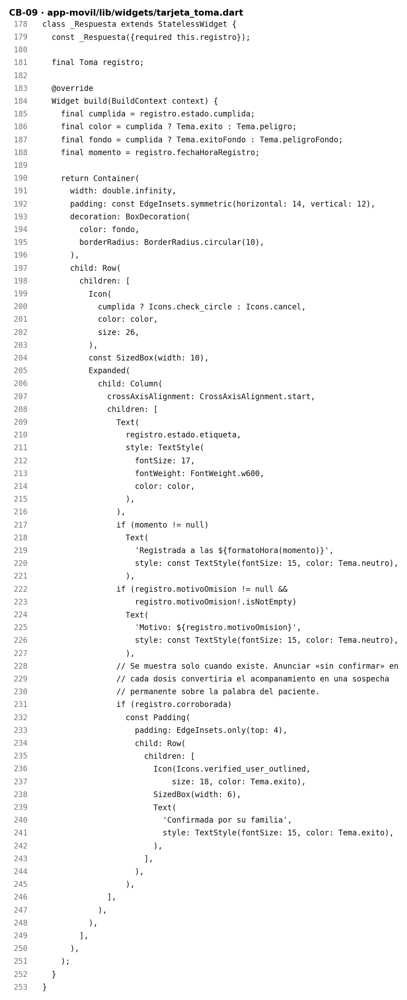

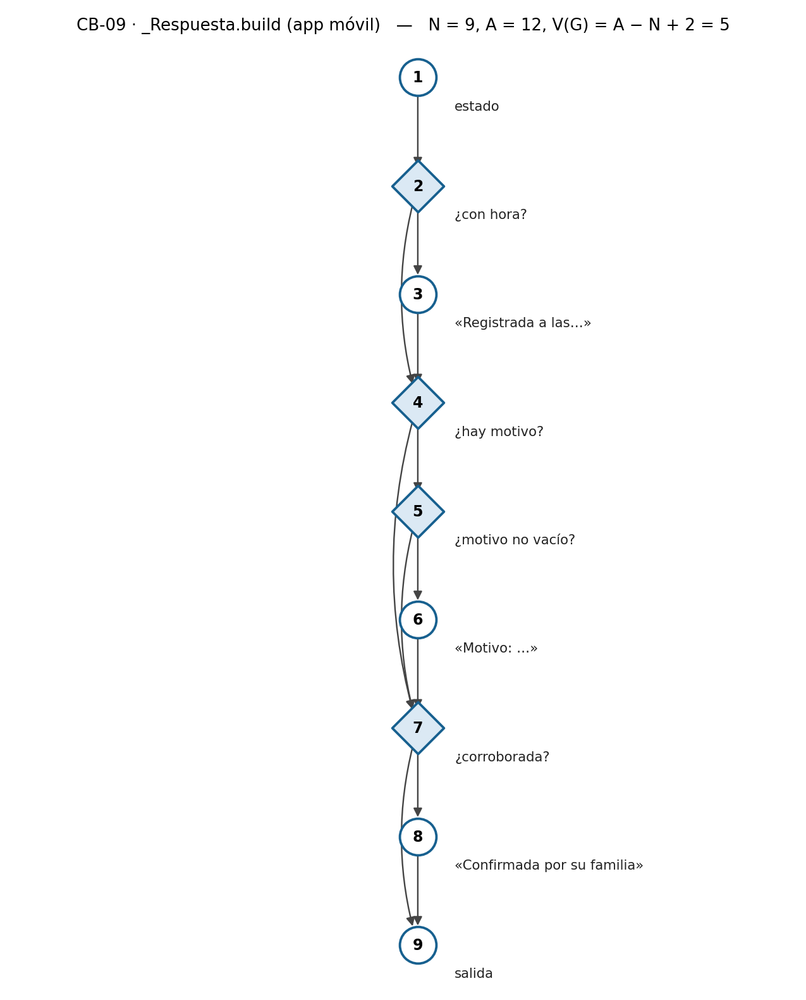

| Camino | Recorrido | Toma registrada | Caso | Resultado |
| :--- | :--- | :--- | :--- | :--- |
| 1 | 1-2-4-7-9 | Omitida sin motivo | C4 | Conforme |
| 2 | 1-2-4-5-6-7-9 | Omitida con motivo | C1 | Conforme |
| 3 | 1-2-4-5-7-9 | Omitida con motivo vacío | C2 | Conforme |
| 4 | 1-2-3-4-7-9 | Tomada sin corroborar | C5 | Conforme |
| 5 | 1-2-3-4-7-8-9 | Tomada y corroborada por el familiar | C3 | Conforme |

### CB-10 y CB-11 · Sincronización sin conexión de la aplicación móvil

Garantizan que ninguna toma se pierda sin internet: se guarda en una cola
local y se envía cuando hay conexión.

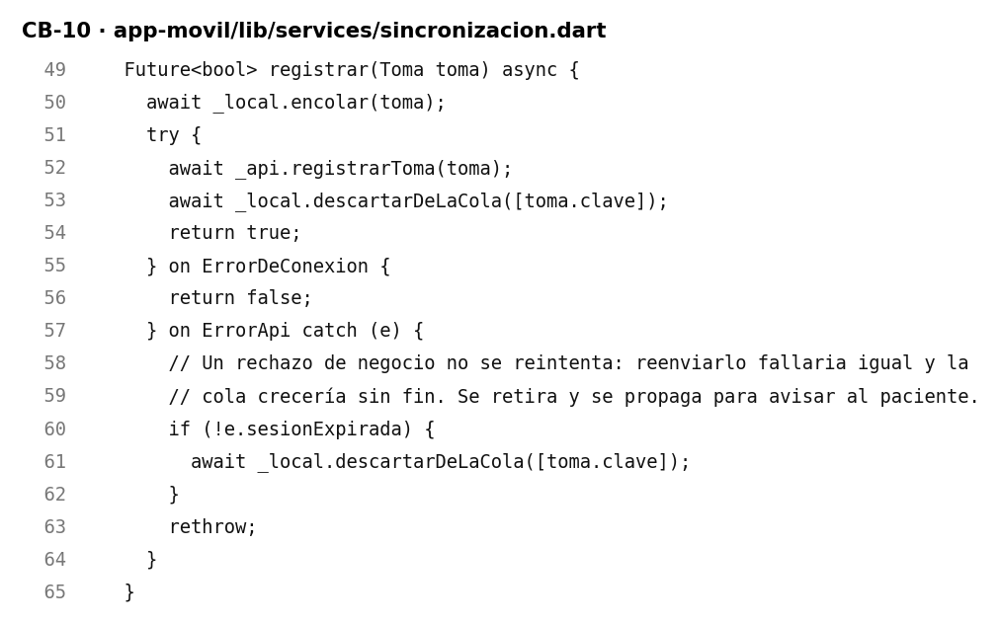

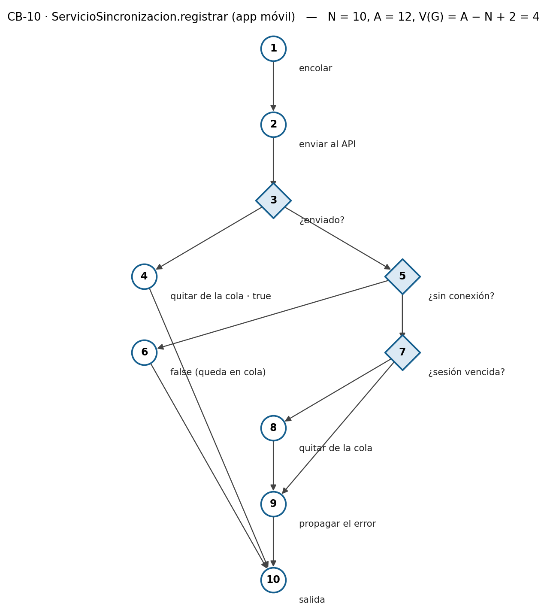

| Camino | Recorrido | Situación | Esperado | Caso | Resultado |
| :--- | :--- | :--- | :--- | :--- | :--- |
| 1 | 1-2-3-4-10 | El servidor acepta | true, cola vacía | C1 | Conforme |
| 2 | 1-2-3-5-6-10 | Sin conexión | false, la toma queda en cola | C2 | Conforme |
| 3 | 1-2-3-5-7-8-9-10 | Rechazo de negocio (422) | Error propagado, sale de la cola | C3 | Conforme |
| 4 | 1-2-3-5-7-9-10 | Sesión vencida (401) | Error propagado, la toma se conserva | C4 | Conforme |

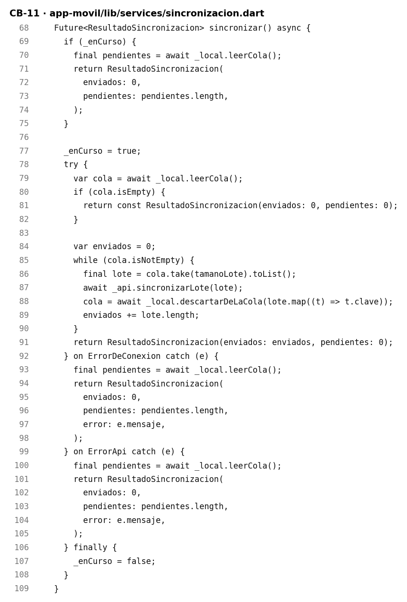

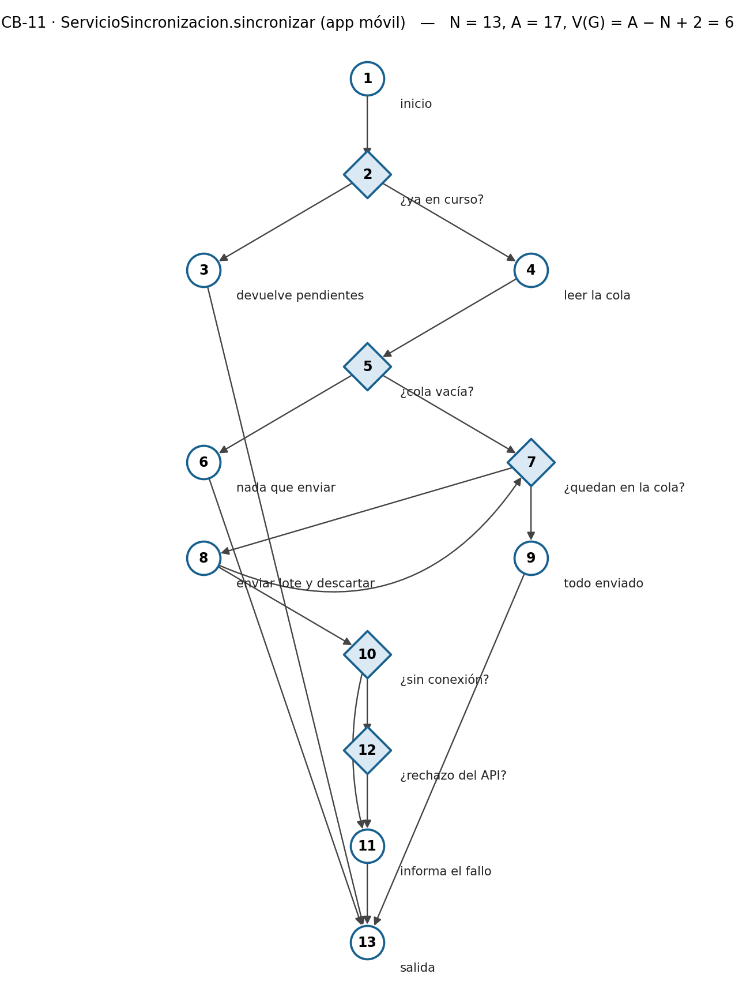

| Camino | Recorrido | Situación | Esperado | Caso | Resultado |
| :--- | :--- | :--- | :--- | :--- | :--- |
| 1 | 1-2-3-13 | Ya hay una sincronización en curso | No envía nada | C1 | Conforme |
| 2 | 1-2-4-5-6-13 | Cola vacía | Nada que enviar | C2 | Conforme |
| 3 | 1-2-4-5-7-8-7-9-13 | Tres tomas (bucle: una iteración) | 3 enviadas | C3 | Conforme |
| 4 | 1-2-4-5-7-8-7-8-7-9-13 | 205 tomas (bucle: dos lotes) | 205 enviadas | C4 | Conforme |
| 5 | 1-2-4-5-7-8-10-11-13 | Sin conexión | Fallo informado, cola intacta | C5 | Conforme |
| 6 | 1-2-4-5-7-8-10-12-11-13 | Rechazo del servidor (500) | Fallo informado, cola intacta | C6 | Conforme |

## 6. Cobertura de código por componente

Medida con **todas** las pruebas automatizadas de cada componente (las de
caja blanca y las demás), en la versión final.

| Componente | Pruebas | Sentencias | Ramas | Cobertura total |
| :--- | :---: | :---: | :---: | :---: |
| API central | 182 (+1 omitida) | 1 728 (97 sin cubrir) | 278 (33 parciales) | 92 % |
| Microservicio del modelo | 25 | 220 (11 sin cubrir) | 26 (3 parciales) | 94 % |
| Panel web (funciones de validación) | 12 | 100 % de las funciones objetivo | 100 % | Ver nota |
| Aplicación móvil | 62 | 574 de 1 755 líneas | No informa | 32,7 % |

**Aplicación móvil por capa:** lógica de negocio y servicios —modelos 75,7 %,
servicios 52,9 %, componentes visuales 95,1 %— y pantallas 13,9 %. Las
pantallas son interfaz y se verificaron con las pruebas manuales de caja negra
del Anexo n.° 24 (CN-M01 a CN-M10).

**Panel web.** Las pruebas unitarias cubren las funciones de limpieza de
campos. La función `validarFicha`, que muestra los avisos del formulario, se
verificó por caja negra a través de la interfaz (CN-54 a CN-58).

**Lo que queda sin cubrir en el API** es sobre todo el envío real de correos
(`services/correo.py`, 20 %), que requiere un servidor SMTP, y el arranque de
la aplicación (`main.py`), que las pruebas evitan a propósito para no tocar la
base de desarrollo.

## 7. Complejidad del código

`radon` analizó 234 funciones del API y del microservicio. La complejidad
ciclomática promedio es **2,5 (rango A, simple)**. Solo tres funciones superan
10:

| Función | V(G) | Rango | Lectura |
| :--- | :---: | :---: | :--- |
| `reportes.construir_reporte` | 32 | E | Arma en una sola función los once bloques del reporte general. Funciona y está cubierta al 97 %, pero es la candidata a dividirse en funciones por bloque en una siguiente versión |
| `adherencia._construir_resumen` | 15 | C | Calcula los indicadores de adherencia de un paciente; cubierta por las pruebas de RF03 |
| `alertas.evaluar_paciente` | 11 | C | Analizada en CB-03 con sus 11 caminos |

## 8. Hallazgos

| ID | Hallazgo | Cómo se detectó | Acción |
| :--- | :--- | :--- | :--- |
| D-06 | `predecir([])` fallaba con `TypeError`. El endpoint lo evitaba filtrando el lote vacío, pero cualquier otro llamador lo habría provocado (defecto latente) | Camino 1 de CB-05 | La guarda pasó a la propia función y se retiró la del endpoint; V(G) subió de 8 a 9 y se añadió el caso C9 |
| O-01 | Una prueba de CB-03 repetía un camino ya cubierto y dejaba sin recorrer la arista 14→15 | Revisión del conjunto de caminos básicos | Se reemplazó por el caso del camino 5 |
| O-02 | `construir_reporte` tiene V(G) = 32 | Métrica de `radon` | Se documenta como deuda técnica; no afecta al funcionamiento |

## 9. Cómo reproducir las pruebas

| Componente | Comando |
| :--- | :--- |
| Preparación (una vez) | `python -m pip install -r backend-api/requirements-dev.txt` |
| API | `cd backend-api` y `python -m pytest tests/test_caja_blanca.py -v` |
| API, cobertura completa | `python -m pytest --cov=app --cov-branch` |
| Modelo | `cd ml-service` y `.venv\Scripts\python -m pytest tests/test_caja_blanca.py -v` |
| Panel | `cd frontend-web` y `npm run test:cobertura` |
| App móvil | `cd app-movil` y `flutter test test/caja_blanca_test.dart --coverage` |
| Complejidad | `python -m radon cc backend-api/app ml-service/app -s -a` |
| Grafos | `python documentacion/07_pruebas/caja_blanca/grafos.py` |
