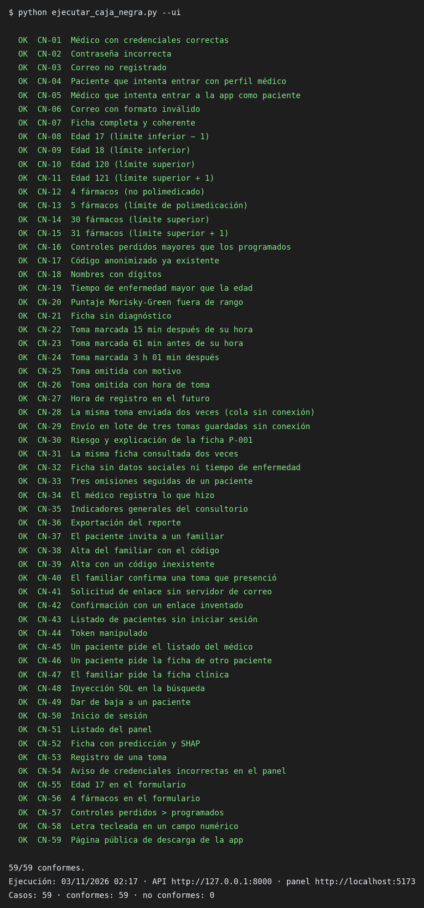
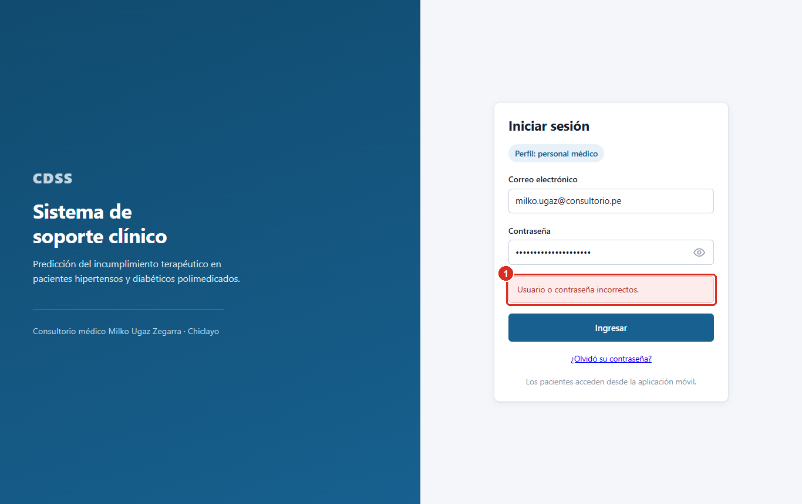
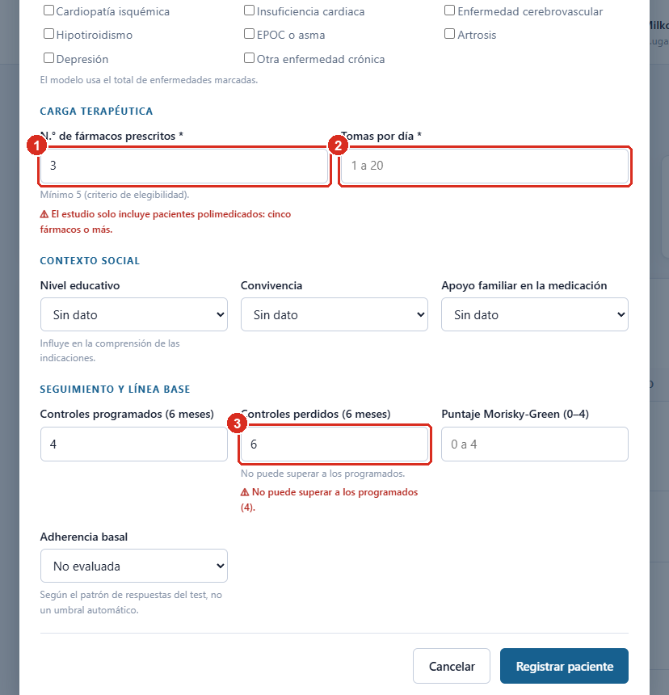
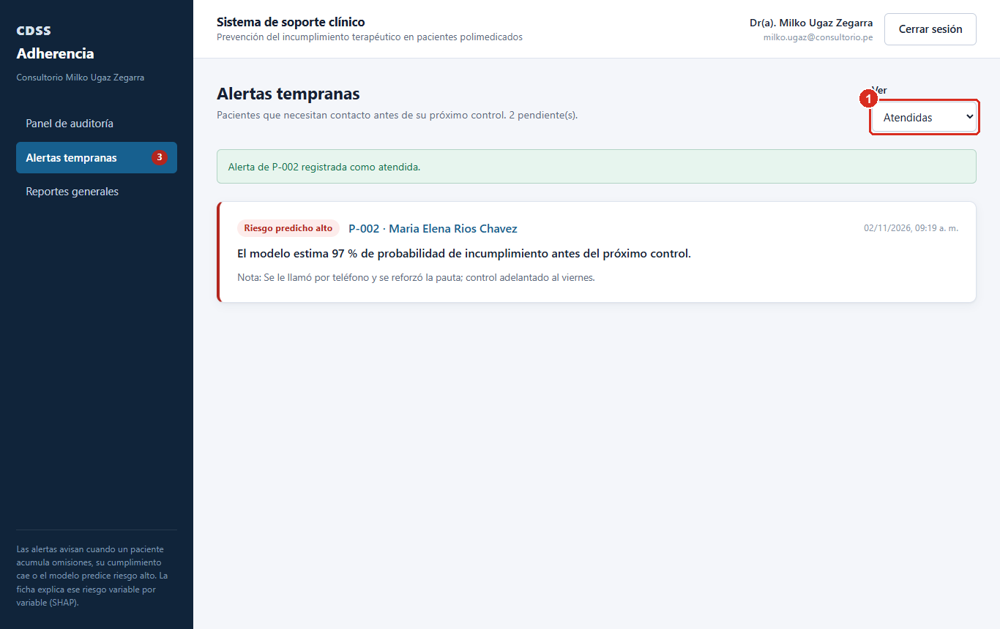
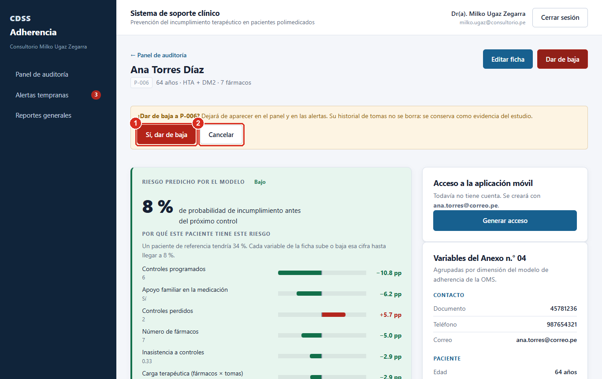
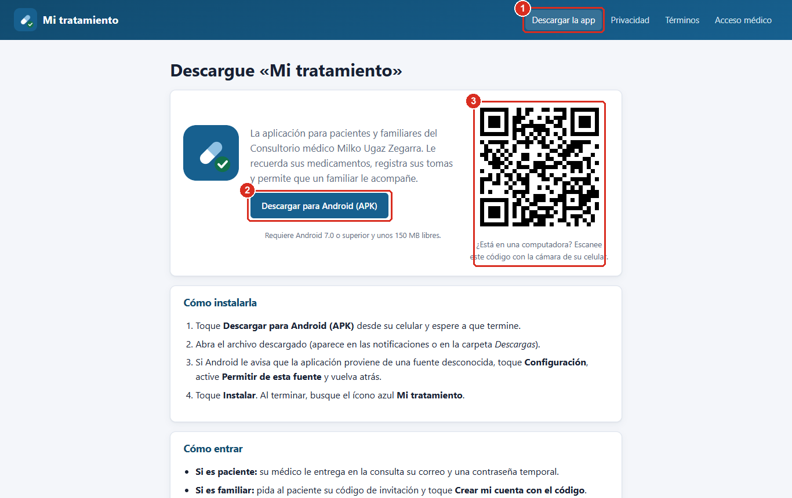
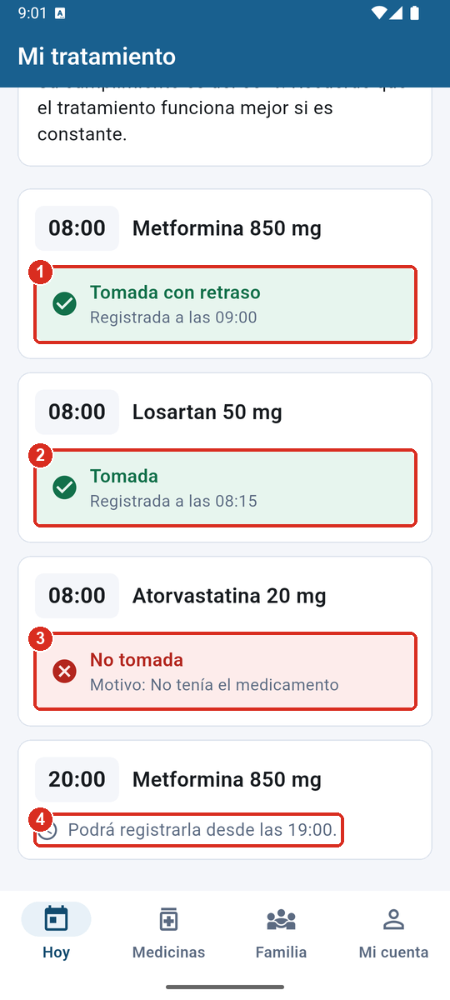
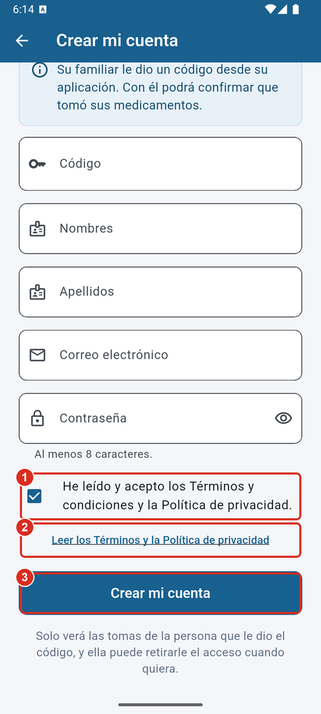

# ANEXO N.° 24: PRUEBAS DE CAJA NEGRA

## 1. Objetivo y alcance

Verificar que el sistema cumple sus requisitos funcionales y no funcionales
observándolo **solo desde fuera**: por las entradas que recibe y las salidas que
produce, sin considerar su código. Se prueban el panel médico, el API central,
el componente de inteligencia artificial y la aplicación móvil, sobre el
escenario principal del producto acreditable: el médico registra al paciente
polimedicado, el paciente registra sus tomas, el sistema estima el riesgo de
incumplimiento, lo explica y alerta al médico.

## 2. Entorno de ejecución

| Elemento | Detalle |
| :--- | :--- |
| Fecha de la ejecución final | 03/11/2026 02:17 |
| Equipo | Laptop con Windows 11, ejecución en modo local |
| Sistema bajo prueba | API central (FastAPI) en http://127.0.0.1:8000, microservicio del modelo en el puerto 8001 y panel (React) en http://localhost:5173 |
| Datos | Base de demostración recién cargada (pacientes ficticios P-001 a P-005, correos @ejemplo.pe) |
| Herramientas | Script `ejecutar_caja_negra.py` (peticiones HTTP con la biblioteca estándar de Python) y Playwright con Microsoft Edge para los casos de interfaz |
| Aplicación móvil | Emulador Android (Medium Phone, API 36) con la compilación de depuración |

Ningún caso usa datos reales de pacientes. El script crea sus propios
registros de prueba y debe ejecutarse solo sobre la base de demostración.

## 3. Técnicas de diseño aplicadas

| Técnica | En qué consiste | Dónde se aplicó |
| :--- | :--- | :--- |
| Partición de equivalencia | Se dividen las entradas en clases que el sistema debe tratar igual (válidas y no válidas) y se prueba un representante de cada una | Credenciales, formato de correo, campos obligatorios, códigos de invitación, entradas maliciosas |
| Análisis de valores límite | Se prueban los bordes de cada rango y el valor inmediatamente exterior | Edad (18–120), número de fármacos (5–30), puntaje Morisky-Green (0–4), ventana de registro (−60 min a +3 h) |
| Tabla de decisión | Se combinan condiciones y se fija la acción esperada para cada combinación | Perfil declarado × rol de la cuenta; rol × recurso solicitado; estado de la toma × hora informada; coherencia entre campos |
| Transición de estados | Se verifican los cambios de estado permitidos y prohibidos | Toma (en espera → registrable → cerrada), alerta (abierta → atendida), paciente (activo → dado de baja) |
| Casos de uso | Se recorre el flujo completo de una funcionalidad | Predicción y explicación, alertas, reportes, acompañamiento familiar, descarga de la app |
| Prueba de desempeño | Se mide el tiempo de respuesta de las operaciones principales con repeticiones | Inicio de sesión, listado, ficha con predicción, registro de toma |

## 4. Diseño de las pruebas

### 4.1 Clases de equivalencia y valores límite

| Entrada | Clases válidas | Clases no válidas | Valores límite probados |
| :--- | :--- | :--- | :--- |
| Edad (años) | 18 ≤ edad ≤ 120 | edad < 18; edad > 120 | 17 · 18 · 120 · 121 |
| N.° de fármacos | 5 ≤ n ≤ 30 (polimedicado) | n < 5; n > 30 | 4 · 5 · 30 · 31 |
| Puntaje Morisky-Green | 0 a 4 | > 4 | 5 |
| Controles perdidos | ≤ controles programados | > controles programados | 4 programados · 6 perdidos |
| Tiempo de enfermedad | ≤ edad | > edad | edad 30 · tiempo 40 |
| Nombres y apellidos | Letras, tildes, ñ, apóstrofo y guion | Con dígitos o símbolos | «Ana3» |
| Hora de registro de una toma cumplida | Desde 60 min antes hasta 3 h después de la hora programada, y no futura | Antes de la ventana; después de la ventana; posterior a la hora actual | −61 min · +3 h 1 min · ahora + 30 min |
| Correo de acceso | Formato nombre@dominio | Sin @ | «milko.ugaz» |
| Código de invitación | Vigente, emitido por el paciente | Inexistente o vencido | ZZZZ9999 |

### 4.2 Tabla de decisión: control de acceso (rol × recurso)

| Condición / acción | R1 | R2 | R3 | R4 | R5 | R6 |
| :--- | :---: | :---: | :---: | :---: | :---: | :---: |
| ¿Envía token? | No | Sí (alterado) | Sí | Sí | Sí | Sí |
| Rol de la cuenta | — | — | Paciente | Paciente | Familiar | Médico |
| Recurso pedido | Listado | Listado | Listado del médico | Ficha ajena | Ficha clínica | Su paciente |
| **Respuesta esperada** | 401 | 401 | 403 | 403 | 403 | 200 |
| Caso | CN-43 | CN-44 | CN-45 | CN-46 | CN-47 | CN-30 |

### 4.3 Transición de estados: la toma de un medicamento

| Estado de la dosis | Momento | Acción permitida | Caso |
| :--- | :--- | :--- | :--- |
| En espera | Antes de 60 min previos a la hora | Ninguna; se informa desde qué hora podrá registrarla | CN-M04 |
| Registrable | Desde 60 min antes hasta 3 h después | «Ya la tomé» o «No la tomé» | CN-22, CN-M03 |
| Cerrada | Más de 3 h después | Solo «No la tomé» | CN-24 |
| Registrada | Tras responder | Ninguna; se muestra el estado y la hora | CN-M03, CN-M05 |

## 5. Casos de prueba y resultados (ejecución final)

Se ejecutaron **59 casos automatizados**: **59 conformes** y **0 no conformes**. A ellos se suman 10 casos manuales de la aplicación móvil (apartado 6), también conformes.

| Técnica | Casos |
| :--- | :---: |
| Partición de equivalencia | 22 |
| Valores límite | 13 |
| Tabla de decisión | 9 |
| Caso de uso | 8 |
| Prueba de desempeño | 4 |
| Transición de estados | 3 |

### RF01 · Autenticación con perfil diferenciado

| ID | Técnica | Caso y entrada | Resultado esperado | Resultado obtenido | Estado |
| :--- | :--- | :--- | :--- | :--- | :--- |
| CN-01 | Partición de equivalencia (clase válida) | Médico con credenciales correctas. *Entrada:* milko.ugaz@consultorio.pe · contraseña correcta · perfil médico | HTTP 200 y token de sesión | HTTP 200. Token emitido | Conforme |
| CN-02 | Partición de equivalencia (clase no válida) | Contraseña incorrecta. *Entrada:* milko.ugaz@consultorio.pe · contraseña errónea | HTTP 401 «Usuario o contraseña incorrectos.» | HTTP 401. Usuario o contraseña incorrectos. | Conforme |
| CN-03 | Partición de equivalencia (clase no válida) | Correo no registrado. *Entrada:* noexiste@correo.pe | HTTP 401 con el mismo mensaje que CN-02 (no revela qué cuentas existen) | HTTP 401. Usuario o contraseña incorrectos. | Conforme |
| CN-04 | Tabla de decisión (rol × perfil declarado) | Paciente que intenta entrar con perfil médico. *Entrada:* p-001@ejemplo.pe · perfil médico | HTTP 401: el perfil no corresponde a la cuenta | HTTP 401. Usuario o contraseña incorrectos. | Conforme |
| CN-05 | Tabla de decisión (rol × perfil declarado) | Médico que intenta entrar a la app como paciente. *Entrada:* milko.ugaz@consultorio.pe · perfil paciente | HTTP 401 | HTTP 401. Usuario o contraseña incorrectos. | Conforme |
| CN-06 | Partición de equivalencia (formato no válido) | Correo con formato inválido. *Entrada:* «milko.ugaz» sin dominio | HTTP 422: validación de formato | HTTP 422. El correo electrónico no es válido. | Conforme |
| CN-54 | Partición de equivalencia (UI) | Aviso de credenciales incorrectas en el panel. *Entrada:* Contraseña errónea | Mensaje visible «Usuario o contraseña incorrectos.» | Aviso en pantalla: «Usuario o contraseña incorrectos.» | Conforme |

### RF02 · Registro y gestión del paciente polimedicado

| ID | Técnica | Caso y entrada | Resultado esperado | Resultado obtenido | Estado |
| :--- | :--- | :--- | :--- | :--- | :--- |
| CN-07 | Partición de equivalencia (clase válida) | Ficha completa y coherente. *Entrada:* Edad 64, 7 fármacos, 4 tomas, 6/2 controles, Morisky 2 | HTTP 201 y código P-xxx asignado | HTTP 201. Código asignado P-006 | Conforme |
| CN-08 | Valores límite | Edad 17 (límite inferior − 1). *Entrada:* edad = 17 | HTTP 422 (rechazada) | HTTP 422. Debe ser mayor o igual a 18. | Conforme |
| CN-09 | Valores límite | Edad 18 (límite inferior). *Entrada:* edad = 18 | HTTP 201 (aceptada) | HTTP 201. Código asignado P-007 | Conforme |
| CN-10 | Valores límite | Edad 120 (límite superior). *Entrada:* edad = 120 | HTTP 201 (aceptada) | HTTP 201. Código asignado P-008 | Conforme |
| CN-11 | Valores límite | Edad 121 (límite superior + 1). *Entrada:* edad = 121 | HTTP 422 (rechazada) | HTTP 422. Debe ser menor o igual a 120. | Conforme |
| CN-12 | Valores límite | 4 fármacos (no polimedicado). *Entrada:* numero_farmacos = 4 | HTTP 422 (rechazada) | HTTP 422. Debe ser mayor o igual a 5. | Conforme |
| CN-13 | Valores límite | 5 fármacos (límite de polimedicación). *Entrada:* numero_farmacos = 5 | HTTP 201 (aceptada) | HTTP 201. Código asignado P-009 | Conforme |
| CN-14 | Valores límite | 30 fármacos (límite superior). *Entrada:* numero_farmacos = 30 | HTTP 201 (aceptada) | HTTP 201. Código asignado P-010 | Conforme |
| CN-15 | Valores límite | 31 fármacos (límite superior + 1). *Entrada:* numero_farmacos = 31 | HTTP 422 (rechazada) | HTTP 422. Debe ser menor o igual a 30. | Conforme |
| CN-16 | Tabla de decisión (coherencia entre campos) | Controles perdidos mayores que los programados. *Entrada:* programados 4 · perdidos 6 | HTTP 422 «Los controles perdidos no pueden superar a los programados.» | HTTP 422. Los controles perdidos no pueden superar a los programados. | Conforme |
| CN-17 | Partición de equivalencia (clave duplicada) | Código anonimizado ya existente. *Entrada:* codigo_anonimizado = P-001 | HTTP 409: el código ya existe | HTTP 409. Ya existe un paciente con el código P-001. | Conforme |
| CN-18 | Partición de equivalencia (clase no válida) | Nombres con dígitos. *Entrada:* nombres = «Ana3» | HTTP 422: los nombres solo admiten letras | HTTP 422. Solo se admiten letras, espacios, apóstrofos y guiones. | Conforme |
| CN-19 | Tabla de decisión (coherencia entre campos) | Tiempo de enfermedad mayor que la edad. *Entrada:* edad 30 · tiempo de enfermedad 40 | HTTP 422: no puede superar la edad | HTTP 422. El tiempo de enfermedad no puede superar la edad del paciente. | Conforme |
| CN-20 | Valores límite | Puntaje Morisky-Green fuera de rango. *Entrada:* puntaje_morisky = 5 | HTTP 422 | HTTP 422. Debe ser menor o igual a 4. | Conforme |
| CN-21 | Partición de equivalencia (campo obligatorio ausente) | Ficha sin diagnóstico. *Entrada:* diagnostico omitido | HTTP 422 | HTTP 422. Campo obligatorio. | Conforme |
| CN-49 | Transición de estados (activo → dado de baja) | Dar de baja a un paciente. *Entrada:* DELETE ficha del paciente de CN-33 | Sale del listado y ya no puede registrar tomas; el historial se conserva | Baja: HTTP 200. En el listado: 0. Nuevo registro de toma: HTTP 409 (El paciente está dado de baja del seguimiento; no admite nue) | Conforme |
| CN-55 | Valores límite (UI) | Edad 17 en el formulario. *Entrada:* edad = 17 | Mensaje junto al campo y el formulario no se envía | Mensaje junto al campo: «El estudio incluye personas adultas: entre 18 y 120 años.». Formulario sin enviar: True | Conforme |
| CN-56 | Valores límite (UI) | 4 fármacos en el formulario. *Entrada:* numero_farmacos = 4 | Mensaje «solo incluye pacientes polimedicados» y no se envía | Mensaje junto al campo: «El estudio solo incluye pacientes polimedicados: cinco fármacos o más.». Formulario sin enviar: True | Conforme |
| CN-57 | Tabla de decisión (UI) | Controles perdidos > programados. *Entrada:* programados 4 · perdidos 6 | Mensaje «No puede superar a los programados» y no se envía | Mensaje junto al campo: «No puede superar a los programados (4).». Formulario sin enviar: True | Conforme |
| CN-58 | Partición de equivalencia (UI, carácter no válido) | Letra tecleada en un campo numérico. *Entrada:* edad: «6a4» | La letra no se admite; queda «64» | Tecleado «6a4», queda «64» | Conforme |

### RF03 · Registro de tomas y ventana de registro

| ID | Técnica | Caso y entrada | Resultado esperado | Resultado obtenido | Estado |
| :--- | :--- | :--- | :--- | :--- | :--- |
| CN-22 | Transición de estados (ventana abierta) | Toma marcada 15 min después de su hora. *Entrada:* tomada · registro = programada + 15 min | HTTP 201 y retraso de 15 min | HTTP 201. Retraso calculado: 15.0 min | Conforme |
| CN-23 | Valores límite (apertura de la ventana) | Toma marcada 61 min antes de su hora. *Entrada:* tomada · registro = programada − 61 min | HTTP 422 «Fuera de la ventana de registro…» | HTTP 422. Fuera de la ventana de registro: una toma se puede marcar como cumplida desde 60 minutos antes hasta 3 horas después de su hora. | Conforme |
| CN-24 | Valores límite (cierre de la ventana) | Toma marcada 3 h 01 min después. *Entrada:* tomada · registro = programada + 3 h 1 min | HTTP 422 «Fuera de la ventana de registro…» | HTTP 422. Fuera de la ventana de registro: una toma se puede marcar como cumplida desde 60 minutos antes hasta 3 horas después de su hora. | Conforme |
| CN-25 | Partición de equivalencia (omisión válida) | Toma omitida con motivo. *Entrada:* omitida · motivo «olvido» | HTTP 201 | HTTP 201. Sin mensaje | Conforme |
| CN-26 | Tabla de decisión (estado × hora) | Toma omitida con hora de toma. *Entrada:* omitida · con fecha_hora_registro | HTTP 422 | HTTP 422. Una toma omitida no puede llevar hora de toma; use 'tomada_tarde'. | Conforme |
| CN-27 | Partición de equivalencia (reloj adelantado) | Hora de registro en el futuro. *Entrada:* tomada · registro = ahora + 30 min | HTTP 422 «posterior a la hora actual» | HTTP 422. La hora de la toma es posterior a la hora actual. Revise la hora del teléfono. | Conforme |
| CN-28 | Partición de equivalencia (reenvío) | La misma toma enviada dos veces (cola sin conexión). *Entrada:* Dos envíos del mismo medicamento y hora | Un solo registro (el segundo actualiza al primero) | Envíos: HTTP 201 y 200. Registros resultantes: 1 | Conforme |
| CN-29 | Caso de uso (sincronización diferida) | Envío en lote de tres tomas guardadas sin conexión. *Entrada:* Lote de 3 tomas omitidas | HTTP 200/201 con 3 creados | HTTP 200. Creados: 3, actualizados: 0 | Conforme |

### RF04 y RF06 · Predicción de riesgo y explicación (componente de IA)

| ID | Técnica | Caso y entrada | Resultado esperado | Resultado obtenido | Estado |
| :--- | :--- | :--- | :--- | :--- | :--- |
| CN-30 | Caso de uso (escenario principal) | Riesgo y explicación de la ficha P-001. *Entrada:* GET predicción de P-001 | Probabilidad entre 0 y 1, nivel bajo/medio/alto y contribuciones SHAP | HTTP 200. Probabilidad 0.5467, nivel «medio», 15 contribuciones SHAP | Conforme |
| CN-31 | Partición de equivalencia (misma entrada) | La misma ficha consultada dos veces. *Entrada:* Dos consultas de P-001 | La misma probabilidad (resultado reproducible) | Consultas: 0.5467 y 0.5467 | Conforme |
| CN-32 | Partición de equivalencia (datos opcionales ausentes) | Ficha sin datos sociales ni tiempo de enfermedad. *Entrada:* Ficha mínima obligatoria | La predicción declara qué variables imputó | Variables imputadas declaradas: apoyo_familiar, convivencia, cronicidad_relativa, nivel_educativo, tiempo_enfermedad_anios | Conforme |

### RF05 · Alertas tempranas

| ID | Técnica | Caso y entrada | Resultado esperado | Resultado obtenido | Estado |
| :--- | :--- | :--- | :--- | :--- | :--- |
| CN-33 | Caso de uso (regla de negocio) | Tres omisiones seguidas de un paciente. *Entrada:* 3 tomas omitidas consecutivas | Aparece la alerta «omisiones seguidas» en la bandeja del médico | Alertas del paciente P-012: omisiones_seguidas | Conforme |
| CN-34 | Transición de estados (abierta → atendida) | El médico registra lo que hizo. *Entrada:* Nota de atención | Estado «atendida» y sale de la bandeja de pendientes | HTTP 200. Estado: atendida. Ya no está en pendientes | Conforme |

### RF07 · Reportes generales

| ID | Técnica | Caso y entrada | Resultado esperado | Resultado obtenido | Estado |
| :--- | :--- | :--- | :--- | :--- | :--- |
| CN-35 | Caso de uso | Indicadores generales del consultorio. *Entrada:* GET reporte general | HTTP 200 con indicadores | HTTP 200. Pacientes activos: 12 | Conforme |
| CN-36 | Caso de uso | Exportación del reporte. *Entrada:* GET reporte CSV | Archivo CSV con encabezado y una fila por paciente | HTTP 200. text/csv; charset=utf-8. 12 filas. Encabezado: Codigo,Paciente,Edad,Diagnostico,Farmacos,Comorbilidades,To… | Conforme |

### RF09 · Acompañamiento familiar

| ID | Técnica | Caso y entrada | Resultado esperado | Resultado obtenido | Estado |
| :--- | :--- | :--- | :--- | :--- | :--- |
| CN-37 | Caso de uso | El paciente invita a un familiar. *Entrada:* Carlos · hijo | HTTP 201 y código de invitación de 8 caracteres | HTTP 201. Código de 8 caracteres | Conforme |
| CN-38 | Partición de equivalencia (código válido) | Alta del familiar con el código. *Entrada:* Código vigente + datos válidos | HTTP 201 y sesión iniciada | HTTP 201. Cuenta creada con sesión | Conforme |
| CN-39 | Partición de equivalencia (código no válido) | Alta con un código inexistente. *Entrada:* codigo = ZZZZ9999 | Rechazo «El código no es válido o ya venció» | HTTP 404. El código no es válido o ya venció. Pida uno nuevo al paciente. | Conforme |
| CN-40 | Caso de uso | El familiar confirma una toma que presenció. *Entrada:* rosa.p-001@ejemplo.pe · primera toma pendiente | Confirmación aceptada | HTTP 200. Confirmada la toma de Losartan 50 mg | Conforme |

### RF10 · Recuperación de contraseña

| ID | Técnica | Caso y entrada | Resultado esperado | Resultado obtenido | Estado |
| :--- | :--- | :--- | :--- | :--- | :--- |
| CN-41 | Partición de equivalencia (correo desactivado en modo local) | Solicitud de enlace sin servidor de correo. *Entrada:* milko.ugaz@consultorio.pe | HTTP 202 que remite al consultorio, sin fingir un envío | HTTP 202. El envío de correos no está disponible. Solicite el restablecimiento en el consultorio. | Conforme |
| CN-42 | Partición de equivalencia (enlace no válido) | Confirmación con un enlace inventado. *Entrada:* testigo aleatorio | Rechazo «El enlace no es válido o ya venció» | HTTP 404. El enlace no es válido o ya venció. Pida uno nuevo. | Conforme |

### RNF01 · Seguridad y protección

| ID | Técnica | Caso y entrada | Resultado esperado | Resultado obtenido | Estado |
| :--- | :--- | :--- | :--- | :--- | :--- |
| CN-43 | Partición de equivalencia (sin credenciales) | Listado de pacientes sin iniciar sesión. *Entrada:* Sin token | HTTP 401 | HTTP 401. No se envió el token de acceso. | Conforme |
| CN-44 | Partición de equivalencia (token alterado) | Token manipulado. *Entrada:* Token del médico con la firma alterada | HTTP 401 | HTTP 401. Token inválido o expirado. | Conforme |
| CN-45 | Tabla de decisión (rol × recurso) | Un paciente pide el listado del médico. *Entrada:* Token de paciente → /api/pacientes | HTTP 403 | HTTP 403. Su perfil no tiene permisos para acceder a este recurso. | Conforme |
| CN-46 | Tabla de decisión (rol × recurso) | Un paciente pide la ficha de otro paciente. *Entrada:* Token de P-001 → ficha de P-002 | HTTP 403 | HTTP 403. Solo puede consultar su propia ficha clínica. | Conforme |
| CN-47 | Tabla de decisión (rol × recurso) | El familiar pide la ficha clínica. *Entrada:* Token de familiar → ficha de P-001 | HTTP 403 | HTTP 403. Su perfil de acompañante no da acceso a la ficha clínica. | Conforme |
| CN-48 | Partición de equivalencia (entrada maliciosa) | Inyección SQL en la búsqueda. *Entrada:* busqueda = «' OR 1=1 --» | HTTP 200 sin resultados: el texto se trata como dato | HTTP 200. Resultados: 0 | Conforme |

### RNF02 · Desempeño

| ID | Técnica | Caso y entrada | Resultado esperado | Resultado obtenido | Estado |
| :--- | :--- | :--- | :--- | :--- | :--- |
| CN-50 | Prueba de desempeño | Inicio de sesión. *Entrada:* 10 peticiones seguidas | p95 ≤ 2000 ms | Media 260 ms · p95 281 ms · máx 281 ms | Conforme |
| CN-51 | Prueba de desempeño | Listado del panel. *Entrada:* 10 peticiones seguidas | p95 ≤ 2000 ms | Media 18 ms · p95 30 ms · máx 31 ms | Conforme |
| CN-52 | Prueba de desempeño | Ficha con predicción y SHAP. *Entrada:* 10 peticiones seguidas | p95 ≤ 2000 ms | Media 145 ms · p95 165 ms · máx 168 ms | Conforme |
| CN-53 | Prueba de desempeño | Registro de una toma. *Entrada:* 10 peticiones seguidas | p95 ≤ 2000 ms | Media 38 ms · p95 53 ms · máx 55 ms | Conforme |

### Descarga de la aplicación

| ID | Técnica | Caso y entrada | Resultado esperado | Resultado obtenido | Estado |
| :--- | :--- | :--- | :--- | :--- | :--- |
| CN-59 | Caso de uso (UI) | Página pública de descarga de la app. *Entrada:* /descargar sin iniciar sesión | Botón de descarga y código QR visibles | Enlace al APK: /descargas/mi-tratamiento.apk. Código QR visible: True | Conforme |

## 6. Pruebas manuales de la aplicación móvil

Se ejecutaron en el emulador, como un paciente y un familiar, sin consultar el
código. Las capturas de cada paso están en el manual de usuario (Anexo n.° 23).

| ID | Caso | Entrada | Resultado esperado | Resultado obtenido | Estado |
| :--- | :--- | :--- | :--- | :--- | :--- |
| CN-M01 | Inicio de sesión del paciente | p-001@ejemplo.pe y su contraseña | Pantalla «Hoy» con su cumplimiento | «Hola, Jose Luis» y 50 % de tomas cumplidas | Conforme |
| CN-M02 | Registrar un medicamento con dos horas | Metformina 850 mg · 08:00 y 20:00 | Aparece en la lista y se programan las alertas | Listado con «08:00 · 20:00» y aviso «Sus alertas están activas» | Conforme |
| CN-M03 | «Ya la tomé» dentro de la ventana | Dosis de las 08:00 marcada a las 09:00 | Confirmación y estado «Tomada con retraso» | «Registrado. ¡Gracias!» y «Tomada con retraso · Registrada a las 09:00» | Conforme |
| CN-M04 | Dosis antes de que abra la ventana | Dosis de las 20:00 consultada a las 09:00 | Sin botones, con la hora de apertura | «Podrá registrarla desde las 19:00.» | Conforme |
| CN-M05 | «No la tomé» con motivo | Atorvastatina · «No tenía el medicamento» | Estado «No tomada» con el motivo | «No tomada · Motivo: No tenía el medicamento» | Conforme |
| CN-M06 | Invitar a un familiar | Carlos · hijo o hija | Código de 8 caracteres con vencimiento | Código de 8 caracteres, «El código vence en 8 días» | Conforme |
| CN-M07 | El familiar confirma una toma | rosa.p-001@ejemplo.pe · «Sí, la tomó» | Confirmación y la toma sale de la lista | «Confirmado. Gracias.» | Conforme |
| CN-M08 | Cerrar sesión | Mi cuenta → Cerrar sesión → confirmar | Vuelve al inicio y conserva el plan | Pantalla de inicio de sesión; el plan sigue en el teléfono | Conforme |
| CN-M09 | Volver a la app tras iniciar sesión | Iniciar sesión, salir al inicio de Android y volver | La pantalla «Hoy» carga sin error | Carga sin error (tras corregir el defecto D-01) | Conforme |
| CN-M10 | Crear la cuenta del familiar sin aceptar los términos | Datos válidos, casilla sin marcar | No se crea la cuenta y se pide aceptar | Mensaje «Para crear su cuenta debe aceptar los Términos y la Política de privacidad.» | Conforme |

## 7. Ciclo de ejecución y defectos

Las pruebas se ejecutaron en ciclos: ejecutar, registrar los resultados no
conformes, corregir y volver a ejecutar la batería completa (regresión). Los
resultados de cada ejecución se conservan junto al script.

| Ejecución | Fecha | Casos | Conformes | No conformes | Qué cambió antes de la siguiente |
| :--- | :--- | :---: | :---: | :---: | :--- |
| 1 | 03/11/2026 01:53 | 59 | 55 | 4 | CN-18 y CN-19: defectos del API, corregidos (D-03 y D-04). CN-37 y CN-38: error del propio caso de prueba, que leía un campo con otro nombre; se corrigió el caso |
| 2 | 03/11/2026 01:57 | 59 | 59 | 0 | Se tradujeron al castellano los mensajes de validación (D-05) y se reforzaron las comprobaciones de CN-22 y CN-29 |
| 3 (final) | 03/11/2026 02:17 | 59 | 59 | 0 | — |

| ID | Origen | Defecto | Severidad | Corrección | Verificación |
| :--- | :--- | :--- | :--- | :--- | :--- |
| D-01 | Prueba manual de la app (CN-M09) | Tras iniciar sesión, todas las peticiones fallaban con «Client is already closed»: la app mostraba «sin conexión» hasta reabrirse | Alta | El cliente HTTP pasó a vivir lo que vive la aplicación y no la pantalla de arranque | Prueba automática de regresión y CN-M09 |
| D-02 | Prueba manual de la app | La dosis aparecía repetida («Metformina 850 mg / 850 mg») en la tarjeta y en la vista del familiar | Baja | Se muestra una sola vez | Prueba automática y nueva captura |
| D-03 | CN-18 | El API aceptaba nombres con dígitos; solo el panel lo impedía | Media | Validación en el servidor, en el alta y en la edición | CN-18 y prueba de regresión |
| D-04 | CN-19 | El API aceptaba un tiempo de enfermedad mayor que la edad | Media | Validación en el alta y sobre el estado resultante de una edición | CN-19 y prueba de regresión |
| D-05 | Ejecución 2 (observación de usabilidad) | Los rechazos del API llegaban en inglés («Input should be greater than or equal to 18») y algunos mensajes sin tildes | Baja | Traducción central de los mensajes de validación | CN-06, CN-08, CN-21 y prueba de regresión |

## 8. Correspondencia con la lista de cotejo del producto acreditable

| Criterio de la lista de cotejo | Casos que lo evidencian |
| :--- | :--- |
| 3. La función principal genera resultados coherentes | CN-07, CN-22, CN-30, CN-31, CN-33 |
| 5. Retroalimentación comprensible | CN-02, CN-16, CN-19, CN-23, CN-54 a CN-57, CN-M03 |
| 7. Ejecución estable y repetida | Tres ejecuciones completas de la batería; CN-31 |
| 8. Control de errores previsibles | CN-06, CN-08 a CN-21, CN-23 a CN-27, CN-39, CN-42 |
| 9. Persistencia de la información | CN-07, CN-28, CN-29, CN-34, CN-49, CN-M08 |
| 10 y 11. Desempeño | CN-50 a CN-53 |
| 12. Acceso controlado | CN-01, CN-04, CN-05, CN-43 a CN-47 |
| 13. Protección de los datos | CN-44 (token alterado), CN-47 (el familiar no ve la ficha clínica), CN-48 (inyección SQL neutralizada) |
| 14. Operación no autorizada | CN-45, CN-46, CN-47, CN-49 (paciente dado de baja) |
| 18 y 19. Componente de IA operativo y validado | CN-30, CN-31, CN-32, CN-33 |
| 20. Riesgos del componente inteligente | CN-32 (declara las variables imputadas), CN-33 (la alerta no depende solo del modelo) |

## 9. Evidencia visual

Salida de la ejecución final del script y capturas del sistema en marcha que ilustran los casos de interfaz. Las capturas proceden del recorrido completo del manual de usuario (Anexo n.° 23).

## 10. Cómo reproducir las pruebas

Con el sistema en marcha en modo local y la base de demostración recién
preparada (`python iniciar_local.py preparar --rehacer` y `python iniciar_local.py`):

`set CLAVE_DEMO=<contraseña de las cuentas de demostración>`

`python documentacion/07_pruebas/caja_negra/ejecutar_caja_negra.py --ui`

El script imprime cada caso y escribe `resultados_caja_negra.csv` y
`resultados_caja_negra.md`. Devuelve un código distinto de cero si algún caso
no es conforme.
