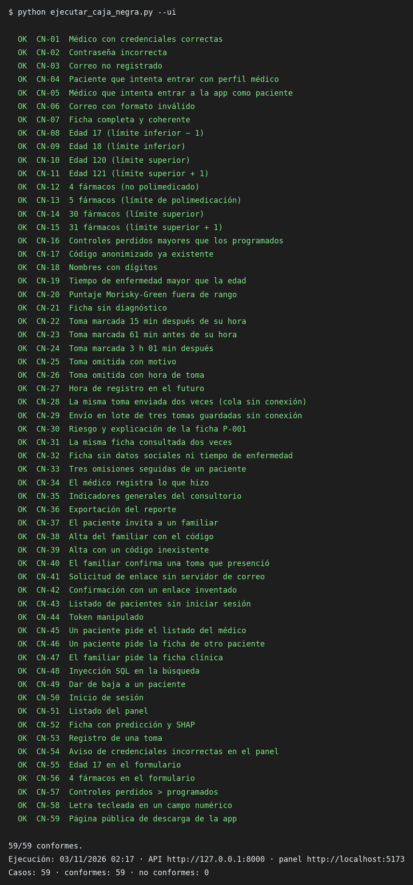
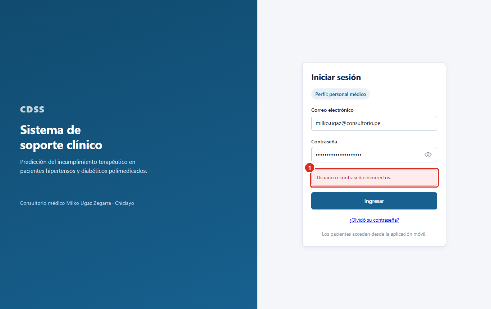
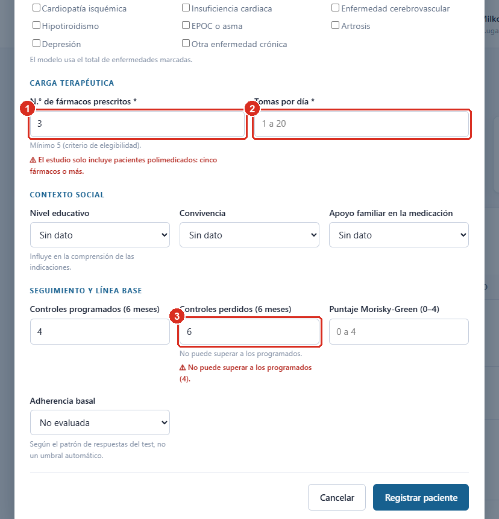
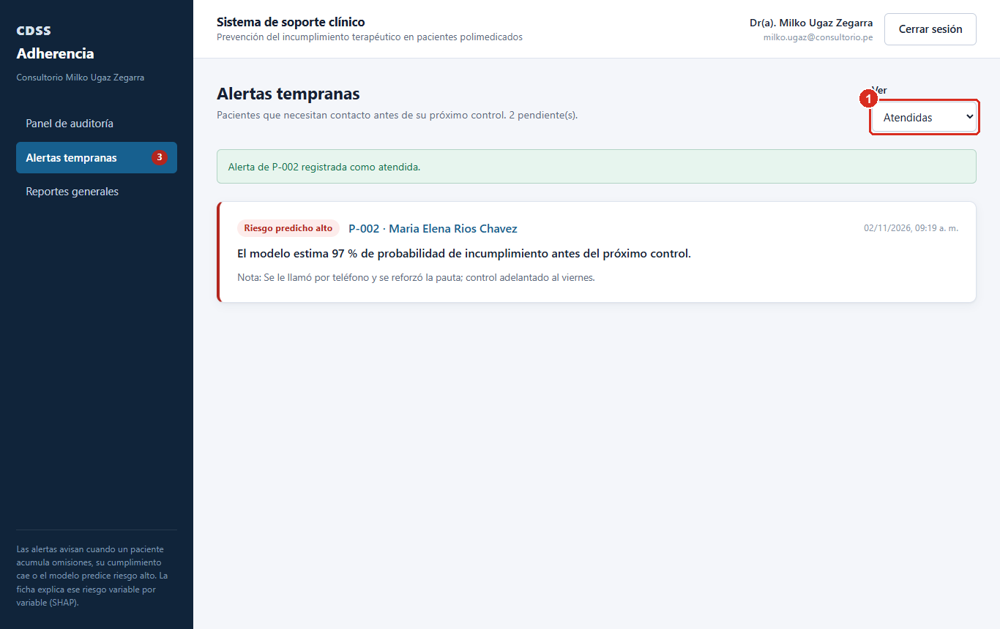
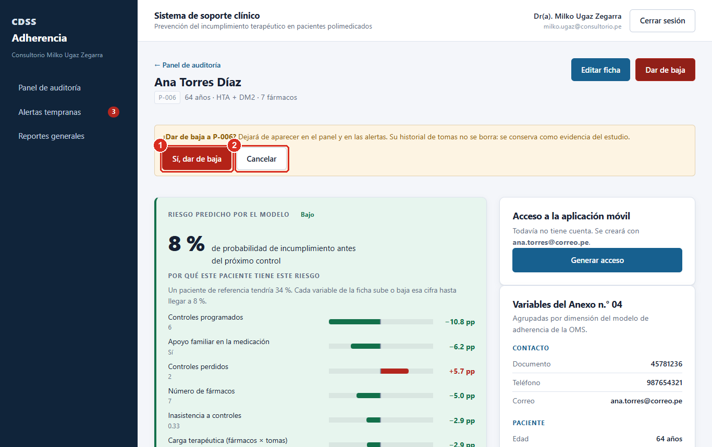
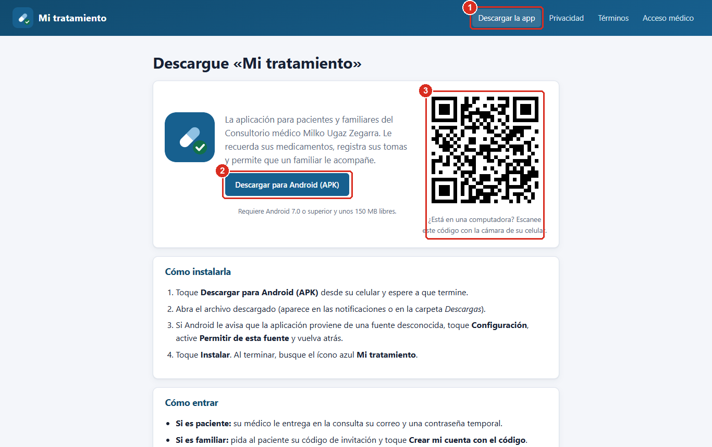
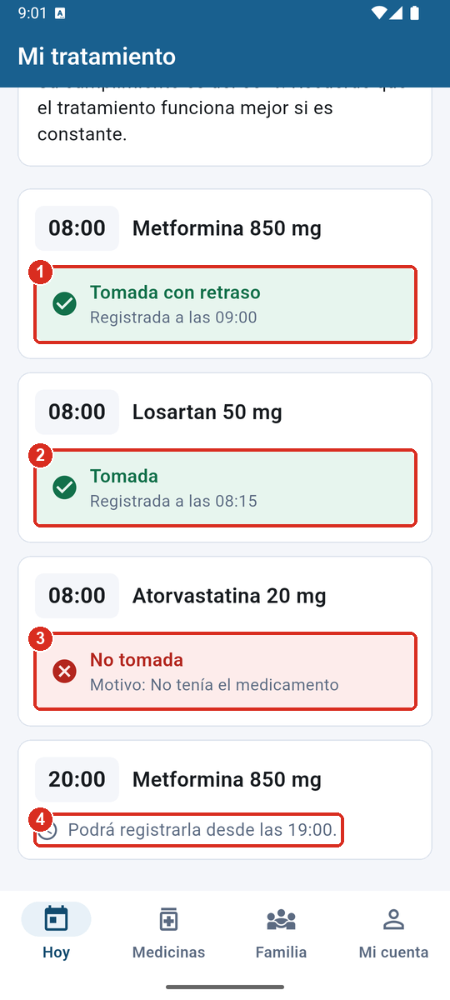
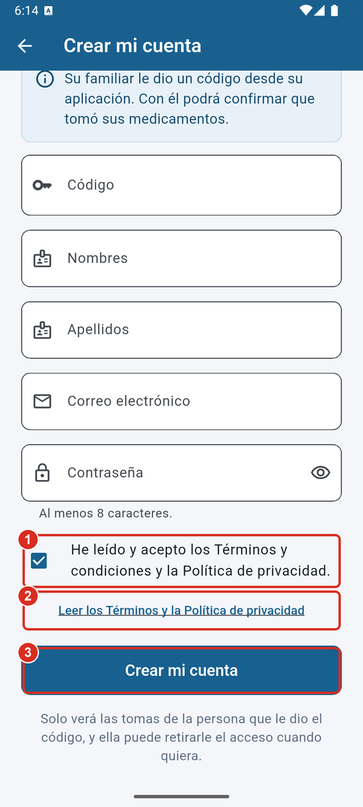

# ANEXO N.° 24: PRUEBAS DE CAJA NEGRA

## 1. Objetivo y alcance

Verificar que el sistema cumple sus requisitos funcionales y no funcionales
observándolo **solo desde fuera**: por las entradas que recibe y las salidas que
produce, sin considerar su código. Se prueban el panel médico, el API central,
el componente de inteligencia artificial y la aplicación móvil, sobre el
escenario principal del producto acreditable: el médico registra al paciente
polimedicado, el paciente registra sus tomas, el sistema estima el riesgo de
incumplimiento, lo explica y alerta al médico.

## 2. Entorno de ejecución

| Elemento | Detalle |
| :--- | :--- |
| Fecha de la ejecución final | {{FECHA}} |
| Equipo | Laptop con Windows 11, ejecución en modo local |
| Sistema bajo prueba | API central (FastAPI) en http://127.0.0.1:8000, microservicio del modelo en el puerto 8001 y panel (React) en http://localhost:5173 |
| Datos | Base de demostración recién cargada (pacientes ficticios P-001 a P-005, correos @ejemplo.pe) |
| Herramientas | Script `ejecutar_caja_negra.py` (peticiones HTTP con la biblioteca estándar de Python) y Playwright con Microsoft Edge para los casos de interfaz |
| Aplicación móvil | Emulador Android (Medium Phone, API 36) con la compilación de depuración |

Ningún caso usa datos reales de pacientes. El script crea sus propios
registros de prueba y debe ejecutarse solo sobre la base de demostración.

## 3. Técnicas de diseño aplicadas

| Técnica | En qué consiste | Dónde se aplicó |
| :--- | :--- | :--- |
| Partición de equivalencia | Se dividen las entradas en clases que el sistema debe tratar igual (válidas y no válidas) y se prueba un representante de cada una | Credenciales, formato de correo, campos obligatorios, códigos de invitación, entradas maliciosas |
| Análisis de valores límite | Se prueban los bordes de cada rango y el valor inmediatamente exterior | Edad (18–120), número de fármacos (5–30), puntaje Morisky-Green (0–4), ventana de registro (−60 min a +3 h) |
| Tabla de decisión | Se combinan condiciones y se fija la acción esperada para cada combinación | Perfil declarado × rol de la cuenta; rol × recurso solicitado; estado de la toma × hora informada; coherencia entre campos |
| Transición de estados | Se verifican los cambios de estado permitidos y prohibidos | Toma (en espera → registrable → cerrada), alerta (abierta → atendida), paciente (activo → dado de baja) |
| Casos de uso | Se recorre el flujo completo de una funcionalidad | Predicción y explicación, alertas, reportes, acompañamiento familiar, descarga de la app |
| Prueba de desempeño | Se mide el tiempo de respuesta de las operaciones principales con repeticiones | Inicio de sesión, listado, ficha con predicción, registro de toma |

## 4. Diseño de las pruebas

### 4.1 Clases de equivalencia y valores límite

| Entrada | Clases válidas | Clases no válidas | Valores límite probados |
| :--- | :--- | :--- | :--- |
| Edad (años) | 18 ≤ edad ≤ 120 | edad < 18; edad > 120 | 17 · 18 · 120 · 121 |
| N.° de fármacos | 5 ≤ n ≤ 30 (polimedicado) | n < 5; n > 30 | 4 · 5 · 30 · 31 |
| Puntaje Morisky-Green | 0 a 4 | > 4 | 5 |
| Controles perdidos | ≤ controles programados | > controles programados | 4 programados · 6 perdidos |
| Tiempo de enfermedad | ≤ edad | > edad | edad 30 · tiempo 40 |
| Nombres y apellidos | Letras, tildes, ñ, apóstrofo y guion | Con dígitos o símbolos | «Ana3» |
| Hora de registro de una toma cumplida | Desde 60 min antes hasta 3 h después de la hora programada, y no futura | Antes de la ventana; después de la ventana; posterior a la hora actual | −61 min · +3 h 1 min · ahora + 30 min |
| Correo de acceso | Formato nombre@dominio | Sin @ | «milko.ugaz» |
| Código de invitación | Vigente, emitido por el paciente | Inexistente o vencido | ZZZZ9999 |

### 4.2 Tabla de decisión: control de acceso (rol × recurso)

| Condición / acción | R1 | R2 | R3 | R4 | R5 | R6 |
| :--- | :---: | :---: | :---: | :---: | :---: | :---: |
| ¿Envía token? | No | Sí (alterado) | Sí | Sí | Sí | Sí |
| Rol de la cuenta | — | — | Paciente | Paciente | Familiar | Médico |
| Recurso pedido | Listado | Listado | Listado del médico | Ficha ajena | Ficha clínica | Su paciente |
| **Respuesta esperada** | 401 | 401 | 403 | 403 | 403 | 200 |
| Caso | CN-43 | CN-44 | CN-45 | CN-46 | CN-47 | CN-30 |

### 4.3 Transición de estados: la toma de un medicamento

| Estado de la dosis | Momento | Acción permitida | Caso |
| :--- | :--- | :--- | :--- |
| En espera | Antes de 60 min previos a la hora | Ninguna; se informa desde qué hora podrá registrarla | CN-M04 |
| Registrable | Desde 60 min antes hasta 3 h después | «Ya la tomé» o «No la tomé» | CN-22, CN-M03 |
| Cerrada | Más de 3 h después | Solo «No la tomé» | CN-24 |
| Registrada | Tras responder | Ninguna; se muestra el estado y la hora | CN-M03, CN-M05 |

## 5. Casos de prueba y resultados (ejecución final)

{{RESUMEN}}

{{TABLAS}}

## 6. Pruebas manuales de la aplicación móvil

Se ejecutaron en el emulador, como un paciente y un familiar, sin consultar el
código. Las capturas de cada paso están en el manual de usuario (Anexo n.° 23).

| ID | Caso | Entrada | Resultado esperado | Resultado obtenido | Estado |
| :--- | :--- | :--- | :--- | :--- | :--- |
| CN-M01 | Inicio de sesión del paciente | p-001@ejemplo.pe y su contraseña | Pantalla «Hoy» con su cumplimiento | «Hola, Jose Luis» y 50 % de tomas cumplidas | Conforme |
| CN-M02 | Registrar un medicamento con dos horas | Metformina 850 mg · 08:00 y 20:00 | Aparece en la lista y se programan las alertas | Listado con «08:00 · 20:00» y aviso «Sus alertas están activas» | Conforme |
| CN-M03 | «Ya la tomé» dentro de la ventana | Dosis de las 08:00 marcada a las 09:00 | Confirmación y estado «Tomada con retraso» | «Registrado. ¡Gracias!» y «Tomada con retraso · Registrada a las 09:00» | Conforme |
| CN-M04 | Dosis antes de que abra la ventana | Dosis de las 20:00 consultada a las 09:00 | Sin botones, con la hora de apertura | «Podrá registrarla desde las 19:00.» | Conforme |
| CN-M05 | «No la tomé» con motivo | Atorvastatina · «No tenía el medicamento» | Estado «No tomada» con el motivo | «No tomada · Motivo: No tenía el medicamento» | Conforme |
| CN-M06 | Invitar a un familiar | Carlos · hijo o hija | Código de 8 caracteres con vencimiento | Código de 8 caracteres, «El código vence en 8 días» | Conforme |
| CN-M07 | El familiar confirma una toma | rosa.p-001@ejemplo.pe · «Sí, la tomó» | Confirmación y la toma sale de la lista | «Confirmado. Gracias.» | Conforme |
| CN-M08 | Cerrar sesión | Mi cuenta → Cerrar sesión → confirmar | Vuelve al inicio y conserva el plan | Pantalla de inicio de sesión; el plan sigue en el teléfono | Conforme |
| CN-M09 | Volver a la app tras iniciar sesión | Iniciar sesión, salir al inicio de Android y volver | La pantalla «Hoy» carga sin error | Carga sin error (tras corregir el defecto D-01) | Conforme |
| CN-M10 | Crear la cuenta del familiar sin aceptar los términos | Datos válidos, casilla sin marcar | No se crea la cuenta y se pide aceptar | Mensaje «Para crear su cuenta debe aceptar los Términos y la Política de privacidad.» | Conforme |

## 7. Ciclo de ejecución y defectos

Las pruebas se ejecutaron en ciclos: ejecutar, registrar los resultados no
conformes, corregir y volver a ejecutar la batería completa (regresión). Los
resultados de cada ejecución se conservan junto al script.

| Ejecución | Fecha | Casos | Conformes | No conformes | Qué cambió antes de la siguiente |
| :--- | :--- | :---: | :---: | :---: | :--- |
| 1 | {{FECHA_1}} | 59 | 55 | 4 | CN-18 y CN-19: defectos del API, corregidos (D-03 y D-04). CN-37 y CN-38: error del propio caso de prueba, que leía un campo con otro nombre; se corrigió el caso |
| 2 | {{FECHA_2}} | 59 | 59 | 0 | Se tradujeron al castellano los mensajes de validación (D-05) y se reforzaron las comprobaciones de CN-22 y CN-29 |
| 3 (final) | {{FECHA}} | 59 | 59 | 0 | — |

| ID | Origen | Defecto | Severidad | Corrección | Verificación |
| :--- | :--- | :--- | :--- | :--- | :--- |
| D-01 | Prueba manual de la app (CN-M09) | Tras iniciar sesión, todas las peticiones fallaban con «Client is already closed»: la app mostraba «sin conexión» hasta reabrirse | Alta | El cliente HTTP pasó a vivir lo que vive la aplicación y no la pantalla de arranque | Prueba automática de regresión y CN-M09 |
| D-02 | Prueba manual de la app | La dosis aparecía repetida («Metformina 850 mg / 850 mg») en la tarjeta y en la vista del familiar | Baja | Se muestra una sola vez | Prueba automática y nueva captura |
| D-03 | CN-18 | El API aceptaba nombres con dígitos; solo el panel lo impedía | Media | Validación en el servidor, en el alta y en la edición | CN-18 y prueba de regresión |
| D-04 | CN-19 | El API aceptaba un tiempo de enfermedad mayor que la edad | Media | Validación en el alta y sobre el estado resultante de una edición | CN-19 y prueba de regresión |
| D-05 | Ejecución 2 (observación de usabilidad) | Los rechazos del API llegaban en inglés («Input should be greater than or equal to 18») y algunos mensajes sin tildes | Baja | Traducción central de los mensajes de validación | CN-06, CN-08, CN-21 y prueba de regresión |

## 8. Correspondencia con la lista de cotejo del producto acreditable

| Criterio de la lista de cotejo | Casos que lo evidencian |
| :--- | :--- |
| 3. La función principal genera resultados coherentes | CN-07, CN-22, CN-30, CN-31, CN-33 |
| 5. Retroalimentación comprensible | CN-02, CN-16, CN-19, CN-23, CN-54 a CN-57, CN-M03 |
| 7. Ejecución estable y repetida | Tres ejecuciones completas de la batería; CN-31 |
| 8. Control de errores previsibles | CN-06, CN-08 a CN-21, CN-23 a CN-27, CN-39, CN-42 |
| 9. Persistencia de la información | CN-07, CN-28, CN-29, CN-34, CN-49, CN-M08 |
| 10 y 11. Desempeño | CN-50 a CN-53 |
| 12. Acceso controlado | CN-01, CN-04, CN-05, CN-43 a CN-47 |
| 13. Protección de los datos | CN-44 (token alterado), CN-47 (el familiar no ve la ficha clínica), CN-48 (inyección SQL neutralizada) |
| 14. Operación no autorizada | CN-45, CN-46, CN-47, CN-49 (paciente dado de baja) |
| 18 y 19. Componente de IA operativo y validado | CN-30, CN-31, CN-32, CN-33 |
| 20. Riesgos del componente inteligente | CN-32 (declara las variables imputadas), CN-33 (la alerta no depende solo del modelo) |

## 9. Evidencia visual

Salida de la ejecución final del script y capturas del sistema en marcha que ilustran los casos de interfaz. Las capturas proceden del recorrido completo del manual de usuario (Anexo n.° 23).

## 10. Cómo reproducir las pruebas

Con el sistema en marcha en modo local y la base de demostración recién
preparada (`python iniciar_local.py preparar --rehacer` y `python iniciar_local.py`):

`set CLAVE_DEMO=<contraseña de las cuentas de demostración>`

`python documentacion/07_pruebas/caja_negra/ejecutar_caja_negra.py --ui`

El script imprime cada caso y escribe `resultados_caja_negra.csv` y
`resultados_caja_negra.md`. Devuelve un código distinto de cero si algún caso
no es conforme.
